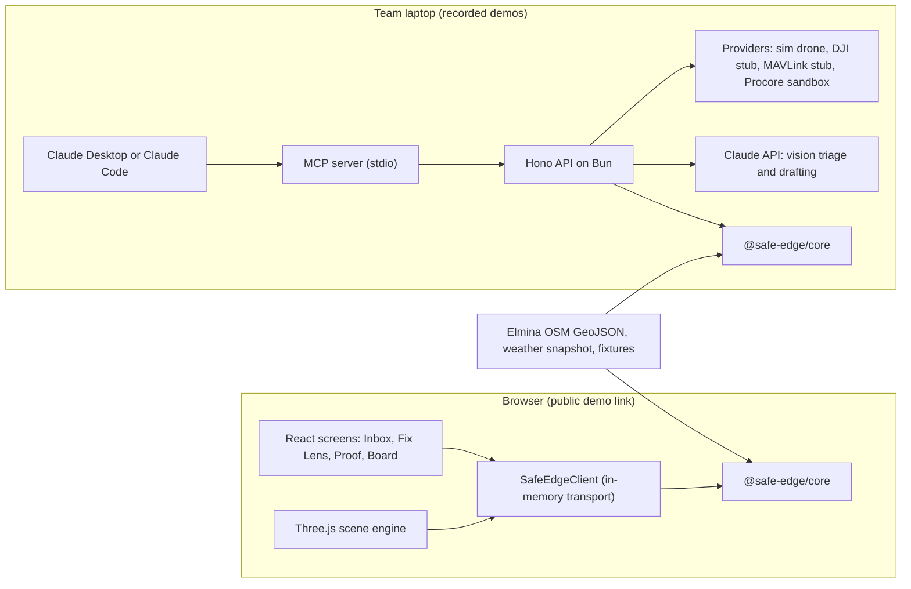

# Safe Edge TRD

How the team builds Safe Edge in five days: architecture, data model, interfaces, the AI layer, the drone integration and the Three.js simulation. Product intent is in [`PRODUCT.md`](/docs/PRODUCT.md); scope and acceptance tests are in the [PRD](/docs/PRD.md). Every version and API below comes from the fact-checked [drone integration research](/docs/research/drone-integration.md); check the linked docs again before you code against them.

Contents:

1.  [Key decisions](#key-decisions)
1.  [Architecture](#architecture)
    1.  [Hackathon build](#hackathon-build)
    1.  [Pilot target](#pilot-target)
1.  [Repository layout](#repository-layout)
1.  [Stack and versions](#stack-and-versions)
1.  [Domain model](#domain-model)
1.  [State machines and policy](#state-machines-and-policy)
1.  [REST API](#rest-api)
1.  [Events](#events)
1.  [SDK and provider adapters](#sdk-and-provider-adapters)
1.  [Patrol planner](#patrol-planner)
1.  [Perception pipeline](#perception-pipeline)
1.  [Claude calls](#claude-calls)
1.  [Agent layer and MCP server](#agent-layer-and-mcp-server)
1.  [Three.js simulation](#threejs-simulation)
    1.  [Scene composition](#scene-composition)
    1.  [Coordinates and data pipeline](#coordinates-and-data-pipeline)
    1.  [Scenario player](#scenario-player)
    1.  [Photoreal layer](#photoreal-layer)
    1.  [Performance and recording](#performance-and-recording)
1.  [Data sources and licences](#data-sources-and-licences)
1.  [Security and privacy](#security-and-privacy)
1.  [Testing](#testing)
1.  [Deployment](#deployment)
1.  [Build order](#build-order)
1.  [Technical risks](#technical-risks)
1.  [See also](#see-also)

## Key decisions

1.  **One core, two transports.** All domain rules (state machines, permissions, planner, route closure, audit) live in one TypeScript package. The API server runs it, and the browser runs the same code in demo mode. The public demo link then needs no backend, and judges cannot break shared state.
2.  **Plain Three.js inside a React app.** The scene engine is framework-free Three.js on `WebGLRenderer`, mounted from React. The research recommends plain Three.js for a time-boxed build; React only hosts the 2D screens.
3.  **OpenStreetMap is the base scene; Google tiles are optional.** Google's terms forbid caching, offline use and image analysis, and charge per tile after 1,000 free events a month. The offline OSM scene is the demo; a photoreal fly-in is a P2 video shot.
4.  **One agent, read, propose and draft only.** Scheduling, comparison, thresholds and state changes are ordinary code. A single Claude agent summarises and drafts. The server, not the prompt, blocks approval.
5.  **Vendor-neutral drone layer.** A `DroneProvider` port with a working simulator adapter. DJI Cloud API and MAVLink adapters are typed stubs with documented mappings. Nothing in the core imports a vendor payload type.
6.  **Licence-clean prototype.** No AGPL (Ultralytics YOLO) or GPL (YOLO-World) models, no BIT change-detection code (non-commercial), and no DJI Cloud API 2 service until DJI confirms its commercial-use terms.
7.  **The drone is optional.** A phone capture enters the same pipeline as a drone image, through the same `POST /observations` with `captureSource: "phone"`. S0 runs the real loop on foot with no aviation dependency.
8.  **Inventory before pixels.** Edge Watch first checks each expected item at its fixed viewpoint (present, missing, changed, not visible). Generic change detection is Tier 1 only, because weekly tropical repeat imagery produces many false changes.

## Architecture

### Hackathon build



- The public link runs in **demo mode**: seeded, labelled fixtures in memory, a "Reset demo" control, and recorded AI outputs for the real photo pair, labelled with model and date.
- **Bring your own key.** In demo mode, a person can paste their own Anthropic key in Settings. The agent then runs in the page (the same module as the API's, `packages/agent-tools/src/claude.ts`) and calls Claude straight from the browser with that key, acting on the in-page core as the agent. It summarises Inbox flags, drafts the monthly report and answers on the Agent page. The key stays in the tab's `sessionStorage` and goes only to `api.anthropic.com`. Settings can also hold a live API's address and a person's token; the Developers page's Try it then calls that API (CORS from `SAFE_EDGE_CORS_ORIGINS`).
- The local stack runs live Claude calls, the MCP server and the provider adapters. S5 and the real-photo triage are recorded from it.

### Pilot target

- **Edge capture:** the walk crew's phone patrol from day one; a licensed operator flies VLOS patrols (phase 1) or a dock on a facility roof flies supervised BVLOS patrols (phase 2) through the `DroneProvider` adapter.
- **Remote-pilot SOP:** a pre-flight call to air traffic control, the agreed altitude cap, lost-link behaviour and emergency landing sites, public notices at park entrances, and the flight-window and weather holds from the planner.
- **Edge server:** a secured township server runs the privacy gate, image alignment and change detection on full-resolution images after landing. Only redacted crops go to a cloud vision model ([perception research][ai-perception]).
- **Platform:** the same API on Postgres with PostGIS and object storage for evidence; a durable queue for events and webhooks.
- **Integrations:** Procore Observations for accepted findings, an SDP-approved maintenance mailbox for alerts, and the MCP server over protected HTTP with OAuth.

[ai-perception]: /docs/research/drone-integration/ai-perception.md

## Repository layout

A Bun workspaces monorepo, added beside the existing `docs/`:

```text
apps/
  web/                  Vite + React: Inbox, Fix Lens, Proof, Board; mounts the scene
  api/                  Hono on Bun: REST /v1, server-sent events, webhooks
  mcp/                  MCP server: stdio for local clients, HTTP later
packages/
  contracts/            OpenAPI 3.1 + AsyncAPI 3.0 sources, Zod schemas, generated types
  core/                 Domain model, state machines, policy, route closure, audit chain
  planner/              Segment tasks, scoring, routing, WPML and .plan export
  perception/           Tier taxonomy, candidate model, Claude triage adapter, privacy gate port
  scene/                Three.js scene engine, layers, drone, scenario player
  sdk/                  SafeEdgeClient with http and in-memory transports
  providers/            drone-sim, drone-dji-cloud (stub), drone-mavlink (stub), workorder-procore
data/
  elmina/               OSM GeoJSON (ODbL), weather snapshots, labelled fixtures, scenarios
e2e/                    Playwright tests
```

## Stack and versions

| Area                | Choice                                                                | Version and source                                             |
| ------------------- | --------------------------------------------------------------------- | -------------------------------------------------------------- |
| Runtime and tooling | Bun workspaces, TypeScript                                            | Bun 1.4.2 on the team machines; pin the rest in `bun.lock`     |
| Web                 | Vite and React                                                        | Latest stable at install; pin in `bun.lock`                    |
| 3D                  | Three.js with `WebGLRenderer`                                         | `three@0.186.1` (r186, MIT) ([geodata research][geodata])      |
| Photoreal tiles     | NASA-AMMOS 3DTilesRendererJS with `GoogleCloudAuthPlugin`             | `3d-tiles-renderer@0.5.3` (Apache-2.0), P2 only                |
| Geometry            | Turf.js (`lineOffset`, `buffer`, `lineChunk`, `along`, `bearing`)     | 7.4.0 (MIT) ([planning research][planning])                    |
| API                 | Hono on Bun, Zod validation                                           | Latest stable at install                                       |
| Contracts           | OpenAPI 3.1, AsyncAPI 3.0, CloudEvents 1.0 envelopes                  | `openapi-typescript@7.13.0` for types ([SDK research][sdk])    |
| MCP                 | Official TypeScript server SDK, spec revision 2026-07-28              | `@modelcontextprotocol/server@2.3.1` ([agent research][agent]) |
| AI                  | Anthropic TypeScript SDK, `claude-opus-5-5`                           | `@anthropic-ai/sdk`, latest stable                             |
| API state           | `bun:sqlite` journal, idempotency and webhook retries (`apps/api`)    | Built into Bun                                                 |
| Webhooks            | Standard Webhooks 1.0.0 signatures; reference library in tests        | `standardwebhooks@1.1.1`                                       |
| Tests               | Playwright end-to-end; `bun test` integration tests over HTTP and MCP | Latest stable                                                  |
| Mission check (CI)  | uv runs the MAVSDK QGroundControl importer on the exported `.plan`    | `mavsdk==4.0.6`, uv via `astral-sh/setup-uv` v10.3.0           |

[geodata]: /docs/research/drone-integration/threejs-geodata.md
[planning]: /docs/research/drone-integration/mission-planning.md
[sdk]: /docs/research/drone-integration/drone-sdk.md
[agent]: /docs/research/drone-integration/agent-layer.md

## Domain model

IDs are prefixed strings (`seg_…`, `cand_…`). Every record carries `simulated: boolean` and `source` provenance.

| Entity           | Key fields                                                                                                                                                                                      |
| ---------------- | ----------------------------------------------------------------------------------------------------------------------------------------------------------------------------------------------- |
| `Asset`          | id, townshipId, kind (`drain`, `pond`, `lake`, `retention_pond`, `river_edge`), name, osmId, retainedBySdp, custodianUserId, geometry                                                           |
| `Segment`        | id, assetId, geometry (LineString), side, lengthM, viewpoints[] (pose, expected item IDs), expectedInventory[] (item ID, type, safety-critical), baselineId, passId                             |
| `Opening`        | id, segmentId, type (`fence_gap`, `fence_end`, `gate`, `missing_cover`, `low_barrier`), photoRefs[], measuredMm, status                                                                         |
| `Route`          | id, segmentId, fromFeature (path, gate, play area), openingIds[], status (`open`, `closed`, `unknown`)                                                                                          |
| `Remedy`         | id, segmentId, type, blocksOpeningIds[], engineerApprovedBy, quote (amount, currency, date) or `quote_needed`                                                                                   |
| `Baseline`       | id, segmentId, capturedAt, imageRefs[], inventorySnapshot, acceptedBy                                                                                                                           |
| `PatrolPlan`     | id, createdAt, contextSnapshotIds[], tasks[], route (GeoJSON), energyWh, returnDockId, rejected[] with reasons, approvedBy                                                                      |
| `Patrol`         | id, planId, provider (`sim`, `dji_cloud`, `mavlink`), droneId, pilotUserId, status, coverage per segment                                                                                        |
| `Observation`    | id, patrolId, segmentId, viewpointId, captureSource (`drone`, `phone`), imageRef, pose, capturedAt, quality (sharpness, alignmentResidualPx, occlusion), privacyAction                          |
| `InventoryCheck` | id, observationId, segmentId, viewpointId, patrolId, items[] (item ID, status, score, uncertainty, grid cell, rationale) for every item the viewpoint expects, candidateIds[], model, checkedBy |
| `Candidate`      | id, segmentId, observationIds[], inventoryItemId, itemStatus, class, tier (1, 2, 3), score, rationale, model, status                                                                            |
| `Finding`        | id, candidateId, segmentId, class, severity (set by a person), confirmedBy, status                                                                                                              |
| `WorkOrder`      | id, findingId, remedyId, draftedBy (user or agent), status, installerUserId, externalRef (Procore)                                                                                              |
| `Retest`         | id, workOrderId, reviewerUserId, checklist results, evidenceRefs[], result, reason                                                                                                              |
| `EdgePass`       | id, segmentId, state, validFrom, validTo, scope (route and test IDs), issuedBy, exceptions[]                                                                                                    |
| `AuditEvent`     | id, at, actor (type, id, role), action, subjectId, before, after, decision, policyVersion, prevHash, hash                                                                                       |

## State machines and policy

```text
Candidate:  candidate ──▶ confirmed | rejected | needs_recapture          (person only)
Finding:    open ──▶ interim_protected ──▶ work_ordered ──▶ repaired ──▶ retest_pending ──▶ closed
                                                                         └──▶ reopened
WorkOrder:  draft ──▶ submitted ──▶ in_progress ──▶ completed ──▶ accepted | rejected
EdgePass:   none ──▶ valid ──▶ expiring (validTo − 30 d) ──▶ expired
            valid | expiring ──▶ suspended ──▶ valid (only through an accepted re-test)
```

Policy, enforced in `@safe-edge/core` and therefore in both the server and the demo:

1.  **The one-way rule.** `system` and `agent` actors may move a pass only to `expiring`, `expired` or `suspended`. Any transition to `valid` needs a `reviewer` actor and an accepted `Retest`.
2.  **Suspicion suspends.** A Tier 2 candidate suspends its segment's pass in the same transaction.
3.  **Two people.** `Retest.reviewerUserId` must differ from `WorkOrder.installerUserId` and from the user who confirmed the finding.
4.  **Unknown is not inspected.** Coverage marked `unknown` creates a field task and never counts towards inspected length.
5.  **Agents draft.** Agent actors can create `Candidate` proposals and `draft` work orders and notices, and nothing else.
6.  **Audit everything.** Every transition appends an `AuditEvent` whose `hash` is SHA-256 of `prevHash` plus the canonical event JSON.

## REST API

Base path `/v1`, JSON, described in `packages/contracts/openapi.yaml`. Bearer tokens carry a role; demo mode issues one token per demo user.

| Method and path                     | Role                   | Purpose                                                               |
| ----------------------------------- | ---------------------- | --------------------------------------------------------------------- |
| `GET /assets`, `GET /segments/{id}` | any                    | Read assets, segments, inventory and pass                             |
| `POST /patrol-plans`                | manager, system        | Score segments and build a route                                      |
| `POST /patrol-plans/{id}/approve`   | pilot                  | Allow the plan to fly                                                 |
| `POST /patrols`                     | pilot                  | Start a patrol from an approved plan                                  |
| `POST /observations`                | provider, crew         | Ingest drone or phone images and quality data                         |
| `POST /inventory-checks`            | provider, crew, system | Report every expected item at a viewpoint; core raises the candidates |
| `GET /inventory-checks`             | any                    | Per-item results by segment or patrol                                 |
| `GET /candidates`                   | manager, agent         | The Inbox queue                                                       |
| `POST /candidates/{id}/decision`    | manager                | Confirm, reject (with reason) or recapture                            |
| `POST /work-orders`                 | manager, agent (draft) | Create a draft from a finding and a remedy                            |
| `POST /work-orders/{id}/submit`     | manager, engineer      | Submit; engineer approval of the remedy required                      |
| `POST /work-orders/{id}/complete`   | installer              | Record the repair as done                                             |
| `POST /retests`                     | reviewer               | Record a re-test; acceptance issues the pass                          |
| `GET /passes?state=expiring`        | any                    | Pass states for the board                                             |
| `GET /false-flags`                  | any                    | False flags per patrol and class against the budget, for the board    |
| `GET /audit?subject={id}`           | manager, gm            | The audit trail                                                       |
| `POST /triage/images`               | manager                | Claude vision triage on a real photo pair                             |
| `POST /agent/ask`                   | manager, gm            | Ask the agent; streams the answer                                     |
| `GET /events`                       | any                    | Server-sent events                                                    |
| `POST /webhooks`                    | integrator             | Register a webhook endpoint                                           |

Every write accepts an `Idempotency-Key` header; a retry with the key within 24 hours replays the first answer (see [Security and privacy](#security-and-privacy)). Forbidden transitions return `403` with the policy rule that blocked them.

## Events

CloudEvents 1.0 envelopes, described in `packages/contracts/asyncapi.yaml`, with `source: safe-edge://townships/{id}` and `subject: segments/{id}`.

`edge.patrol.planned.v1`, `edge.patrol.started.v1`, `edge.patrol.completed.v1`, `edge.candidate.raised.v1`, `edge.candidate.decided.v1`, `edge.pass.suspended.v1`, `edge.work_order.drafted.v1`, `edge.work_order.submitted.v1`, `edge.repair.completed.v1`, `edge.retest.recorded.v1`, `edge.pass.issued.v1`, `edge.pass.expiring.v1`, `edge.pass.expired.v1`.

Payloads carry IDs and `simulated`, not images. Consumers fetch evidence with a short-lived URL.

## SDK and provider adapters

`@safe-edge/sdk` exposes `SafeEdgeClient` with types generated from the OpenAPI contract. A transport option selects `http` (the API) or `memory` (the in-browser core).

The ports below follow the [SDK research][sdk]:

```ts
export interface DroneProvider {
  listDevices(): Promise<DroneDevice[]>
  getStatus(deviceId: string): Promise<DroneStatus>
  schedulePatrol(plan: PatrolPlan): Promise<PatrolRun>
  dispatchPatrol(runId: string, approval: HumanApproval): Promise<void>
  updatePatrol(runId: string, plan: PatrolPlan, approval: HumanApproval): Promise<void>
  cancelPatrol(runId: string): Promise<void>
  onEvent(handler: (event: ProviderEvent) => void): () => void
}

export interface WorkOrderProvider {
  createFinding(input: Finding): Promise<ExternalRecordRef>
  addEvidence(ref: ExternalRecordRef, evidence: EvidenceRef[]): Promise<void>
  updateStatus(ref: ExternalRecordRef, status: ExternalWorkStatus): Promise<void>
}

export interface EvidenceStore {
  put(input: EvidenceUpload): Promise<EvidenceRef>
  getTemporaryUrl(ref: EvidenceRef): Promise<string>
}
```

| Adapter             | Hackathon status | Maps to                                                                                                                                                                                                                            |
| ------------------- | ---------------- | ---------------------------------------------------------------------------------------------------------------------------------------------------------------------------------------------------------------------------------- |
| `drone-sim`         | Real             | The scene engine's flight model and scenario events. Waits in flight at unreleased separation holds; follows approved re-plans in flight. Lives in its host process: an API restart completes its in-flight patrols as interrupted |
| `drone-dji-cloud`   | Typed stub       | DJI Cloud API: dock binding on `/requests`, wayline tasks (`flighttask_prepare`, `flighttask_execute`, method names snippet-only, verify first), `live_start_push`, media upload callback                                          |
| `drone-mavlink`     | Typed stub       | MAVLink mission upload (`MISSION_COUNT`, `MISSION_REQUEST_INT`, `MISSION_ITEM_INT`, `MISSION_ACK`) through a small server-side bridge; PX4 SITL only if a teammate already runs it                                                 |
| `workorder-procore` | P2 sandbox       | Procore Observations: `POST /rest/v1.0/observations/items` plus the upload flow. API-created observations do not notify assignees automatically.                                                                                   |

## Patrol planner

Follows the [planning research][planning].

1.  **Tasks.** Project edge geometry to local metres, split segments at bends, obstructions and ownership changes, and offset a flight line by the camera stand-off with Turf `lineOffset`. Space stations by the footprint and the forward overlap: footprint width = 2 × range × tan(HFOV ÷ 2), spacing = footprint length × (1 − overlap). Stand-off and pitch come from the chosen camera, not from fixed numbers.
2.  **Score.** `priority = 0.25 × expiry + 0.35 × reviewedFlag + 0.25 × rain + 0.15 × waterLevel`, each in 0 to 1. Rain bins follow the JPS one-hour categories (light 1–10 mm, moderate 11–30 mm, heavy 31–60 mm, very heavy above 60 mm). A stale or missing input becomes `unknown` and asks for review. The weights are a hypothesis to tune with SDP.
3.  **Route.** Greedy insertion: add the feasible task with the highest added priority per added watt-hour, keep a return path to a dock with a reserve, and treat geofences (no-fly areas, homes and playgrounds as no-capture zones) as hard constraints. Re-order only uncommitted stops. Cost is O(k·n²) for k drones and n tasks.
4.  **Flight window and separation.** A plan carries a window (first light by default), an altitude cap from air traffic control and a weather gate: no launch above the dock's 2 mm/h rain limit or during a lightning warning, and a preference for the next dry morning after heavy rain. The whole flight keeps CAR 2016 regulation 143's distances from people, vehicles and structures not under the pilot's control: 50 m at stations, along flight lines and on transits, 30 m from people during the climb from the dock and the descent onto it, and 150 m from an open-air assembly of more than 1,000 persons. A station waits for a clear pass or moves to a longer zoom stand-off; a stop whose transit passes people waits for them; the dock holds take-off while its climb or transits are not clear; nothing flies within reach of a structure or an assembly. The pilot or observer confirms the path is clear. Third parties a plan request reports count for every plan until that plan's window closes.
5.  **Re-plan triggers.** A JPS heavy-rain reading or a data.gov.my warning, a newly confirmed flag, a pass within 30 days of expiry, a damage report, or a completed repair (which queues a re-test patrol).
6.  **Export.** DJI WPML KMZ (`wpmz/template.kml`, `wpmz/waylines.wpml`) and QGroundControl `.plan` JSON, both stamped "not flight-ready". The battery model in the simulation is a stated assumption until an aircraft is chosen.
7.  **Phone patrols.** The same tasks render as a walking checklist of fixed viewpoints for the crew, ordered along the path network.

## Perception pipeline

Pilot pipeline, from the [perception research][ai-perception]:

1.  **Asset and baseline registry:** stable segment IDs, expected inventory, approved viewpoints and the last accepted baseline.
2.  **Capture and privacy gate:** check sharpness, coverage and pose; detect people in memory and discard the frame before storage.
3.  **Alignment gate:** register the current view to its baseline on stable hardscape; poor alignment becomes `unreviewable` and asks for recapture.
4.  **Inventory check first:** for each expected item at the viewpoint, report present, missing, changed or not visible. Only a missing or changed safety item becomes Tier 2.
5.  **Candidates:** a change model plus class detectors propose further regions as Tier 1. Open-vocabulary detectors only propose; the published aerial benchmark found 69% false positives for the best one ([detection research][detection]).
6.  **Routing:** keep image quality, alignment quality, detection score and class calibration separate. Low quality means recapture, uncertain means review, and Tier 2 means a priority review and a suspended pass. Count false flags per class against the budget (proposed: no more than 10 per patrol by week 4); a class over budget drops to Tier 1. A false flag is a candidate a person rejected. Its class is the item type for an expected-inventory flag (fence panel, ring buoy), else the candidate class. A class is over budget while the latest patrol with reviewed flags of that class rejected more than 10 of them; a patrol that raised none of its flags does not restore it.
7.  **Human decision and learning:** reviewer labels feed an active-learning set; a locked golden set stays out of training; audits sample unflagged segments.

Hackathon implementation:

- **In the scene:** candidates come from the scenario script with tier, score and quality values, and carry `simulated: true`.
- **Real photos:** `POST /triage/images` sends a real baseline and current photo pair, plus the segment's inventory as data, to Claude and returns structured candidates (see [Claude calls](#claude-calls)). The UI shows "AI suggestion, unvalidated".
- **Privacy gate:** simulated in the scene (counted discarded frames). The team's real photos are taken with no people in frame.

[detection]: /docs/research/drone-integration/detection.md

## Claude calls

Rules from the Claude API reference for `claude-opus-5-5`:

- **Model and effort.** `claude-opus-5-5` for triage and drafting. Thinking is always on and cannot be disabled, so control depth with `output_config.effort`. Its default is `medium`, so set it explicitly: `medium` for triage and drafting, `high` for the monthly report.
- **Structured outputs, not forced tools.** Forced `tool_choice` (`any` or `tool`) returns a 400 on this model. Triage returns JSON through `output_config.format` (`client.messages.parse()` with a Zod schema). The agent uses `tool_choice: auto` with `strict: true` tools.
- **Refusals.** Always check `stop_reason` before reading content. Requests send the server-side fallback parameter by default (`fallbacks: "default"` with the `server-side-fallback-2026-07-01` beta), and the UI shows which model served the answer.
- **Images.** Base64 image blocks for the photo pair. A 1000 × 1000 image is about 1,296 input tokens, under USD 0.01 at USD 4 per million input tokens.
- **Caching and streaming.** Cache the stable system prompt and tool list; stream chat answers.
- **Text in images is data.** The triage prompt treats sign text as evidence, and the output schema allows only the enumerated classes. The triage call has no tools.

Triage output schema (Zod, abbreviated). General vision models mislocalise objects ([detection research][detection]), so the schema asks for a coarse 4 × 4 grid cell, not pixel boxes:

```ts
const TriageResult = z.object({
  items: z.array(
    z.object({
      inventoryItemId: z.string(), // from the segment's expected inventory, sent as data
      status: z.enum(['present', 'missing', 'changed', 'not_visible']),
      gridCell: z.string().regex(/^[A-D][1-4]$/),
      rationale: z.string(),
      uncertainty: z.enum(['low', 'medium', 'high'])
    })
  ),
  otherChanges: z.array(
    z.object({
      class: z.enum([
        'worn_path',
        'bank_change',
        'vegetation',
        'floating_debris',
        'water_level_change',
        'text_in_image',
        'other'
      ]),
      gridCell: z.string().regex(/^[A-D][1-4]$/),
      rationale: z.string(),
      uncertainty: z.enum(['low', 'medium', 'high'])
    })
  ),
  notVisible: z.array(z.string())
})
```

The core, not the model, assigns tiers: a `missing` or `changed` safety item becomes Tier 2, and `otherChanges` become Tier 1. The schema has no "safe" field, and nothing in it can change a pass.

## Agent layer and MCP server

Design from the [agent research][agent]:

- **Shape.** A deterministic workflow with one Claude agent. The agent runs through the SDK's tool runner (`betaZodTool`) with the same tool functions the MCP server exposes. Its module, `packages/agent-tools/src/claude.ts`, runs in the API with the server's key and in the web demo with the person's own key; either way it acts through a Safe Edge client that holds the agent's identity, so the same scope and state checks refuse it.
- **Identity.** The agent has its own token with scopes `edge.read`, `inspection.read`, `finding.propose`, `workorder.draft`, `notice.draft` and `patrol.propose`. No token issued to an agent carries `edge.pass.accept`, `repair.verify`, `workorder.submit` or `notice.send`.
- **MCP server.** `@modelcontextprotocol/server` 2.3.1: an `McpServer`, tools registered with `registerTool(name, config, handler)` and Zod input schemas, served with `serveStdio` for local clients. Logs go to stderr. Configure and verify the 2026-07-28 protocol revision, because the SDK can still speak the 2025 handshake unless told otherwise.

| Tool                      | Scope             | Effect                                                      |
| ------------------------- | ----------------- | ----------------------------------------------------------- |
| `get_edge_context`        | `edge.read`       | Owner, asset type, baseline ID, inventory and pass state    |
| `get_inspection_evidence` | `inspection.read` | Current and baseline image references and candidate details |
| `list_open_findings`      | `edge.read`       | Open findings with owners and ages, and the as-of time      |
| `list_expiring_passes`    | `edge.read`       | Passes expiring within N days, and the as-of time           |
| `propose_finding`         | `finding.propose` | Adds a candidate to the review queue                        |
| `draft_work_order`        | `workorder.draft` | Creates a draft linked to a confirmed finding               |
| `draft_escalation`        | `notice.draft`    | Saves an internal notice draft; never sends                 |
| `propose_patrol`          | `patrol.propose`  | Asks the planner for a plan; a pilot must still approve it  |

- **Resources:** `safeedge://edges/{id}`, `safeedge://findings/{id}`, `safeedge://passes/{id}`. **Prompts:** `triage_finding`, `monthly_report`.
- **Enforcement.** The server checks scope and state on every call. A client confirmation dialog is helpful but is not the boundary.
- **Prompt injection.** Pixels, OCR text, metadata, tool descriptions and returned resources are untrusted. They live in evidence fields, never in instructions, and can never set a tool's target, recipient or scope.

## Three.js simulation

### Scene composition

| Layer               | Source                                                                                                                                                        | Label in the legend   |
| ------------------- | ------------------------------------------------------------------------------------------------------------------------------------------------------------- | --------------------- |
| Water, waterways    | OSM: 27 water polygons (18 excluding wastewater ponds) and 28 rivers, streams, drains and ditches                                                             | "OpenStreetMap"       |
| Parks, paths        | OSM: Elmina Valley Central Park, Elmina Urban Park, 418 path lines                                                                                            | "OpenStreetMap"       |
| Buildings           | OSM building footprints, extruded (to fetch with the same query)                                                                                              | "OpenStreetMap"       |
| Terrain             | A flat plane, or Copernicus DEM at 30 m for broad shape only                                                                                                  | "approximate terrain" |
| Edge assets         | Fence runs, covers, gratings, gates, ring buoys and signs on the selected segments                                                                            | "modelled"            |
| Dock, drone, events | Dock on a facility roof, weather hold, patrol flight, frustum, path-clear holds, candidate pins, discarded-frame ticks, unknown hatching, rain, day and night | "SIMULATION"          |

- **Rendering:** water with the `Water` addon at low reflection resolution, or a flat animated material; edge segments as tube ribbons coloured by pass state (`LineBasicMaterial.linewidth` is ignored on WebGL); fence posts and panels as `InstancedMesh`; the patrol path as `CatmullRomCurve3`; the camera frustum with `CameraHelper`; labels with `CSS2DRenderer`; rain as `Points`.
- **Drone model:** a procedural quadcopter mesh by default. A glTF model is allowed only after its licence is verified on its live page and credited.

### Coordinates and data pipeline

1.  Fetch the Elmina window (west 101.490, south 3.160, east 101.540, north 3.200) through Overpass, not the OSM editing API, and add `building=*` to the [research query][geodata].
2.  Store the layers as GeoJSON in `data/elmina/` with the ODbL notice.
3.  Project to a local east-north-up frame in metres around the Elmina Valley Central Park centroid (101.5135 °E, 3.1784 °N). An equirectangular projection is accurate enough across a 5 km window.
4.  Build static geometry once at load, merge it by material, and keep OSM IDs on the objects for picking.

### Scenario player

- A deterministic clock with a fixed time step and play, pause, scrub, speed and reset controls.
- Scenarios are JSON files in `data/elmina/scenarios/` (S1 to S6 from the PRD). Each event has a time, a type and a payload: weather, plan, takeoff, waypoint, observation, candidate, decision, repair, re-test.
- The player drives the scene and the SDK's in-memory transport, so the Inbox and the board update from the same events.

### Photoreal layer

P2 only: 3DTilesRendererJS 0.5.3 with `GoogleCloudAuthPlugin`, a key restricted to the Map Tiles API and the demo domain, and a capped Google Cloud budget. Coverage of the exact park is unverified, so test it first. Keep the Google attribution visible, never cache tiles, never pass them to any analysis, and keep video clips to at most 30 seconds marked "for promotional purposes only".

### Performance and recording

- **Budgets:** at least 30 fps at 1080p on integrated laptop graphics, at least 24 fps on a mid-range phone; pixel ratio capped at 1.5 on desktop and 1 on phones; one directional shadow; one post-processing pass at most.
- **Recording:** a fixed camera path and the deterministic clock. Capture with `getDisplayMedia`, because canvas `captureStream` misses the CSS2D labels.

## Data sources and licences

| Source                         | Use                                    | Terms                                                                                      |
| ------------------------------ | -------------------------------------- | ------------------------------------------------------------------------------------------ |
| OpenStreetMap via Overpass     | Base scene and edge geometry           | ODbL 1.0; show "© OpenStreetMap contributors" with a link                                  |
| data.gov.my weather API        | Forecasts and warnings for re-planning | CC BY 4.0; 4 requests a minute; no token                                                   |
| JPS Public Infobanjir          | Rainfall reading (Sungai Buloh, 27880) | Public pages; no documented API or reuse licence, so use timestamped snapshots             |
| Copernicus DEM GLO-30          | Broad terrain only                     | Free licence for registered users                                                          |
| Google Photorealistic 3D Tiles | Optional fly-in                        | No caching, offline use or analysis; attribution; paid after the free cap                  |
| Team photos                    | Real-photo triage and Fix Lens         | Taken with permission and no people in frame; location data stripped from the public build |

## Security and privacy

- Keys live in environment variables. The public build contains no API key; its AI outputs are recorded results.
- Stored evidence never shows people (see the [privacy research][privacy] for the eleven pilot rules).
- Demo tokens work only in demo mode. The API rejects them.
- Every state change is in the hash-chained audit log, including refused attempts.
- The API keeps its state in `$SAFE_EDGE_DATA_DIR/api.sqlite`, unencrypted: the command journal holds every webhook's signing secret and uploaded evidence, and the idempotency table keeps each answer replayed by key, a webhook registration's secret included. The API sets the directory to 0700 on every start, one that already existed included, so only its OS user can read them.
- Idempotency keys expire: an answer is kept for 24 hours of wall-clock time after it was given (`SAFE_EDGE_IDEMPOTENCY_RETENTION_SECONDS`, default `86400`), then pruned, and a request with that key runs as a new one. A write's answer commits in the same SQLite transaction as the journal entries it made, so a crash cannot keep the write without the answer that stops a retry repeating it.
- Webhooks reach only the origins in `SAFE_EDGE_WEBHOOK_ORIGINS` (loopback too in development and test). The API checks the list at registration and again before every delivery attempt, retries included: a webhook whose origin has left the list gets nothing more, and each refused delivery is recorded as its final failure. A failed delivery's retry waits in the store with its due time, so it outlives a restart; a first attempt in flight at a crash is lost.
- Browsers may call the API only from the exact origins in `SAFE_EDGE_CORS_ORIGINS` (comma-separated, such as `http://localhost:5173`): those get CORS headers for the methods and headers the SDK sends (Authorization, Content-Type, Idempotency-Key), without credentials, since tokens travel in Authorization. Unset, the API sends no CORS headers. `bun run dev` allows the web app's dev server, `http://localhost:$WEB_PORT` and `http://127.0.0.1:$WEB_PORT` (5173 by default), so the Developers page's Try it can call it with a dev token.
- A journal moved to another operating system may refuse to start: replay re-runs the planner, whose trigonometry comes from the platform's maths library and differs in the last bit between macOS and Linux, and a replayed result that differs from the recorded one stops the start.
- Dependencies: no AGPL or GPL models; record every model and asset licence in `docs/licences.md`.

[privacy]: /docs/research/drone-integration/privacy.md

## Testing

The [project conventions](/docs/references/project-conventions.md) rule out unit tests. Prove behaviour the way users meet it:

1.  **End to end (Playwright):** in demo mode, play S1, confirm the card, choose the full remedy in Fix Lens, complete the repair as the installer, accept as the reviewer, and see the pass become valid with an expiry date.
2.  **API integration (`bun test` over HTTP):** the installer cannot accept their own work (403); an agent token cannot confirm or accept (403); a Tier 2 candidate suspends the pass; no system transition reaches `valid`; every write appears in the audit chain and the chain verifies.
3.  **MCP integration:** a real MCP client lists the tools and finds no approving tool, drafts a work order, and gets a 403 when it tries an approval through REST with the agent token.
4.  **Scene smoke test:** Playwright loads the scene and checks the frame time stays inside budget for 10 seconds of S1.

`bun run lint` must pass on every pull request.

## Deployment

- **Public demo link:** a static build of `apps/web` in demo mode on Vercel. It works without the API. It is live at <https://safe-edge-two.vercel.app>: the landing page at `/`, a guest sign-in at `/sign-in`, the Edge Inbox at `/demo/` and the 3D scene at `/demo/scene.html`; any other path gets the not-found page with status 404. `bun run build:demo-site <dir>` builds it, and the script's header gives the deploy commands.
- **Local stack:** `bun run dev` starts the API, the MCP server and the web app against the same core, for the recorded S5 and real-photo segments. The API runs on the scenario clock and prints so: it starts at the seed's date (20 October) and moves only when the system user sets it, which also runs the automation (drone-sim, tick, missed patrols). So the stack opens in the seed's state on any day. `SAFE_EDGE_CLOCK=wall` runs it on the wall clock, with the automation on timers, as real fieldwork needs for its records' times. On the wall clock, from 23 October the seed's weekly patrols are missed, so the first scheduled pass suspends every valid or expiring pass, S1's included.
- **Later:** the API on a serverless host and the MCP server over protected HTTP. The 2026-07-28 revision is stateless, which suits that model.

## Build order

| Day         | Platform and AI                                                                         | Simulation                                                                     | App                                                         |
| ----------- | --------------------------------------------------------------------------------------- | ------------------------------------------------------------------------------ | ----------------------------------------------------------- |
| Sun 18      | Monorepo, contracts, core state machines and policy, in-memory SDK                      | OSM fetch and projection, base layers, camera controls                         | App shell, routes, Inbox card from a fixture                |
| Mon 19 (M1) | API endpoints, audit chain, planner scoring and routing                                 | Segments by pass state, dock, drone on a path, scenario clock                  | Fix Lens on a real photo, decisions wired to the SDK        |
| Tue 20      | Claude triage with inventory checks, agent drafts, MCP server and tools, flight windows | Candidate pins, frustum, discarded-frame ticks, unknown hatching, weather hold | Phone capture (S0), proof flow on a phone, governance board |
| Wed 21 (M2) | Integration tests, guardrail demo (S5, S6)                                              | Weather and light, recording mode, performance pass                            | End-to-end test, labels audit, accessibility pass           |
| Thu 22 (M3) | Recorded local demos; stretch adapters                                                  | Final camera paths; optional photoreal shot                                    | Polish from the comprehension test                          |

## Technical risks

| Risk                                        | Mitigation                                                                             |
| ------------------------------------------- | -------------------------------------------------------------------------------------- |
| Scene frame rate drops on phones            | Instancing, merged static geometry, capped pixel ratio, a reduced layer set on phones  |
| OSM gaps around the chosen asset            | Model the asset from team photos and label it "modelled"                               |
| MCP SDK version or protocol mismatch        | Pin 2.3.1, configure the 2026-07-28 revision, and test with a real client on day 3     |
| Claude refusal or outage during a recording | Server-side fallbacks, recorded outputs for the public build, retry before recording   |
| DJI or Procore terms block a live call      | Keep both as stubs or sandbox; show the documented mapping instead                     |
| Hidden licence in a model or 3D asset       | Procedural drone mesh by default; licences recorded before any asset lands in the repo |

## See also

- [`PRODUCT.md`](/docs/PRODUCT.md) and the [PRD](/docs/PRD.md)
- [Drone integration research](/docs/research/drone-integration.md): CAAM rules, privacy, hardware and cost, detection, mission planning, drone SDKs, AI perception, the agent layer, Three.js and geodata, prior art
- [Safe Edge pitch and Fix Lens design](/docs/research/shortlist/safe-edge.md)
