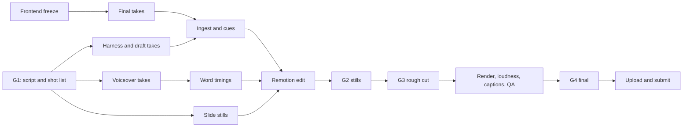

# Demo video

The submission video is the narrated pitch deck with one live-demo segment of the prototype after slide "5. How It Works". [`director-script.md`](/docs/demo/director-script.md) holds the words and what each segment shows. This page holds the timeline, the shots to capture and the steps that make the video. Two Claude Code sessions do the work: a **Director** edits, and a **Recorder** films the real app with Playwright. Remotion assembles everything. The demo is its own short video, voiced by ElevenLabs and built in three labelled parts (problem, solution, outcome); the main video, read by one team member, places it at V8.

Issue: [#97](https://github.com/TolongLabs/safe-edge/issues/97).

Contents:

1.  [Record the live demo](#record-the-live-demo)
1.  [Rules for the video](#rules-for-the-video)
1.  [Video plan](#video-plan)
1.  [Roles](#roles)
1.  [Execution workflow](#execution-workflow)
    1.  [Fallback cut](#fallback-cut)
1.  [Scenes to capture](#scenes-to-capture)
    1.  [H1: the problem on the map](#h1-the-problem-on-the-map)
    1.  [H2: landing hero](#h2-landing-hero)
    1.  [D1: patrol and flag](#d1-patrol-and-flag)
    1.  [The D2 to D5 chain](#the-d2-to-d5-chain)
    1.  [D2: confirm](#d2-confirm)
    1.  [D3 and D3b: fix](#d3-and-d3b-fix)
    1.  [D4: prove on the phone](#d4-prove-on-the-phone)
    1.  [D5: pass and record](#d5-pass-and-record)
    1.  [D6: guardrail](#d6-guardrail)
    1.  [D6b: recorded Claude answer](#d6b-recorded-claude-answer)
    1.  [D7: developers](#d7-developers)
    1.  [Slides](#slides)
1.  [Recording the prototype](#recording-the-prototype)
    1.  [What the probes showed](#what-the-probes-showed)
    1.  [Harness](#harness)
    1.  [Screencast takes](#screencast-takes)
    1.  [Frame-stepped takes](#frame-stepped-takes)
    1.  [Determinism](#determinism)
    1.  [Manifest and cue sheets](#manifest-and-cue-sheets)
1.  [Assembling in Remotion](#assembling-in-remotion)
    1.  [Project](#project)
    1.  [Data files](#data-files)
    1.  [How the edit works](#how-the-edit-works)
    1.  [Motion design](#motion-design)
    1.  [Sound and captions](#sound-and-captions)
        1.  [Music](#music)
        1.  [Captions](#captions)
    1.  [Finish script](#finish-script)
1.  [Quality checks](#quality-checks)
1.  [Review gates and timeline](#review-gates-and-timeline)
1.  [Risks and fallbacks](#risks-and-fallbacks)
1.  [Known pitfalls](#known-pitfalls)
1.  [Kickoff prompts](#kickoff-prompts)
    1.  [Director prompt](#director-prompt)
    1.  [Recorder prompt](#recorder-prompt)
1.  [Sources](#sources)

## Record the live demo

Run these commands from the repository root. The recording build includes the Inbox, title-colour, Passes, reporting and repair-tracker changes. The recorder drives the app itself: it selects the sample people, completes interim protection, approves and sends fix B, uploads the simulated re-test image and issues the pass. No API key or live AI service is needed.

1.  Install the locked dependencies once:

    ```shell
    rtk bun install --frozen-lockfile
    ```

1.  Check the complete recording path before the final take:

    ```shell
    rtk bun run record:demo --check
    ```

    This drives the real flow with short holds and low scene frame rate. It checks that the cues and required controls still work. Its footage is a preflight, not a final take.

1.  At **12:00 PM MYT on Friday 23 October**, record the final footage:

    ```shell
    rtk bun run record:demo
    ```

    Leave the terminal running. The browser runs headless, so no clicking or role switching is required. The earlier scene probe budgets about 35 minutes for a full capture; the command prints the actual run directory when it finishes. The recorder checks for ffmpeg and ffprobe and installs its pinned Chromium if needed.

Each run has its own directory under `video/public/footage/runs/`. It contains `manifest.json` with the source commit, raw takes and cue times, the cut windows in `edit-windows.json`, and an **83-second silent `demo-preview.mp4`**. Earlier takes are retained. The preview keeps the app's Simulation label and adds the problem, solution and outcome chapter labels. Add the approved narration in the video edit; this command makes no speech-service calls.

For a faster visual draft, use `rtk bun run record:demo --draft`. Its scene motion has fewer captured frames, so use the default command for the final take. `--grep @app` and `--grep @scene` record only that group and leave assembly to a complete run.

A failed cue or upload stops the command with an error. Fix the named step and run the check again. A green preflight on the frozen commit is the readiness gate. The capture source is in [`video/record/`](/video/record); the rest of this page explains the shots and the full submission edit.

## Rules for the video

- **At most five minutes.** Target 4:40; the hard cap is 4:50 ([context][video-context]). Issue #15 confirms the limit.
- **Submit a YouTube link.** Upload as Public or Unlisted so judges can watch without requesting permission. The organiser's [submission reminder](/docs/sources/organiser-submission-reminder.md), supplied by the user on 22 October 2026, specifies YouTube; a live demo link is optional supporting material.
- **Show the solution, not the team** ([brief][brief-video]).
- **The deck carries the pitch.** The slides follow the 11-slide organiser flow confirmed by the user on 22 October 2026 ([deck README](/docs/demo/README.md)). The live demo sits after "5. How It Works".
- **Simulated means labelled.** Every app and scene shot keeps the app's own **Simulation** label on screen, and the edit adds a "Simulation · sample data" tag. The narration never calls a sample drawing a site photo, a simulated flight real, or a finding confirmed in the field ([`PRODUCT.md`](/docs/PRODUCT.md#product-principles), principle 7). False claims can disqualify the team.
- **Who, what and why first.** Judges skim, so the team, the track and the problem are named in the first 12 seconds, and the stories and their evidence finish by 0:50 ([context][judges]).
- **The real stories are told exactly as reported.** V3 opens on two reported drownings. The narration adds nothing to the reports and claims no cause; the [director script's notes](/docs/demo/director-script.md#v3-1-the-problem) set the limits.
- **The demo shows problem, solution and outcome, clearly.** Each part says its name aloud and carries it on the chapter bar. This is where the marks are.
- **Every number has a source.** The [claims ledger](/docs/demo/director-script.md#claims-ledger) lists each spoken claim and its source.
- **The words live in the director script.** Change the narration there, never only in the edit.

## Video plan

The director script owns the words and the on-screen detail of each segment; this table owns the times. Change both together. "Deck N" is the slide position in [`pitch-deck.html`](/docs/demo/deck/pitch-deck.html); the six evidence pages in [`supporting-deck.html`](/docs/demo/deck/supporting-deck.html) are separate and are not in the video.

| Seg | Time      | Part                         | Source                                      |
| --- | --------- | ---------------------------- | ------------------------------------------- |
| V1  | 0:00–0:12 | Team Information             | Deck 1, with project title and team         |
| V3  | 0:12–0:50 | 1. The Problem               | Story cards 1 and 2, then Deck 2            |
| V4  | 0:50–1:02 | 2. Target User               | Deck 3                                      |
| V5  | 1:02–1:23 | 3. Your Solution             | Deck 4, optional H2                         |
| V6  | 1:23–1:35 | 4. Innovation                | Deck 5                                      |
| V7  | 1:35–1:42 | 5. How It Works              | Deck 6                                      |
| V8  | 1:42–3:05 | **Live demo**                | The demo video: H1, then D1 to D5           |
| V9  | 3:05–3:30 | 6. Impact                    | Deck 7                                      |
| V10 | 3:30–3:55 | 7. Feasibility               | Deck 8, optional D7                         |
| V11 | 3:55–4:09 | 8. Implementation            | Deck 9                                      |
| V13 | 4:09–4:37 | 10. Why Your Team Should Win | Deck 11                                     |
| V14 | 4:37–4:47 | Closing hold                 | Deck 11 continues, with demo and repo links |

Inside V8, the demo video (83 seconds): Problem, H1, 1:42–1:54; Solution, D1 find 1:54–2:04, D2 confirm 2:04–2:14, D3 fix 2:14–2:38, D4 prove 2:38–2:50; Outcome, D5, 2:50–3:05. One narrator reads everything outside the demo, and every narrator take plays at 1.2× with its pitch kept; an ElevenLabs voice reads the demo at its own pace. Team Information appears in V1, so there is no separate V2 segment. Not in the default cut: V12 (Deck 10, "9. Visual Concept") and the optional demo shots D3b and D6; adding one means trimming another ([optional segments](/docs/demo/director-script.md#optional-segments)).

## Roles

| Role        | Who                                                          | Owns                                                                                                        | Hands over                                                    |
| ----------- | ------------------------------------------------------------ | ----------------------------------------------------------------------------------------------------------- | ------------------------------------------------------------- |
| Director    | Claude Code session on Opus 5.5                              | `shots.json`, the slide stills, the ingest, the Remotion edit, the mix, the captions and the quality checks | The shot list to the Recorder; stills and cuts to AlaskanTuna |
| Recorder    | Claude Code session on Opus 5.5                              | The recording harness, the takes, the manifest and the motion components (callouts, push-ins, chips)        | Footage, the manifest and the components to the Director      |
| Narrator    | One team member picked at G1                                 | The voiceover takes for V1 to V7 and V9 to V14, read from the director script                               | `vo/*.wav` to the Director                                    |
| Demo voice  | ElevenLabs, generated by the Director with AlaskanTuna's key | The six demo lines, with character timings                                                                  | `video/public/voice/demo/` and `demo-voice.json`              |
| AlaskanTuna | Person                                                       | The review gates, the upload and the link check                                                             | Approvals                                                     |
| kymil4      | Person                                                       | The frontend; says when it is frozen for final takes                                                        | The freeze commit                                             |
| chaosiris   | Person                                                       | The designed deck                                                                                           | The final `pitch-deck.html`                                   |

Name the sessions `safe-edge-director` and `safe-edge-recorder`. They message each other with SendMessage; files are the contract between them. The Recorder never drives the edit, and the Director never drives the app. Only the Director runs Git.

## Execution workflow



1.  **Set up (Director, once).** Make one shared worktree, so the main checkout stays free, then install:

    ```shell
    git worktree add -b video/edit ../sdp-hack-video origin/main
    cd ../sdp-hack-video && bun install && bunx playwright install chromium
    ffmpeg -version && ffprobe -version
    ```

    Done when the root e2e suite's Chromium starts and `ffmpeg` runs.

1.  **Lock the script (AlaskanTuna, gate G1).** Approve [`director-script.md`](/docs/demo/director-script.md) and the [shot list](#scenes-to-capture), and pick the narrator and the ElevenLabs voice ([open decisions](/docs/demo/director-script.md#decisions-for-the-team)). The Director then writes `video/src/data/shots.json`: one entry per shot with its cue ids, copied from this page, and sends it to the Recorder.
1.  **Check the harness (Recorder).** Run `rtk bun run record:demo --check` on the frozen commit. The [Harness](#harness) is implemented.
1.  **Record draft takes (Recorder).** Run the whole harness on the current `main`:

    ```shell
    rtk bun run record:demo --draft
    ```

    It takes about 35 minutes; the frame-stepped scene takes are about 25 of them. The output is a unique folder under `video/public/footage/runs/` with raw takes, `manifest.json`, edit windows and the silent demo preview, tied to the commit hash. Send the Director the manifest path and every shot that failed, with the reason.

1.  **Export the slides (Director; full submission tooling).** Build a separate slide export step for `video/public/slides/S01.png` to `S11.png`. Run it again whenever the deck changes.
1.  **Record the voiceover (narrator; Director for the speed-up and the demo voice).** Follow [Recording the voiceover](/docs/demo/director-script.md#recording-the-voiceover). The narrator records one file per segment outside the demo, plus room tone, into `vo/`. The Director speeds each chosen take up to 1.2× with ffmpeg's pitch-keeping `atempo` filter, writing it to `video/public/voice/` (`ffmpeg -i vo/V09.wav -af atempo=1.2 -ar 48000 video/public/voice/V09.wav`), then runs Whisper with word timestamps on the sped-up file, so the timings match what plays, and writes `video/src/data/voice.json` ([Data files](#data-files)). The Director generates the six demo lines with ElevenLabs' text-to-speech with timestamps and writes their timings to `video/src/data/demo-voice.json`. A take that still runs past its segment is read again from its pickup line, never sped up further.
1.  **Ingest (Director).** `bun scripts/ingest.ts` reads the manifest, picks the newest take marked `"ok"` for each shot, and converts each screencast take to constant 30 fps H.264. Frame-stepped takes are already 30 fps H.264 and are copied as they are:

    ```shell
    ffmpeg -v error -y -fflags +igndts -i raw/D3-take2.webm \
      -vf fps=30,tpad=stop_mode=clone:stop_duration=5,format=yuv420p \
      -t 9.84 -c:v libx264 -crf 16 -preset veryfast -an footage/D3-take2.mp4
    ```

    `-fflags +igndts` times frames by their presentation timestamps. `fps=30` turns the variable frame rate of a screencast into the edit's constant rate. A screencast writes a frame only when the page changes, so it can end early on a still screen; `tpad` repeats the last frame, and `-t` (the take's `durationMs` from the manifest, in seconds) cuts it to the true length. The script then writes `video/src/data/footage.json` ([Data files](#data-files)).

1.  **Edit (Director; Recorder for motion).** First build the `Demo` composition: H1 and D1 to D5 on their edit windows below, the chapter bar, and the ElevenLabs lines at their start times. Then build `Main` from the [video plan](#video-plan), with `Demo` mounted at 1:42 and each narrator file at its segment's start ([How the edit works](#how-the-edit-works)). The Recorder builds the motion components to the Director's spec ([Motion design](#motion-design)).
1.  **Freeze and record the final takes (kymil4, Recorder).** kymil4 posts the frozen commit on #97. The Recorder runs step 4 again on that commit, and the Director runs step 7 again. After gate G3, nobody records again.
1.  **Review (AlaskanTuna).** Gate G2: five stills from the edit, one per chapter. Gate G3: a half-scale rough cut of the whole video.
1.  **Finish (Director).** Run `video/scripts/finish.sh` ([Finish script](#finish-script)): the tests, then the renders of `Demo`, `Main` and `MainNoMusic`, loudness normalised in linear passes to −14 LUFS and −1 dBTP, so the two voices sit at the same level, the English SRT, and the [quality checks](#quality-checks). Then stop at gate G4.
1.  **Upload and submit (AlaskanTuna).** Upload to YouTube as Public or Unlisted. Open every link from a signed-out browser, then submit the **11-page deck PDF and YouTube link** through the [official submission page](https://simedarbyproperty.com/universityhackathon/submission/). Add the separate **six-page supporting PDF** and online demo/repository links as supporting materials. If the deck was already submitted as PPT/PPTX, resubmit it as PDF. [Source: organiser reminder supplied by the user on 22 October](/docs/sources/organiser-submission-reminder.md).

### Fallback cut

If the Remotion edit misses gate G3, cut the video with ffmpeg alone. Use the same slides, the same trimmed shots and the same voice files:

1.  Write `video/plain/segments.txt` for ffmpeg's concat demuxer: one `file` and `duration` pair per slide still, and one `file` per trimmed shot clip, in the video plan's order.
1.  Mix the voice files into one track, each delayed to its segment start with `adelay`, then joined with `amix`.
1.  Join, add the voice, and burn the captions:

    ```shell
    ffmpeg -f concat -safe 0 -i segments.txt -i voice.wav -vf subtitles=captions.srt -c:v libx264 -crf 18 -c:a aac -shortest out/plain.mp4
    ```

1.  Normalise the loudness and run the quality checks as in step 11.

## Scenes to capture

Every shot below is captured in headless Chromium, the scene as well as the app ([What the probes showed](#what-the-probes-showed)). Selectors and steps come from the end-to-end tests that already drive this path: [`s1-s3.e2e.ts`](/e2e/s1-s3.e2e.ts), [`fix-lens.e2e.ts`](/e2e/fix-lens.e2e.ts), [`retest.e2e.ts`](/e2e/retest.e2e.ts), [`story.e2e.ts`](/e2e/story.e2e.ts) and [`agent-key.e2e.ts`](/e2e/agent-key.e2e.ts). Steps marked "off camera" run between takes, with the screencast stopped.

| Shot         | Edit length | Screen                                         | Method           | Used in        |
| ------------ | ----------: | ---------------------------------------------- | ---------------- | -------------- |
| Story card 1 |        12 s | Black card: Bandar Mahkota Cheras · 1 May 2026 | Made in the edit | V3             |
| Story card 2 |        10 s | Black card: Kajang · 4 December 2025           | Made in the edit | V3             |
| H1           |        12 s | Scene, story intro, desktop                    | Frame-stepped    | Demo, Problem  |
| H2           |         3 s | Landing hero, desktop                          | Screencast       | V5             |
| D1           |        10 s | Scene, story, desktop                          | Frame-stepped    | Demo, Solution |
| D2           |        10 s | Inbox, desktop                                 | Screencast       | Demo, Solution |
| D3           |        24 s | Fix Lens, desktop                              | Screencast       | Demo, Solution |
| D3b          |         6 s | Fix Lens, desktop                              | Screencast       | Optional       |
| D4           |        12 s | Repair check, phone                            | Screencast       | Demo, Solution |
| D5           |        15 s | Pass page and Passes, desktop                  | Screencast       | Demo, Outcome  |
| D6           |        12 s | Agent, desktop                                 | Screencast       | Optional       |
| D6b          |        10 s | Agent, recorded answer, desktop                | Screencast       | Optional       |
| D7           |         3 s | Developers, desktop                            | Screencast       | V10            |
| S01–S11      |           – | Deck slides 1 to 11, 1920 × 1080               | Stills           | Deck           |

A cue is the moment its state is visible, not the moment of the click. Each cue below names the locator the harness waits for.

### H1: the problem on the map

- **Setup:** a fresh page at 1920 × 1080; install the page clock, open `demo/scene.html` and wait until **Play the story** is enabled. Pause the clock.
- **On camera:** step 22 seconds of the intro screen without pressing Play: the night lake in the rain, the dock, and the story card.
- **Cues:** `h1-card`, the heading "Last night’s storm knocked out a fence panel. The edge still shows a valid pass: nobody has checked yet."
- **Edit window:** 0 to 12 s, the demo's Problem part, with a slow push-in toward the fence. Capture the full 22 seconds anyway, for spare frames.

### H2: landing hero

- **Setup:** a fresh page at 1920 × 1080 on `/`, the landing page.
- **On camera:** 6 seconds of the hero, with no input.
- **Cues:** `h2-hero`, the level-1 heading; `h2-tag`, the first "Panel 4 missing".
- **Watch for:** the landing page has no Simulation label of its own, so the harness skips the label check here and the edit's tag carries it.

### D1: patrol and flag

- **Setup:** the same as H1, in its own page. Press **Play the story**, then pause the clock.
- **On camera:** step the whole story, 92 seconds of page time, to the end card "Safety pass issued, valid to …". Read the caption on every frame.
- **Cues:** one per caption, by its first words. The times are page seconds from Play, measured on 22 Oct 2026:

  | Cue               | Caption starts                              | At (s) |
  | ----------------- | ------------------------------------------- | -----: |
  | `d1-rain`         | "Overnight storm: 40 mm of rain in an hour" |    0.0 |
  | `d1-takeoff`      | "A dry morning. The drone takes off"        |   11.5 |
  | `d1-jogger`       | "A jogger walks into a photo"               |   30.0 |
  | `d1-glare`        | "Glare hides a ring buoy"                   |   50.5 |
  | `d1-flag`         | "The drone's photo shows panel 4 is gone"   |   59.5 |
  | `story-confirm`   | "The park manager compares the photos"      |   62.5 |
  | `story-barrier`   | "The crew puts up a temporary barrier"      |   66.0 |
  | `story-fix-a`     | "Fix A would replace panel 4"               |   69.0 |
  | `story-fix-b`     | "Fix B replaces the panel"                  |   72.0 |
  | `story-approve`   | "The engineer approves fix B"               |   75.0 |
  | `story-installer` | "The installer finishes the repair"         |   81.5 |
  | `story-prove`     | "Priya Nair, who did not install it"        |   84.5 |
  | `story-end`       | "Safety pass issued, valid to"              |   88.0 |

- **Edit windows:** `d1-takeoff` +0 to +4 s, then `d1-flag` +0 to +6 s: 10 seconds. The rest of the story is spare B-roll.
- **Watch for:** at `d1-flag` + 1 s, the harness also checks that "Fence panel 4 missing · simulated" is visible. The top label "Simulation · every flight, photo, flag and repair here" stays in frame in every window.

### The D2 to D5 chain

D2 to D5 run in **one test, one page and one browser context**, because the demo's data lives in the page's memory and a reload resets it. The context is 1920 × 1080 at a device scale factor of 2. It opens `demo/?as=manager#/inbox` as Farah Hashim, the sample park manager, and switches person through the profile menu off camera, as `s1-s3.e2e.ts` does. D4 resizes the same page to a phone.

### D2: confirm

- **Setup:** the Inbox opens with "Fence panel 4 missing" selected.
- **On camera:** hold 2 seconds on the card, move to **Confirm: needs a fix**, click, hold on the new finding.
- **Cues:** `d2-card`, the heading "Fence panel 4 missing"; `d2-consequence`, the plain explanation of why the flag paused the pass; `d2-confirm`, the button **Confirm: needs a fix**; `d2-finding`, the region named "Finding …".
- **Off camera after:** sign in as Siti Aminah, click **Mark done** on the interim protection task, and wait for "Marked done by Siti Aminah". Sign in as Farah Hashim again. Fix B cannot be sent until the interim protection is done.

### D3 and D3b: fix

- **On camera, D3:** click the link **Choose a fix**, then **Use the S2 sample markings**, then **Next: compare fixes**, then **Use the two sample fixes**, then check the radio **B · …**. Hold 2 seconds after each result.
- **Cues, D3:** `d3-lens`, the level-1 heading "Fix Lens"; `d3-marked`, "2 openings and 2 ways recorded."; `d3-fix-a-open`, "Leaves 1 way to the water open, Playground path, around the fence end"; `d3-fix-b-closed`, "Closes all 2 ways to the water"; `d3-proposed`, the first "proposed repair, not installed"; `d3-pick-b`, the radio B checked.
- **D3b, two short takes:** off camera, sign in as Lim Wei Jie; on camera, click **Approve fix B as Lim Wei Jie**, cue `d3b-approved` on "Approved by Lim Wei Jie". Off camera, sign in as Farah Hashim; on camera, click **Send fix B to Hafiz Rahman’s crew**, cue `d3b-sent` on the heading "Fix B sent to … crew".
- **Off camera after:** keep the address of the link **Open the repair check**. Decide the ring buoy flag in the Inbox (**Not a problem**, with a reason, then **Submit rejection**), because a pass waits for every other open flag on the edge. Go back to the repair check's address. Sign in as Hafiz Rahman: **Start work**, a note, **Mark work complete**. Sign in as Priya Nair. Resize the page to 390 × 844.

### D4: prove on the phone

- **On camera:** the repair check. Upload the recorder's labelled simulated after-image through the real photo-upload control before passing the photo check. The new photo is required; the recorder cannot bypass it. For the two route checks ("Playground path, through the panel gap" and "Playground path, around the fence end"), choose **Pass** and type "Seen on site" at a visible pace (`pressSequentially` with a 40 ms delay). Fill the other five checks quickly. Then click **Sign and issue the pass**.
- **Cues:** `d4-heading`, "A different person checks this repair"; `d4-count`, "7 checks at the fence"; `d4-first`, the first route check's reason typed; `d4-photo`, the newly uploaded re-test image; `d4-sign`, the button **Sign and issue the pass**; `d4-issued`, the heading "Safety pass issued".
- **Edit windows:** `d4-heading` +0 to +2 s, `d4-first` −1 to +4 s, `d4-photo` +0 to +2 s, then `d4-sign` −1 s to +2 s: 12 seconds. "Safety pass issued" opens D5.
- **Off camera after:** resize the page to 1920 × 1080 and sign in as Farah Hashim. The pass page now shows the history.

### D5: pass and record

- **Take 1, on camera:** the pass page; scroll the history slowly, one mouse-wheel step every 150 ms.
- **Cues, take 1:** `d5-pass`, the heading "Safety pass issued"; `d5-signed`, the text "who signed the check"; `d5-timeline`, "Checked and signed" in the region "How it got here".
- **Take 2, on camera:** click **Passes** in the rail.
- **Cues, take 2:** `d5-board`, "Action needed"; `d5-unknown`, "Unknown is never shown as safe."
- **Edit windows:** take 1 for 11 seconds, opening on "Safety pass issued" and the line "All 2 ways to the water … are closed"; take 2 for the last 4.

### D6: guardrail

Optional; not in the default demo. Record it anyway, for a longer cut and for Q&A.

- **Setup:** a fresh context at 1920 × 1080 on `demo/?as=manager#/agent`. No key is needed: no model runs.
- **On camera:** hold on the question, click **Ask core as the agent**, hold on the refusal.
- **Cues:** `d6-question`, the heading "Can the agent decide anything?"; `d6-refused`, "Refused, as it must be."; `d6-rule`, the first `agents_draft_only`; `d6-audit`, the refusal listed under "What the agent did this session".
- **Watch for:** check `d6-audit` on the first draft take; if the list does not show the refusal there, report it and cut on `d6-rule`.

### D6b: recorded Claude answer

- **Setup:** a fresh context. Fix the page clock at `2026-10-20T08:00:00+08:00`, the day the recordings were made. Put a placeholder key in `sessionStorage` with an init script, and replay `apps/api/test/fixtures/claude/ask-expiring-passes.json` at `api.anthropic.com`, as `agent-key.e2e.ts` does. Move that test's `claude()` helper into `e2e/claude.ts` and import it in both places, rather than copying it.
- **On camera:** type "Which passes expire in the next 30 days?" in **Your question** at a visible pace, press Enter, and hold on the answer.
- **Cues:** `d6b-answer`, the answer starting "One pass expires in the next 30 days"; `d6b-tag`, "AI suggestion, unvalidated".
- **Watch for:** the edit captions this shot "Recorded answer, replayed". It is a real Claude reply recorded on 20 Oct, replayed; never call it live.

### D7: developers

- **Setup:** a fresh context at 1920 × 1080 on `demo/#/developers`.
- **On camera:** scroll the heading **Quickstart** into view and hold 4 seconds.
- **Cues:** `d7-quickstart`, the heading "Quickstart".

### Slides

- **Setup:** a plain Playwright page, without the offline fixture, because the deck loads its stand-in fonts from Google Fonts. Use a 1920 × 1080 viewport and open `docs/demo/deck/pitch-deck.html` as a `file://` URL. Wait for `document.fonts.ready`.
- **Capture:** for each slide `i` from 0 to 10, call `document.querySelector('deck-stage').goTo(i)`. Wait until the deck's control overlay hides (its `.overlay` in the shadow root loses `data-visible`), then screenshot `video/public/slides/S01.png` to `S11.png`.
- **Push-in targets:** on the same pass, read the box of every element with a `data-focus` attribute on the slide, and write them to `video/src/data/slides.json`: `{ "S07": { "main-measure": { "x": 112, "y": 330, "width": 820, "height": 260 } } }`, in CSS pixels of the 1920 × 1080 slide. The director script names push-ins by these ids ("the main-measure card"), so a slide can change its layout without breaking the edit.

## Recording the prototype

### What the probes showed

Throwaway probes on 22 Oct 2026, against the deployed `main` (`e73a5d1`), set these choices:

- **Headless renders the scene; headed WSL did not.** Headed Chromium on WSL drew the scene's canvas white in page screenshots, in `page.screencast` and in the scene's own tab capture, because its WebGL context failed. Headless Chromium drew the scene with SwiftShader. So every take is headless, and nothing needs the GPU.
- **Frame stepping is exact.** With Playwright's page clock paused and advanced 1/30 second at a time, the story played every caption and ended on "Safety pass issued, valid to 22 Oct 2027" after 88 seconds of page time. That matches the story card's "about 90 s". One 1080p frame took about 0.4 seconds with its screenshot, so the full story takes about 19 minutes to capture.
- **Screencasts are sharp.** Headless `page.screencast` records the app screens at 30 fps. A 390 × 844 page at a device scale factor of 3 recorded crisp 1170 × 2532 frames.
- **A cursor comes free.** `page.screencast.showActions({ cursor: 'pointer', style: { title: 'display: none' } })` draws the pointer moving to each click, without the action titles.
- **The story's Record button stops at once** ([#239](https://github.com/TolongLabs/safe-edge/issues/239)). The scenario takes from the details menu record fine (S1 made a full 64-second take), but D1 needs the story, so D1 uses frame stepping.

### Harness

The live-demo recorder is implemented. The later full-submission edit, slide export, voiceover and Remotion sections are production instructions; those tools are separate from `record:demo`.

- **Entry:** `rtk bun run record:demo --check` verifies the flow. `rtk bun run record:demo --draft` captures a quick scene draft and assembles the preview. `rtk bun run record:demo` captures the final scene at 30 fps.
- **Files:** `video/record/playwright.config.ts`, `takes.rec.ts`, `scene.rec.ts`, `take.ts`, `contract.ts` and `assemble.ts`. The command runner is `scripts/record-demo.ts`. The root typecheck includes these files. CI does not run recording tests.
- **Config:** headless Chromium, one worker, light theme, desktop 1920 × 1080, phone 390 × 844, and a 45-minute limit per test. It builds a fresh demo site into the system temp folder and serves it on port 4197. No API keys or paid services are needed.
- **Tags:** `--grep @scene` records H1 and D1; `--grep @app` records the app takes. Partial runs keep their manifest but do not assemble a preview.
- **Outputs:** each run has its own commit-and-time directory under `video/public/footage/runs/`. `manifest.json` records each take, cue, viewport, duration and failure. `assemble.ts` makes the 83-second silent `demo-preview.mp4` from successful takes only. Raw takes remain available for the full edit.

### Screencast takes

App takes use `recordTake` to start capture, verify visible cues and the Simulation label, and save the result even when a step fails. `hold` shortens waits during `--check`. Role changes use the profile menu between takes. The D4 re-test requires the bundled simulated repair photo to pass through the real upload control.

```ts
await recordTake(page, 'D2', async (cue) => {
  await cue('d2-card', page.getByRole('heading', { name: 'Fence panel 4 missing' }))
  await hold(page, 2000)
  // Perform the real action, then record its visible result.
})
```

Cues use a monotonic clock aligned to the encoder creation time stored in each raw file. `ffprobe` checks the assembled frame size and duration. The desktop capture is 1920 × 1080. The phone records a native 390 × 844 WebM, then makes a 780 × 1688 MP4 with Lanczos scaling. Both files remain in the run folder. This avoids the screencast canvas padding smaller phone content into a larger frame.

### Frame-stepped takes

The scene is captured one frame at a time: advance the paused page clock by 1/30 second, take a screenshot, and pipe it to ffmpeg. Each frame is exactly 1/30 second of page time, however slow the machine, so the output is smooth 30 fps H.264 with no ingest step. Playwright's clock fakes `requestAnimationFrame` and the timers as well as `Date` ([Playwright clock][pw-clock]), so the story's caption holds run on the same clock.

```ts
import { spawn } from 'node:child_process'

await page.clock.install({ time: new Date('2026-10-22T08:00:00+08:00') })
await page.goto('demo/scene.html')
const play = page.getByRole('region', { name: 'Story' }).getByRole('button', { name: /^Play the story/ })
await expect(play).toBeEnabled({ timeout: 120_000 })
await play.click() // D1 only; H1 steps the intro screen without it
await page.clock.pauseAt((await page.evaluate(() => Date.now())) + 1000)

const ffmpeg = spawn(
  'ffmpeg',
  [
    '-y',
    '-f',
    'image2pipe',
    '-framerate',
    '30',
    '-i',
    '-',
    '-c:v',
    'libx264',
    '-crf',
    '14',
    '-pix_fmt',
    'yuv420p',
    file
  ],
  { stdio: ['pipe', 'inherit', 'inherit'] }
)
const closed = new Promise<void>((done, fail) =>
  ffmpeg.on('close', (code) => (code === 0 ? done() : fail(new Error(`ffmpeg exited with ${code}`))))
)
for (let frame = 0; frame < seconds * 30; frame++) {
  await page.clock.runFor(1000 / 30)
  if (!ffmpeg.stdin.write(await page.screenshot())) await new Promise((drained) => ffmpeg.stdin.once('drain', drained))
  // D1: read the caption with one page.evaluate per frame; a locator would wait once the end card removes it.
  // A caption change is a cue at frame * 1000 / 30 ms.
}
ffmpeg.stdin.end()
await closed
```

### Determinism

- **A fresh browser context for every test.** Identity and keys live in `sessionStorage`, and the demo's data lives in the page, so nothing carries over. The D2 to D5 chain is one test on purpose.
- **Sign in by URL first:** `demo/?as=manager`. The app reads `as` only on the tab's first load; later switches go through the profile menu, off camera.
- **Clocks:** the chain runs on the real clock, as `s1-s3.e2e.ts` does, so record every final take in one run and the dates match. D6b fixes the page clock at the recording day. The scene takes step their own clock.
- **Same build for every final take.** All five PR groups must be present before the recording check. Re-record every shot after any frontend change, and record the commit in the manifest.

### Manifest and cue sheets

The Recorder writes `video/public/footage/manifest.json`. Coordinates are CSS pixels of the take's viewport. Cue times are milliseconds from the take's first frame; frame-stepped cue times are exact frame times. `durationMs` is the take's length, from the first frame to the stop.

```json
{
  "commit": "e73a5d1",
  "takes": [
    {
      "shot": "D3",
      "take": 2,
      "status": "ok",
      "method": "screencast",
      "file": "raw/D3-take2.webm",
      "viewport": { "width": 1920, "height": 1080 },
      "durationMs": 9840,
      "fps": 30,
      "labelled": true,
      "cues": [{ "id": "d3-fix-a-open", "tMs": 6120, "box": { "x": 812, "y": 404, "width": 520, "height": 48 } }]
    }
  ]
}
```

- Agree the cue ids with the Director before recording. They come from `shots.json`, which copies this page.
- Mark a bad take `"failed"`. Never overwrite or delete a take; the ingest picks the newest `"ok"` take.

## Assembling in Remotion

[Remotion][remotion] renders React components to video, one frame at a time. Every frame is a pure function of its frame number and static data, so the same inputs always give the same video. This section is the whole recipe: anyone with this repository, Bun and ffmpeg can rebuild the edit from it.

### Project

- **Where:** a `video/` folder at the repository root, with its own `package.json`, outside the Bun workspaces. Run `bun install` inside `video/`.
- **Packages:** `remotion`, `@remotion/cli`, `@remotion/media` and `@remotion/fonts`, all pinned to the same exact version, `4.0.530`; mixed Remotion versions fail at render. Also `react` and `react-dom` 19, and as dev dependencies `typescript` and `@types/bun`.
- **Scripts:** `"studio": "remotion studio src/index.ts"`, `"test": "bun test"` and `"typecheck": "tsc --noEmit"`.
- **`remotion.config.ts`:** `Config.setVideoImageFormat('jpeg')` and `Config.setOverwriteOutput(true)`. Codec, quality and scale come from the render command.
- **`tsconfig.json`:** `target` ES2022, `module` ESNext, `moduleResolution` Bundler, `jsx` react-jsx, `strict`, `noEmit`, `skipLibCheck`, `resolveJsonModule` (the data files are imported as JSON), `esModuleInterop`, `types: ["bun"]`, and `include: ["src", "scripts", "test"]`.
- **Ignore media in Git:** `video/out/`, `video/public/footage/`, `video/public/voice/`, `video/public/slides/` and `video/public/music/`. Commit the code, the tests and the data JSON. Every media file is rebuilt by a script.

```text
video/
  src/
    index.ts          registerRoot(Root)
    Root.tsx          the compositions
    Main.tsx          the whole video: one <Sequence> per segment, the voices, the music
    Demo.tsx          the demo video: one <Sequence> per shot window, the chapter bar, the demo voice
    edit.ts           the cut, as data: segments, edit windows, push-ins, callouts
    build.ts          buildEdit(): turns edit.ts and the data into frame-exact placements, voice cues and captions
    fonts.ts          loadFont() for every font the edit uses
    theme.ts          colour and size tokens from DESIGN.md; MIN_TEXT = 54
    lib/              time.ts, kf.ts, timeline.ts, windows.ts, camera.ts, envelope.ts, words.ts, captions.ts, qa.ts
    motion/           the Recorder's components: AppFrame, PhoneFrame, Callout, ChapterBar, StoryCard, SimTag
    data/             shots.json, footage.json, slides.json, voice.json, demo-voice.json
  scripts/            ingest.ts, voice.ts, audio.ts, stills.ts, captions.ts, qa.ts, finish.sh
  record/             the Recorder's Playwright harness (Recording the prototype)
  test/               bun:test files (Quality checks)
  public/             footage/, voice/, slides/, music/: generated, never committed
```

### Data files

Scripts write these, and the edit imports them. All times in them are in the source file's own time; `build.ts` turns them into composition frames.

- **`shots.json`** (the Director, from [Scenes to capture](#scenes-to-capture)): each shot's id, method, viewport and cue ids. The Recorder records against it.
- **`footage.json`** (`ingest.ts`, from the manifest): one entry per shot, the newest `"ok"` take:

  ```json
  {
    "shot": "D3",
    "take": 2,
    "src": "footage/D3-take2.mp4",
    "frames": 295,
    "viewport": { "width": 1920, "height": 1080 },
    "cues": [{ "id": "d3-fix-a-open", "frame": 184, "box": { "x": 812, "y": 404, "width": 520, "height": 48 } }]
  }
  ```

  `frames` is `Math.floor(durationMs * 0.03)`; a cue's `frame` is `Math.round(tMs / 1000 * 30)`.

- **`slides.json`** (the slide export): the push-in targets, as above.
- **`voice.json`** (`voice.ts`, from the narrator's sped-up takes): `{ "V09": { "src": "voice/V09.wav", "durationMs": 24610, "words": [{ "word": "So", "startMs": 300, "endMs": 410 }] } }`. Punctuation stays on its word.
- **`demo-voice.json`** (`voice.ts`, from ElevenLabs): the same shape, keyed `problem` and `d1` to `d5`.

**Narrator timings.** `voice.ts` runs [Whisper][whisper] on each sped-up take, `whisper V09.wav --model small.en --language en --word_timestamps True --output_format json`, and reads `segments[].words[]` (`word`, `start` and `end`, in seconds). Whisper's words can differ from the script ("371" for "three hundred and seventy-one"). So the captions use the script's words, and Whisper only times them: align the two word lists in order, after lowercasing and stripping everything but letters and digits; every matched script word takes its Whisper times, and an unmatched word takes times spread evenly between its matched neighbours. Fail if fewer than 90% of the script's words match; that means a take misread the script.

**Demo-voice timings.** ElevenLabs returns `alignment.characters`, `character_start_times_seconds` and `character_end_times_seconds`. Split the characters on whitespace into words; a word starts at its first character's start and ends at its last character's end, rounded to milliseconds. The demo's words are the script's words, so no alignment is needed.

**Loudness staging.** Every voice file is brought to −16 LUFS with a static gain before the edit, so the edit plays them all at full volume. Measure, then apply:

```shell
ffmpeg -hide_banner -nostats -i voice/V09.wav -af loudnorm=print_format=json -f null -  # read input_i from the JSON on stderr
ffmpeg -v error -y -i voice/V09.wav -af volume=<-16 minus input_i>dB -ar 48000 -ac 2 voice/V09.norm.wav
```

A static gain changes no timing and no dynamics. The room tone goes to −40 LUFS and any music to −16 LUFS the same way.

### How the edit works

**Time.** The edit runs at 30 fps. `lib/time.ts` holds the only conversions, so no file rounds differently:

```ts
export const FPS = 30
export const sec = (seconds: number) => Math.round(seconds * FPS) // sec(1.5) = 45
export const toSec = (frames: number) => frames / FPS
```

**Keyframes.** `lib/kf.ts` animates every value from a list of `[frame, value]` keys, clamped at both ends, with an ease-out that never overshoots:

```ts
import { Easing, interpolate } from 'remotion'
export type Key = readonly [frame: number, value: number]
export const easeOut = Easing.bezier(0.16, 1, 0.3, 1)
export const easeInOut = Easing.bezier(0.65, 0, 0.35, 1)
export function kf(frame: number, keys: readonly Key[], easing = easeOut): number {
  if (keys.length === 1) return keys[0][1]
  return interpolate(
    frame,
    keys.map((k) => k[0]),
    keys.map((k) => k[1]),
    { easing, extrapolateLeft: 'clamp', extrapolateRight: 'clamp' }
  )
}
```

For example, a callout fades in over 8 frames and rises 16 px over 10: `opacity = kf(f, [[at, 0], [at + 8, 1]])`, `translateY = kf(f, [[at, 16], [at + 10, 0]])`.

**Compositions.** `Root.tsx` registers each at 1920 × 1080 and 30 fps, and imports `fonts.ts` first:

| Id            | Length                                   | Holds                                                    |
| ------------- | ---------------------------------------- | -------------------------------------------------------- |
| `Main`        | `buildEdit().total`, 8,610 frames (4:47) | The whole video, with music if any                       |
| `MainNoMusic` | The same                                 | `Main` with the music layer left out                     |
| `Demo`        | 2,490 frames (83 s)                      | The demo video on its own, for its own upload and review |
| `P-<shot>`    | That shot's window                       | One shot with its motion, to check by stills             |

`Main` mounts the same `Demo` component inside a `<Sequence from={sec(102)}>`, so the demo is never encoded twice.

**Segments.** `edit.ts` lists the segments in the [video plan](#video-plan)'s order, each with its length in frames: `{ id: 'V9', frames: sec(25), slides: [{ slide: 'S07', push: ['main-measure', 'speed', 'park', 'value'] }] }`. `lib/timeline.ts` lays them end to end:

```ts
export type Segment = { id: string; frames: number }
export function layout(segments: Segment[]) {
  let cursor = 0
  return segments.map((s) => {
    if (!Number.isInteger(s.frames) || s.frames <= 0) throw new Error(`${s.id}: frames must be a positive integer`)
    const placed = { ...s, from: cursor, to: cursor + s.frames }
    cursor = placed.to
    return placed
  })
}
```

A test checks each segment's `from` against the video plan's start time, so the plan and the edit can't drift apart. Every cut is a hard cut.

**`Main.tsx`**, bottom layer first:

1.  The background.
1.  One `<Sequence from={p.from} durationInFrames={p.frames} premountFor={30}>` per segment: a slide still with its push-ins, a story card, or `<Demo />`. `premountFor` loads each segment's media a second before it shows.
1.  The room tone under each run of narrator segments, looped, with a 15-frame fade in and out: `volume={(f) => Math.max(0, Math.min(1, f / 15, (run.frames - f) / 15))}`.
1.  Each narrator file, at full volume, placed so its first word lands 0.2 seconds into its segment: `<Sequence from={p.from + 6 - sec(v.words[0].startMs / 1000)}><Audio src={staticFile(v.src)} /></Sequence>`. The silence a take starts with doesn't move the words. `Demo` places each demo line the same way at the start of its part.
1.  The music, only in `Main`, with the volume callback in [Music](#music).

`Video` and `Audio` come from `@remotion/media`. Footage is always `muted`; the voices are separate files.

**Edit windows.** A window is a stretch of one take, set by a cue and two offsets in seconds, as this page writes them ("`d4-sign` −1 s to +2 s"). `lib/windows.ts`:

```ts
export type Window = { shot: string; cue: string; from: number; to: number }
export function clipWindow(take: Take, w: Window) {
  const cue = take.cues.find((c) => c.id === w.cue)
  if (!cue) throw new Error(`${take.shot}: no cue ${w.cue}`)
  const trimIn = Math.max(0, cue.frame + sec(w.from))
  const end = Math.min(take.frames, cue.frame + sec(w.to))
  if (end <= trimIn) throw new Error(`${take.shot}: empty window at ${w.cue}`)
  return { trimIn, frames: end - trimIn }
}
```

`trimIn` goes to `<Video trimBefore={trimIn} muted />`, and `frames` is the window's `<Sequence>` length, so the window's first frame shows the take's frame `trimIn`. A shot with several windows (D4's three) plays them back to back, which drops the waits between actions. An event inside a window lands at `p.from - trimIn + event.frame` in the composition.

**Push-ins.** The app window sits inset at scale `S = 0.86`, centred. A take pixel `(x, y)` in a `W × H` viewport lands at `X = 960 + (x - W / 2) * S` and `Y = 540 + (y - H / 2) * S`. A push-in scales the inset about the centre of its cue's box, with `transform: scale(z)` and `transform-origin` at that centre, in the inset's own pixels (`(box.x + box.width / 2) * S`, `(box.y + box.height / 2) * S`). The zoom eases in over 18 frames before the cue, holds, and eases out over the window's last 12 frames: `z = kf(f, [[c - 18, 1], [c, 1.12], [end - 12, 1.12], [end, 1]])`. The deepest push, 1.25, is on `d3-fix-a-open`. Keep one focus per shot, so a cut between two windows of the same shot doesn't jump. Slide push-ins work the same way on the slide still, about a `slides.json` box, at 1.06 at most, so the text stays sharp.

**Easing for the callout and chapter bar.** `arrive(f, at) = spring({ frame: f - at, fps: 30, config: { damping: 200 }, durationInFrames: 18 })` gives an entrance with no overshoot. A held frame can drift a few pixels to stay alive: `x = sin(t) * 6`, `y = cos(0.8 t) * 3.6`, with `t = f / 240 * 2π`.

### Motion design

- **The app is the star.** Show the app window inset on a calm background, at about 0.86 scale, with room for one callout beside it. The phone shot sits in a plain phone frame, 900 px tall.
- **Guide the eye.** A gentle push-in, about 1.12×, toward the cue's box at each key action. The biggest, about 1.25×, is on `d3-fix-a-open`.
- **The chapter bar (demo):** a three-part bar across the top, large enough to read on a phone, **1 Problem · 2 Solution · 3 Outcome**, lighting the current part. Under Solution, a step label: Find, Confirm, Fix, Prove. It replaces per-shot chips.
- **The story cards (V3):** near-black, one line of white text ("Bandar Mahkota Cheras · 1 May 2026", then "Kajang · 4 December 2025") and a small source line; no motion, no music and no tag. They are the only frames in the video without a callout.
- **One callout per shot,** five words at most, for example "Route still open" in D3.
- **Motion rules:** deterministic by frame, eased in and at rest; no bounce, whip-pan or smear. No timers, no state and no `Math.random`; use Remotion's `random(seed)` if anything needs jitter. Cut on the narration.
- **Look:** Atkinson Hyperlegible Next and the colour tokens in [`DESIGN.md`](/docs/DESIGN.md). Overlay text is at least 54 px.
- **Never cover the Simulation label.** Add the small persistent "Simulation · sample data" tag on every app and scene shot, never on the slides.
- **Fonts and images must hold the frame.** `loadFont` from `@remotion/fonts` holds rendering until each font is ready. A CSS `background-image` does not hold a frame, so draw images with Remotion's ``.
- **Inside a `<Sequence>`, `useVideoConfig().durationInFrames` is the Sequence's length.** A component can use it to time its own exit.

### Sound and captions

- **One narrator outside the demo,** a team member reading the director script, sped up 1.2× ([Recording the voiceover](/docs/demo/director-script.md#recording-the-voiceover)); **an ElevenLabs voice for the demo video**, generated with AlaskanTuna's key. Both are staged at −16 LUFS, and the finish brings the mix to −14 LUFS.
- **The voices never overlap.** A test checks that no narrator file runs into the demo's first line or past its own segment.
- **Loudness:** −14 LUFS integrated and at most −1 dBTP true peak, YouTube's reference.

#### Music

Music is optional. If used, `lib/envelope.ts` sets its volume on every frame. `Main` passes `volume={(f) => musicGain(f + musicStart, voices, quiet, musicStart, musicEnd)}`, because the callback gets the Sequence's own frame. `voices` holds the composition span of every voice line, from its first word to its last; `quiet` holds the story cards.

```ts
type Span = { from: number; to: number }
const ENVELOPE = { base: 0.5, duckDb: -12, duckRamp: 8, fade: 10, endFade: 60 }
const clamp01 = (x: number) => Math.min(1, Math.max(0, x))
// 0 inside [a, b]; rises linearly to 1 over `ramp` frames on either side.
const around = (f: number, a: number, b: number, ramp: number) =>
  f >= a && f <= b ? 0 : clamp01((f < a ? a - f : f - b) / ramp)

export function musicGain(f: number, voices: Span[], quiet: Span[], start: number, end: number) {
  if (f < start || f >= end) return 0
  const o = ENVELOPE
  const entry = clamp01((f - start + 1) / 2) // a 2-frame ramp, so it doesn't click
  const exit = clamp01((end - f) / o.endFade)
  const silence = Math.min(1, ...quiet.map((q) => around(f, q.from, q.to, o.fade)))
  const d = 10 ** (o.duckDb / 20)
  const duck = Math.min(1, ...voices.map((v) => d + (1 - d) * around(f, v.from, v.to, o.duckRamp)))
  return o.base * entry * exit * silence * duck
}
```

- The music sits at half volume, ducks 12 dB under every voice line with 8-frame ramps, and fades out over the last 2 seconds.
- The story cards in V3 are `quiet` spans: the music fades out over 10 frames before them and stays silent through them.
- Render `MainNoMusic` as well, in case YouTube claims the track.

#### Captions

`lib/captions.ts` builds the English SRT from the timed words:

1.  Place every word in the composition: its file's start frame plus `sec(startMs / 1000)`.
1.  Fill caption rows word by word, at most 42 characters each. Start a new row after `.`, `?`, `!` or `;`, or before a word that comes more than half a second after the last.
1.  A row starts 2 frames before its first word and ends where the next row starts. The last row of a voice file holds 12 frames after its last word, but never past its segment.
1.  Write the SRT: blocks numbered from 1, `HH:MM:SS,mmm --> HH:MM:SS,mmm` (milliseconds `Math.round(frame / 30 * 1000)`), the row's text, and a blank line between blocks.

`bun scripts/captions.ts > out/safe-edge.en.srt` prints it. Upload it to YouTube with the video. The captions are not burned in.

### Finish script

`video/scripts/finish.sh` runs every final step, and stops at the first failure. It needs `bun`, `ffmpeg`, `jq` and `awk`.

```bash
#!/usr/bin/env bash
set -euo pipefail
cd "$(dirname "$0")/.."
bun test
bunx tsc --noEmit
mkdir -p out
bunx remotion render src/index.ts Demo out/raw-demo.mp4 --codec=h264 --crf=16 --audio-bitrate=320k
bunx remotion render src/index.ts Main out/raw.mp4 --codec=h264 --crf=16 --audio-bitrate=320k
bunx remotion render src/index.ts MainNoMusic out/raw-no-music.mp4 --codec=h264 --crf=16 --audio-bitrate=320k

json() { sed -n '/^{/,/^}/p'; } # loudnorm prints its JSON among other lines on stderr
for pair in raw-demo:safe-edge-demo raw:safe-edge raw-no-music:safe-edge-no-music; do
  in="out/${pair%%:*}.mp4" out="out/${pair##*:}.mp4"
  i0=$(ffmpeg -hide_banner -nostats -i "$in" -af loudnorm=print_format=json -f null - 2>&1 | json | jq -r .input_i)
  pre="volume=$(awk "BEGIN{print -13 - $i0}")dB,aresample=192000,alimiter=limit=0.794:attack=1:release=60:level=disabled,aresample=48000"
  m=$(ffmpeg -hide_banner -nostats -i "$in" -af "$pre,loudnorm=I=-14:TP=-1:LRA=11:print_format=json" -f null - 2>&1 | json)
  t=$(ffmpeg -hide_banner -nostats -y -i "$in" -c:v copy \
    -af "$pre,loudnorm=I=-14:TP=-1:LRA=11:measured_I=$(jq -r .input_i <<<"$m"):measured_TP=$(jq -r .input_tp <<<"$m"):measured_LRA=$(jq -r .input_lra <<<"$m"):measured_thresh=$(jq -r .input_thresh <<<"$m"):offset=$(jq -r .target_offset <<<"$m"):linear=true:print_format=json,aresample=48000" \
    -c:a aac -b:a 320k "$out" 2>&1 | json | jq -r .normalization_type)
  [ "$t" = linear ] || { echo "$out: loudnorm fell back to $t" >&2; exit 1; }
done

bun scripts/captions.ts > out/safe-edge.en.srt
bun scripts/qa.ts out/safe-edge.mp4 out/safe-edge-no-music.mp4 out/safe-edge-demo.mp4 out/safe-edge.en.srt
```

Why the loudness takes three passes:

1.  **Measure** the render's integrated loudness, `input_i`.
1.  **Pre-chain.** Voice peaks sit far above the programme loudness. Gain the mix to −13 LUFS, 1 dB over the target, then catch the peaks with a limiter at −2 dBFS (`limit=0.794`), 4× oversampled at 192 kHz so it catches peaks between samples, with no make-up gain. Without this, loudnorm can't reach −14 LUFS and −1 dBTP with one gain, falls back to dynamic mode, and the music pumps.
1.  **Measure through the pre-chain,** then **apply** loudnorm with those measurements fed back (`input_i` → `measured_I`, `input_tp` → `measured_TP`, `input_lra` → `measured_LRA`, `input_thresh` → `measured_thresh`, `target_offset` → `offset`) and `linear=true`. The video stream is copied, and the audio is encoded as AAC at 320 kb/s. The script fails unless loudnorm reports `normalization_type` `linear`.

**Other renders:**

- Gate G2 stills: `bunx remotion still src/index.ts Main out/stills/<name>.png --frame=<f>`; `scripts/stills.ts` picks one frame per chapter from `buildEdit()`.
- Gate G3 rough cut: `bunx remotion render src/index.ts Main out/rough.mp4 --scale=0.5 --crf=28`.
- One shot: `bunx remotion still src/index.ts P-D3 out/stills/D3.png --frame=60`, or `bun run studio` to scrub it.
- The first render downloads Chrome Headless Shell once.

## Quality checks

Automated. `bun test` inside `video/` runs first in the finish script, before any render:

- **Time:** `sec` and `toSec` at 30 fps; `kf` clamps at both ends, never overshoots and holds a single key.
- **Timeline:** `layout` rejects zero and fractional lengths; every segment starts at the video plan's time; the whole video is at most 290 seconds; the demo is exactly 83 seconds.
- **Windows:** `clipWindow` applies its offsets, clamps to the take and throws on a missing cue; every window's cue is in the newest `"ok"` take of its shot; every take marked `"labelled"` confirmed the Simulation label at each cue.
- **Voices:** every voice line's words, first to last, sit inside its segment; no narrator line overlaps a demo line; Whisper matched at least 90% of each script segment's words.
- **Music:** the gain is 0 at every frame of the story cards, is at most 0.5 everywhere, and equals 0.5 × 10^(−12/20) in the middle of a voice line.
- **Captions:** every row is at most 42 characters; rows run in order without overlap; the SRT writer's output matches an exact expected string.
- **Script:** the default cut's narration in the director script is at most 770 words, and the narration, the captions and every on-screen string contain no banned phrase: "real drone", "certified", "certificate", "prevents drowning", "lives saved", "saves lives", "risk score", "real site photo", "guarantee". The Director extends the list.
- **Look:** every text size token in `theme.ts` is at least 54 px.

`scripts/qa.ts` then checks the finished files, prints every problem and exits 1, or prints `QA passed`:

- **Length,** from `ffprobe -v error -show_entries format=duration -of csv=p=0 <file>`: the main videos at most 290 seconds, the demo 83 seconds within 0.1.
- **Loudness,** from `ffmpeg -hide_banner -nostats -i <file> -af loudnorm=print_format=json -f null -`: `input_i` within 0.7 LU of −14, and `input_tp` at most −0.9 dBTP (the target is −1; 0.1 dB allows for measurement).
- **Captions:** no banned phrase in the SRT.

By hand, before upload:

- Every spoken number matches the claims ledger.
- AlaskanTuna watches the whole video once, with sound.

## Review gates and timeline

The submission is due at 11:59 PM on Friday 23 October. The user moved the final live-demo recording to **12:00 PM MYT on Friday 23 October**. That replaces the earlier noon submission target in [#99](https://github.com/TolongLabs/safe-edge/issues/99). Finish the recording preflight before noon; review, edit and upload after the final capture.

| Gate | AlaskanTuna approves / recording milestone                              | By                   |
| ---- | ----------------------------------------------------------------------- | -------------------- |
| G1   | Approved script, updated cues, narrator and demo voice                  | Fri 23 Oct, 11:00 AM |
| —    | All five groups merged; frozen commit passes `record:demo --check`      | Fri 23 Oct, 11:30 AM |
| —    | Start final live-demo capture with `record:demo`                        | Fri 23 Oct, 12:00 PM |
| —    | Final footage and manifest available; narration and slide exports ready | Fri 23 Oct, 1:00 PM  |
| G2   | Five stills from the edit, one per chapter                              | Fri 23 Oct, 2:00 PM  |
| G3   | Half-scale rough cut of the complete video                              | Fri 23 Oct, 4:00 PM  |
| G4   | Final files after render, loudness, captions and link checks            | Fri 23 Oct, 7:00 PM  |
| —    | Upload, signed-out link check and submission                            | Fri 23 Oct, 8:00 PM  |

- **Start the final render by 4:30 PM on Friday,** right after the G3 notes. Expect roughly 5 to 7 minutes per 3,000 frames of 1080p at Remotion's default concurrency on a laptop (an estimate from render progress, not a timed run). This video is about 8,600 frames and the demo about 2,500, so budget about 30 minutes for the finish script.
- **Final takes need the frozen frontend.** Run the recording check after all five PR groups merge, freeze that exact commit, then start the final capture at noon MYT. Do not silently record an older build that lacks a required group. If a later fix changes the screens, repeat the check and the final capture.

## Risks and fallbacks

| Risk                                                                                                  | Response                                                                                                                                                                             |
| ----------------------------------------------------------------------------------------------------- | ------------------------------------------------------------------------------------------------------------------------------------------------------------------------------------ |
| An Inbox, Passes or repair-check change lands before the final takes (#212, #213, #216, #230 or #234) | Complete all five required groups before the freeze. Run the updated recording check; any later screen change requires new takes and matching cues. #212 renames the Inbox list row. |
| The story capture is slow, about 19 minutes                                                           | Run `--grep @scene` first, while the Director exports the slides                                                                                                                     |
| A voice take runs past its segment                                                                    | Read the segment's pickup line from the director script; never speed the audio past 1.2×                                                                                             |
| Deck 10's screenshots go stale after a frontend change                                                | Capture `docs/demo/deck/assets/screens/` again on the frozen commit, as the deck README says                                                                                         |
| The V3 stories read as using children's deaths                                                        | They stay unnamed, told only as reported, with no cause claimed; the team chose to open on them. Fallback hook: the H1 scene and its headline, then the 371 figure                   |
| The Remotion edit misses gate G3                                                                      | Make the [fallback cut](#fallback-cut)                                                                                                                                               |
| A slide's layout changes after the slide stills are exported                                          | Export the slides again; push-ins follow the `data-focus` boxes in `slides.json`, so the edit needs no other change                                                                  |

## Known pitfalls

- **Cut on cue windows, not one long take per scene.** One span per scene keeps every wait, and tends to run well over the time limit. Windows drop the waits and keep the actions.
- **Actions run ahead of the screen.** An automation's log time can come 0.8 to 1.7 seconds before the screen shows the result. Log a cue when its state is visible, as the harness does, then check it on a still.
- **Screencasts are variable frame rate and can drop their last still frames.** Re-encode them to constant 30 fps, pad the last frame and cut to the take's true length, as the ingest does.
- **Loudnorm can fall back to dynamic mode,** which pumps the music. The finish script's limiter pre-chain prevents it, and the script fails if it happens anyway.
- **A UI change means new takes.** Inbox, Passes and the repair check must match the merged five-group build; the preflight verifies the current selectors before final recording.
- **Agree the contract first:** cue ids, time base, coordinate scale and file paths, before either session builds on them.
- **Label every render** with its version, its source takes and its review state, so notes map to a cut.

## Kickoff prompts

Start each session in the shared worktree from step 1. The Director owns everything in `video/` except `video/record/` and `video/src/motion/`, which the Recorder owns.

### Director prompt

```text
You are safe-edge-director, the Director of the Safe Edge submission video (issue #97).
Read docs/demo/video.md and docs/demo/director-script.md fully. Then read docs/DESIGN.md,
docs/CONTEXT.md "Five-minute video", and docs/demo/deck/pitch-deck.html.

The director script is the approved brief: you do not rewrite its narration. You own
video/src/data/shots.json, the slide stills, the narrator's voice ingest, the ElevenLabs demo voice, the
Remotion project in video/, the mix, the captions and the quality checks. The Recorder
session (safe-edge-recorder) films the app; you never drive the app yourself.

Build the timing, window, push-in, music, caption, finish and QA modules exactly as
video.md "Assembling in Remotion" describes, with the tests in "Quality checks".

Steps: 1) write shots.json from video.md "Scenes to capture" and send it to the Recorder;
2) scaffold video/ and export the slides; 3) ingest the voice and the Recorder's takes;
4) build the edit; 5) stills (G2), rough cut (G3), final (G4).

Rules: claim nothing the claims ledger can't source; keep every app and scene shot
labelled; commit code and data only, never media; open a pull request per gate.
```

### Recorder prompt

```text
You are safe-edge-recorder, the Recorder and motion designer for the Safe Edge
submission video (issue #97). The Director is safe-edge-director; it owns the script
and the edit.

Read docs/demo/video.md fully, then e2e/fixtures.ts, e2e/s1-s3.e2e.ts,
e2e/fix-lens.e2e.ts, e2e/retest.e2e.ts, e2e/story.e2e.ts, e2e/agent-key.e2e.ts and
playwright.config.ts. Read the Playwright screencast and clock docs before using them.

You own video/record/ (the harness) and video/src/motion/ (callouts, push-ins and
the demo's chapter bar), plus the footage in video/public/footage/. Don't run Git.

Steps: 1) build the harness headless, with frame-stepped scene takes and screencast app
takes, and record draft takes of every shot in shots.json on the current build; 2) send
the Director the manifest path and any shot you could not record, with the reason;
3) build the motion components to the Director's spec; 4) when kymil4 announces the
frontend freeze, record every shot again on that commit.

Rules: never change the app to make a shot work; report the gap instead. Keep failed
takes, marked failed. Confirm the Simulation label at every app cue.
```

## Sources

- [Director script](/docs/demo/director-script.md), with the narration, the on-screen notes and the claims ledger.
- [PRD demo script](/docs/PRD.md#demo-script) and [scenarios](/docs/PRD.md#scenarios).
- [Five-minute video guidance][video-context] and [how judges read a submission][judges].
- [Brief: video and prototype][brief-video].
- [Playwright screencast][pw-screencast] and [Playwright clock][pw-clock].
- [Remotion documentation][remotion], [Whisper][whisper] and [ffmpeg's `loudnorm` filter][loudnorm].

[video-context]: /docs/CONTEXT.md#five-minute-video
[judges]: /docs/CONTEXT.md#how-judges-read-a-submission
[brief-video]: /docs/BRIEF.md#video-and-prototype
[pw-screencast]: https://playwright.dev/docs/api/class-screencast
[pw-clock]: https://playwright.dev/docs/api/class-clock
[remotion]: https://www.remotion.dev/docs/
[whisper]: https://github.com/openai/whisper
[loudnorm]: https://ffmpeg.org/ffmpeg-filters.html#loudnorm
