# Opening briefing slides

Every slide shown during the Sime Darby Property University Hackathon 2026 opening briefing on 9 October 2026, transcribed verbatim with a short description of each slide's visuals. The [transcript](transcript.md) covers what was said; this file covers what was shown.

Source: the screen-shared deck in the local OBS recording `2026-10-09 18-34-49.mp4` (Microsoft Teams, "SDP University Hackathon Briefing with Students Nationwide"). Method: one frame was captured per distinct slide by detecting when the shared screen changed and stayed still, duplicates were removed (37 unique slides), each frame was read at full resolution and in four zoomed quarters, and every QR code was decoded. `[illegible]` marks text that could not be read; `[?]` marks a doubtful word. The deck itself was not provided; the organisers said the slides would be shared on Telegram.

QR codes on the slides:

- Slide 23, submission: <https://simedarbyproperty.com/universityhackathon/submission/>
- Slide 33, terms and conditions: <https://simedarbyproperty.com/universityhackathon/terms-and-conditions/>
- Slide 35, Telegram support channel: <https://t.me/+cJZO7xI1KJM4NmVl>

Contents:

1.  [Slide 01: Sime Darby Property logo](#slide-01-sime-darby-property-logo)
1.  [Slide 02: Message from the Group Managing Director and CEO](#slide-02-message-from-the-group-managing-director-and-ceo)
1.  [Slide 03: Meet Sime Darby Property](#slide-03-meet-sime-darby-property)
1.  [Slide 04: Purpose, vision, mission and core values](#slide-04-purpose-vision-mission-and-core-values)
1.  [Slide 05: Shaping Malaysia's urban landscape for over five decades](#slide-05-shaping-malaysias-urban-landscape-for-over-five-decades)
1.  [Slide 06: Recent company highlights and milestones](#slide-06-recent-company-highlights-and-milestones)
1.  [Slide 07: Business segments overview](#slide-07-business-segments-overview)
1.  [Slide 08: Property development footprint](#slide-08-property-development-footprint)
1.  [Slide 09: Commitment to sustainability](#slide-09-commitment-to-sustainability)
1.  [Slide 10: University Hackathon 2026 section title](#slide-10-university-hackathon-2026-section-title)
1.  [Slide 11: Message from the Chief Digital and Technology Officer](#slide-11-message-from-the-chief-digital-and-technology-officer)
1.  [Slide 12: Video message still, Elmen Tan](#slide-12-video-message-still-elmen-tan)
1.  [Slide 13: Why Township of Tomorrow](#slide-13-why-township-of-tomorrow)
1.  [Slide 14: How might we reimagine the Township of Tomorrow](#slide-14-how-might-we-reimagine-the-township-of-tomorrow)
1.  [Slide 15: Challenge theme 1, People](#slide-15-challenge-theme-1-people)
1.  [Slide 16: People problems and ideas](#slide-16-people-problems-and-ideas)
1.  [Slide 17: Challenge theme 2, Planet](#slide-17-challenge-theme-2-planet)
1.  [Slide 18: Planet problems and ideas](#slide-18-planet-problems-and-ideas)
1.  [Slide 19: From a big challenge to a great idea](#slide-19-from-a-big-challenge-to-a-great-idea)
1.  [Slide 20: What makes a strong solution](#slide-20-what-makes-a-strong-solution)
1.  [Slide 21: The journey begins](#slide-21-the-journey-begins)
1.  [Slide 22: Your hackathon journey](#slide-22-your-hackathon-journey)
1.  [Slide 23: Submission deadline](#slide-23-submission-deadline)
1.  [Slide 24: What your pitch deck should cover](#slide-24-what-your-pitch-deck-should-cover)
1.  [Slide 25: Example pitch deck walkthrough](#slide-25-example-pitch-deck-walkthrough)
1.  [Slide 26: Judges criteria](#slide-26-judges-criteria)
1.  [Slide 27: Top 10 ideas refined by industry experts](#slide-27-top-10-ideas-refined-by-industry-experts)
1.  [Slide 28: Top 10 pitch and talent spotlight](#slide-28-top-10-pitch-and-talent-spotlight)
1.  [Slide 29: Final presentation and award ceremony](#slide-29-final-presentation-and-award-ceremony)
1.  [Slide 30: Prize structure and winner pathway](#slide-30-prize-structure-and-winner-pathway)
1.  [Slide 31: Journey to build your idea and career](#slide-31-journey-to-build-your-idea-and-career)
1.  [Slide 32: Other matters](#slide-32-other-matters)
1.  [Slide 33: Terms of hackathon](#slide-33-terms-of-hackathon)
1.  [Slide 34: Selected finalists must attend physically](#slide-34-selected-finalists-must-attend-physically)
1.  [Slide 35: Stay connected](#slide-35-stay-connected)
1.  [Slide 36: Your next move](#slide-36-your-next-move)
1.  [Slide 37: Questions](#slide-37-questions)

## Slide 01: Sime Darby Property logo

On screen from 00:06 in the recording.

Sime Darby Property logo only. No other text.

Visuals: Plain black background with the Sime Darby Property logo (red and orange shield with white wordmark) centred.

## Slide 02: Message from the Group Managing Director and CEO

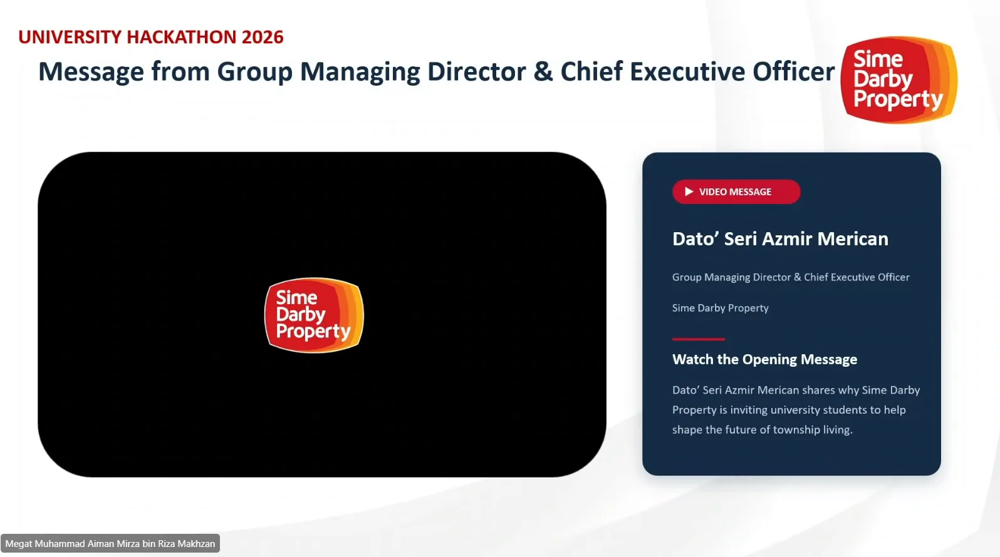

On screen from 00:08 in the recording.

UNIVERSITY HACKATHON 2026

VIDEO MESSAGE

Dato’ Seri Azmir Merican

Group Managing Director & Chief Executive Officer

Sime Darby Property

Watch the Opening Message

Dato’ Seri Azmir Merican shares why Sime Darby Property is inviting university students to help shape the future of township living.

Visuals: Sime Darby Property logo top right. Left: large black rounded video panel with the Sime Darby Property logo centred (video placeholder, no footage shown). Right: dark navy card with a red VIDEO MESSAGE pill carrying a play icon, and a short red rule above "Watch the Opening Message".

## Slide 03: Meet Sime Darby Property

On screen from 00:32 in the recording.

Our Story

Dr Lam Su Ki

Head, Innovation & Partnership

Sime Darby Property

Visuals: Full-bleed red-to-orange gradient with overlapping curved arcs in lighter orange. Sime Darby Property logo top right. Text is white and centred; the presenter credit is in italics.

## Slide 04: Purpose, vision, mission and core values

On screen from 01:38 in the recording.

Our Purpose

Driving Real Estate as a Value Multiplier for People, Businesses, Economies & the Planet.

Our Vision

Advancing real estate as a force for collective progress, in harmony with the planet’s resources.

Our Mission

To develop, own and manage a thriving asset portfolio, creating value for all stakeholders.

Our Values

- (T) Together we do what’s right
- (E) We lead with Excellence
- (A) We embrace new Approaches
- (M) We Make things happen

Footer number: 6

Visuals: Sime Darby Property logo top right. Title words "Purpose, Vision, Mission and Core Values" are red, "Our" and "and" are dark grey. Three columns headed Our Vision, Our Mission and Our Values, divided by red rules. The four value badges are circles in yellow, orange and red that spell TEAM, with the matching letter in each line picked out in colour. Seven photos in a strip along the bottom, left to right: people planting in a raised garden bed; men and women at a table with a board game, one bearded man raising a fist; a uniformed squad marching with rifles; staff at a banquet table with a red cloth and dishes; a colourful party with a boombox; a group planting trees on a grassy slope; men in hard hats and orange safety vests on a site.

## Slide 05: Shaping Malaysia's urban landscape for over five decades

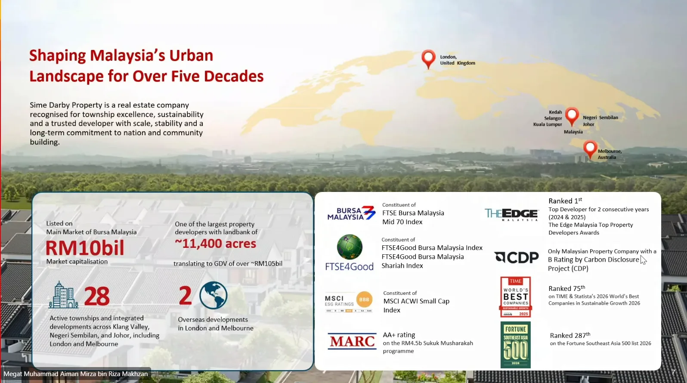

On screen from 03:03 in the recording.

Sime Darby Property is a real estate company recognised for township excellence, sustainability and a trusted developer with scale, stability and a long-term commitment to nation and community building.

Map labels:

- London, United Kingdom
- Kedah, Selangor, Kuala Lumpur, Negeri Sembilan, Johor, Malaysia
- Melbourne, Australia

Left panel:

- Listed on Main Market of Bursa Malaysia
- RM10bil
- Market capitalisation
- One of the largest property developers with landbank of
- ~11,400 acres
- translating to GDV of over ~RM105bil
- 28
- Active townships and integrated developments across Klang Valley, Negeri Sembilan, and Johor, including London and Melbourne
- 2
- Overseas developments in London and Melbourne

Right panel:

| Logo                                                   | Text                                                                                                            |
| ------------------------------------------------------ | --------------------------------------------------------------------------------------------------------------- |
| BURSA MALAYSIA                                         | Constituent of FTSE Bursa Malaysia Mid 70 Index                                                                 |
| FTSE4Good                                              | Constituent of FTSE4Good Bursa Malaysia Index FTSE4Good Bursa Malaysia Shariah Index                            |
| MSCI ESG RATINGS, BBB                                  | Constituent of MSCI ACWI Small Cap Index                                                                        |
| MARC                                                   | AA+ rating on the RM4.5b Sukuk Musharakah programme                                                             |
| THE EDGE MALAYSIA                                      | Ranked 1st Top Developer for 2 consecutive years (2024 & 2025) The Edge Malaysia Top Property Developers Awards |
| CDP                                                    | Only Malaysian Property Company with a B Rating by Carbon Disclosure Project (CDP)                              |
| TIME, World's Best Companies, Sustainable Growth badge | Ranked 75th on TIME & Statista’s 2026 World’s Best Companies in Sustainable Growth 2026                         |
| FORTUNE, SOUTHEAST ASIA 500, 2026                      | Ranked 287th on the Fortune Southeast Asia 500 list 2026                                                        |

Footer number: 7

Visuals: Hazy photo of a township skyline with landed houses and trees, with a pale yellow world map across the top. Three red map pins: London (top centre), Malaysia (centre right, labels on its sides and "Malaysia" below the pin), and Melbourne (lower right). Left panel is translucent white over a housing photo with a dark teal border. Right panel is white with the logos. The TIME badge prints 2025 and the Fortune badge prints 2026. The MSCI ESG scale runs CCC to AAA with BBB highlighted in orange.

## Slide 06: Recent company highlights and milestones

On screen from 03:55 in the recording.

Printed slide number: 8

Subtitle: Over 50 years of developing township & communities

Top row, left to right:

- Opened KL East Mall (1st wholly-owned retail mall)
- Opened Elmina Lakeside Mall (2nd wholly-owned retail mall)
- Opened KLGCC Mall (3rd wholly-owned retail mall)

Bottom row, left to right:

- Grand opening of Battersea Power Station, London
- Announced build-and-lease deals for 2 hyperscale data centres
- Launched nation's first residential rooftop solar program under the National Energy Transition Roadmap

Visuals: Six photo cards in two rows, with a vertical divider between the top-row Elmina and KLGCC cards and between the bottom-row Google and solar cards. Top row: KL East Mall aerial rendering beside a residential tower; Elmina Lakeside Mall street-level rendering with a "LAKESIDE MALL" pylon sign and "Seraí" and "STEAK HOUSE" signage; KLGCC Mall building photo with "KLGCC MALL" sign. Bottom row: Battersea Power Station lit red at dusk; ground-breaking photo of a site rendering with overlay text "The ground breaking ceremony of Malaysia's first Google Data Center and Cloud Region", banner "Mantap Malaysia Bersama AI", and a Google logo at top right; solar launch photo of seven men in front of a banner reading "Majlis Perasmian Projek Solar Kediaman di bawah Program CREAM", "Dirasmikan oleh: YAB Dato' Sri Haji Fadillah bin Haji Yusof", "Timbalan Perdana Menteri dan Menteri Peralihan Tenaga dan Transformasi Air", "26 September 2025", with the Malaysian coat of arms and the Sime Darby Property logo. Background is a dusk aerial of a city.

## Slide 07: Business segments overview

On screen from 05:15 in the recording.

Printed slide number: 9

Subtitle: A balanced portfolio across development and assets. Three synergistic segments delivering growth and recurring income.

Card 1: Property Development

- Leading developer of sustainable communities
- Delivering landed and integrated projects across residential, commercial and industrial segments
- FY2025 Sales Achieved (underlined heading)
- RM 4.2b
- 36% industrial
- 26% residential landed
- 24% residential high rise
- 13% commercial
- 93% – Contribution to Group Revenue in FY25
- 28 – Active Townships and Developments

Card 2: Investment & Fund Management

- Institutional-Grade Fund Management & Investment Capabilities
- Generating recurring income from investment properties, concessions and private funds
- ~7.1 mil sq. ft. total NLA
- of c.20 diversified assets across the commercial, retail and industrial and logistics sectors (excl. BPS)
- RM2.25b FUM
- pioneering developer-led fund mngmnt.
- RM5b AUM
- With a further >RM5bn project pipeline under development, incl. DCs
- Footnotes below the card: FUM – Funds Under Management; AUM – Assets Under Management; *as of July 2026

Card 3: Asset Management

- Maximising Value from Strategic Assets
- Maximising returns from strategic assets through disciplined portfolio management and leasing excellence
- Retail Assets:
- i. KL East Mall
- ii. Elmina Lakeside Mall
- iii. KLGCC Mall
- Industrial, Commercial & Others:
- i. Hyperscale DC1
- ii. Gateway I & II
- iii. Wisma MRT
- iv. Menara KLGCC
- v. KLGCC Convention Centre
- Footnote: *Selected assets; list is non-exhaustive

Visuals: Dark-overlaid aerial background of a township with terrace houses and roads. Three cards with photo headers. Card 1 photo: landscaped township aerial with a red arch structure, hills and a row of buildings behind. Icons beside 93% (hand holding a pie chart) and 28 (cluster of buildings). Card 2 photo: aerial of a multi-storey industrial or logistics building at dusk. Card 3 photo: night aerial of a township by water with a lit red structure and a hot-air balloon. Headings and figures are in gold on dark panels; the figures carry no other colour coding.

## Slide 08: Property development footprint

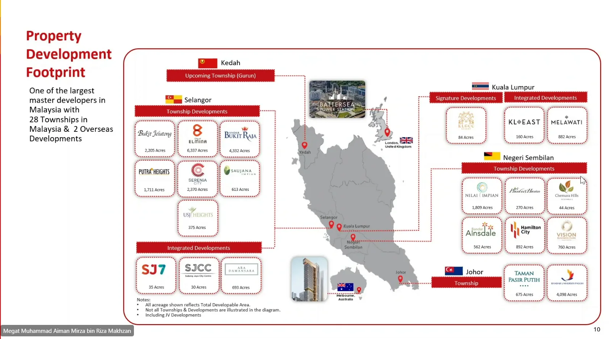

On screen from 06:46 in the recording.

Printed slide number: 10

Intro: One of the largest master developers in Malaysia with 28 Townships in Malaysia & 2 Overseas Developments

Kedah

- Upcoming Township (Gurun)

Selangor, Township Developments

- Bukit Jelutong – 2,205 Acres
- City of Elmina – 6,337 Acres
- Bandar Bukit Raja – 4,332 Acres
- Putra Heights – 1,711 Acres
- Serenia City – 2,370 Acres
- Saujana Impian – 613 Acres
- USJ Heights – 375 Acres

Selangor, Integrated Developments

- SJ7 – 35 Acres
- SJCC (Subang Jaya City Centre) – 30 Acres
- Ara Damansara – 693 Acres

Kuala Lumpur, Signature Developments

- KLGCC Resort – 84 Acres

Kuala Lumpur, Integrated Developments

- KL EAST – 160 Acres
- Melawati – 882 Acres

Negeri Sembilan, Township Developments

- Nilai Impian – 1,809 Acres
- Planters Haven – 270 Acres
- Chemara Hills (small text beneath: SEREMBAN[?]) – 44 Acres
- Bandar Ainsdale – 562 Acres
- Hamilton City – 892 Acres
- Vision Business Park (small text beneath: NILAI SOUTH[?]) – 760 Acres

Johor, Township

- Taman Pasir Putih – 675 Acres
- Bandar Universiti Pagoh – 4,098 Acres

Overseas

- London, United Kingdom – Battersea Power Station (photo card, no acreage shown)
- Melbourne, Australia – unlabelled tower photo, no acreage shown

Notes:

- All acreage shown reflects Total Developable Area.
- Not all Townships & Developments are illustrated in the diagram.
- Including JV Developments

Visuals: Grey outline map of Peninsular Malaysia with red location pins at Kedah, Selangor, Kuala Lumpur, Negeri Sembilan and Johor, plus pins for London, United Kingdom and Melbourne, Australia. Red dotted leader lines run from each region banner to its pins. Region labels carry flags: Kedah, Selangor, Kuala Lumpur, Negeri Sembilan and Johor flags, plus the Australian and United Kingdom flags for the overseas pins. Red bold banners label each group. Each development is a card with a dotted red border, a logo and its acreage. Photo cards: Battersea Power Station aerial rendering beside the London pin, and a tall tower rendering beside the Melbourne pin. The whole diagram sits in a red-outlined frame. Red is used throughout for banners, pins and borders.

## Slide 09: Commitment to sustainability

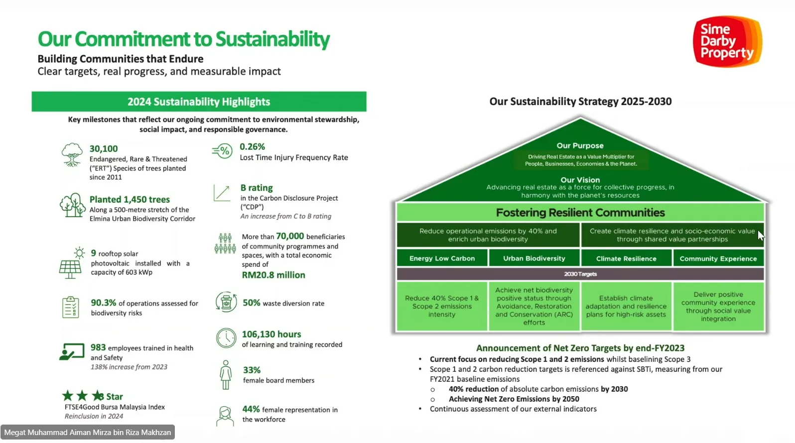

On screen from 08:05 in the recording.

Our Commitment to Sustainability

Building Communities that Endure

Clear targets, real progress, and measurable impact

**2024 Sustainability Highlights**

Key milestones that reflect our ongoing commitment to environmental stewardship, social impact, and responsible governance.

| Figure              | Label                                                                            | Note                           |
| ------------------- | -------------------------------------------------------------------------------- | ------------------------------ |
| 30,100              | Endangered, Rare & Threatened ("ERT") Species of trees planted since 2011        |                                |
| Planted 1,450 trees | Along a 500-metre stretch of the Elmina Urban Biodiversity Corridor              |                                |
| 9                   | rooftop solar photovoltaic installed with a capacity of 603 kWp                  |                                |
| 90.3%               | of operations assessed for biodiversity risks                                    |                                |
| 983                 | employees trained in health and Safety                                           | 138% increase from 2023        |
| 3 Star              | FTSE4Good Bursa Malaysia Index                                                   | Reinclusion in 2024            |
| 0.26%               | Lost Time Injury Frequency Rate                                                  |                                |
| B rating            | in the Carbon Disclosure Project ("CDP")                                         | An increase from C to B rating |
| More than 70,000    | beneficiaries of community programmes and spaces, with a total economic spend of | RM20.8 million                 |
| 50%                 | waste diversion rate                                                             |                                |
| 106,130 hours       | of learning and training recorded                                                |                                |
| 33%                 | female board members                                                             |                                |
| 44%                 | female representation in the workforce                                           |                                |

**Our Sustainability Strategy 2025-2030**

**Roof**

- Our Purpose: Driving Real Estate as a Value Multiplier for People, Businesses, Economies & the Planet.
- Our Vision: Advancing real estate as a force for collective progress, in harmony with the planet's resources

**Band**

- Fostering Resilient Communities

**Pillars, row 1 (two wide boxes)**

- Reduce operational emissions by 40% and enrich urban biodiversity
- Create climate resilience and socio-economic value through shared value partnerships

**Pillars, row 2 (four boxes)**

- Energy Low Carbon
- Urban Biodiversity
- Climate Resilience
- Community Experience

**2030 Targets**

**Targets (four boxes)**

- Reduce 40% Scope 1 & Scope 2 emissions intensity
- Achieve net biodiversity positive status through Avoidance, Restoration and Conservation (ARC) efforts
- Establish climate adaptation and resilience plans for high-risk assets
- Deliver positive community experience through social value integration

**Announcement of Net Zero Targets by end-FY2023**

- Current focus on reducing Scope 1 and 2 emissions whilst baselining Scope 3
- Scope 1 and 2 carbon reduction targets is referenced against SBTi, measuring from our FY2021 baseline emissions
  - 40% reduction of absolute carbon emissions by 2030
  - Achieving Net Zero Emissions by 2050
- Continuous assessment of our external indicators

Visuals: Sime Darby Property logo (red and orange) top right. Left half has a green header bar and a two-column grid of green line icons, each beside its figure: tree with roots, cluster of trees, solar panel with sun, clipboard, presenter at a board, three green star icons (the third star is partly overlapped by the "3" of "3 Star"), percent gauge, rising line chart, group of people, waste bin with recycle arrows, clock, standing female figure, female head and shoulders. Right half is a green house diagram: darkest green roof holding Purpose and Vision, mid-green band, dark-green pillar boxes, light-green target boxes, and a grey-purple "2030 Targets" bar.

## Slide 10: University Hackathon 2026 section title

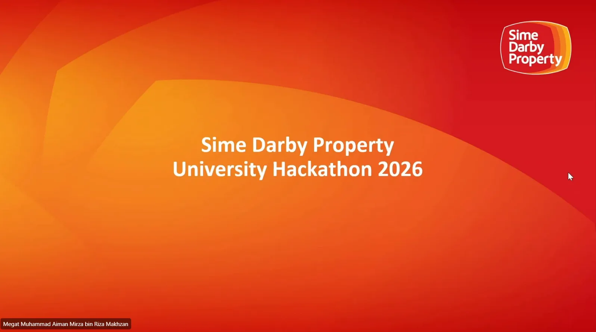

On screen from 09:31 in the recording.

Sime Darby Property

University Hackathon 2026

Visuals: Full-bleed red-to-orange gradient with curved lighter swooshes. Sime Darby Property logo (red and orange) top right. Both title lines are centred in large white bold text.

## Slide 11: Message from the Chief Digital and Technology Officer

On screen from 09:50 in the recording.

UNIVERSITY HACKATHON 2026 (red eyebrow)

Message from Chief Digital & Technology Officer

Panel, right side:

- VIDEO MESSAGE (red pill badge with play icon)
- Elmen Tan
- Chief Digital & Technology Officer
- Sime Darby Property
- Watch the Opening Message
- Elmen Tan, Chief Digital & Technology Officer, shares why Sime Darby Property is inviting university students to help shape the future of township living.

Visuals: Left: video still of a city street with people's legs and tan paper shopping bags; small Sime Darby Property logo in the top-right corner of the frame; video controls along the bottom (play button, progress bar, speaker icon). Right: navy card with the red "VIDEO MESSAGE" badge. Top right of slide: large Sime Darby Property logo. Background is white with pale grey swooshes.

## Slide 12: Video message still, Elmen Tan

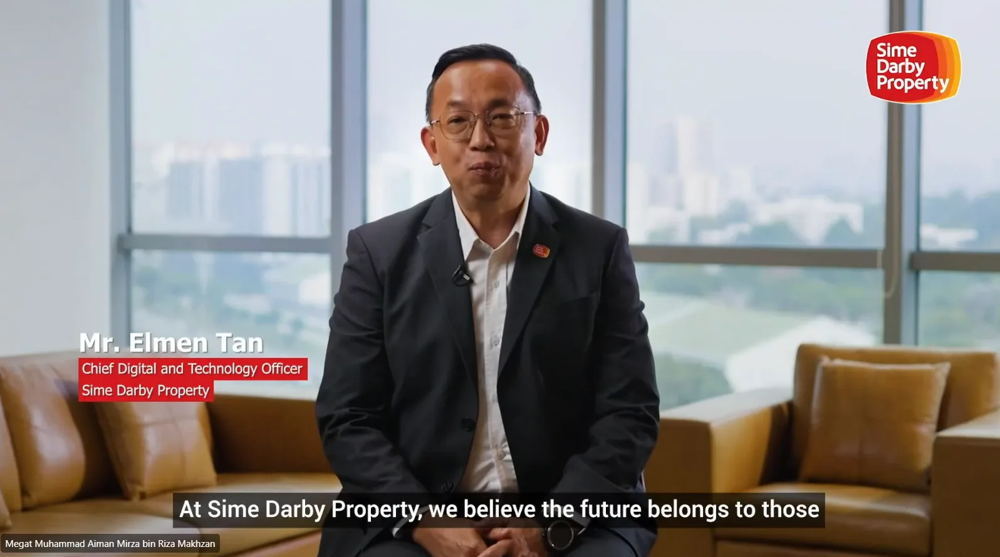

On screen from 10:14 in the recording.

Lower-third name block:

Mr. Elmen Tan

Chief Digital and Technology Officer

Sime Darby Property

Subtitle line:

At Sime Darby Property, we believe the future belongs to those

Visuals: Still from a pre-recorded video. A man in a dark suit, white open-neck shirt, rimless glasses, and a small red lapel pin with a clip-on microphone sits on a tan leather sofa in front of floor-to-ceiling windows showing a hazy city skyline. Sime Darby Property logo top right. Lower-third name and title are white text on red bars. The subtitle is white text on a dark bar and is the only subtitle line shown in this frame.

## Slide 13: Why Township of Tomorrow

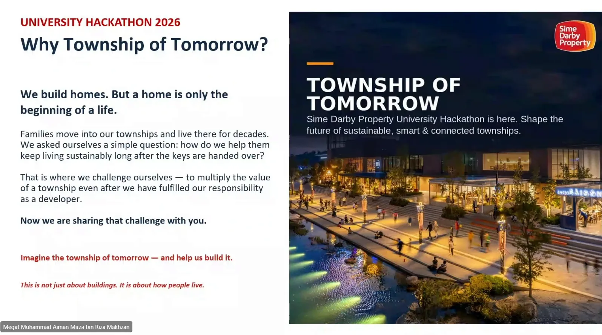

On screen from 12:37 in the recording.

UNIVERSITY HACKATHON 2026 (red eyebrow)

Why Township of Tomorrow?

**We build homes. But a home is only the beginning of a life.**

Families move into our townships and live there for decades. We asked ourselves a simple question: how do we help them keep living sustainably long after the keys are handed over?

That is where we challenge ourselves — to multiply the value of a township even after we have fulfilled our responsibility as a developer.

**Now we are sharing that challenge with you.**

Imagine the township of tomorrow — and help us build it. (red, bold)

This is not just about buildings. It is about how people live. (red, bold italic)

Image panel, text on photo:

TOWNSHIP OF TOMORROW

Sime Darby Property University Hackathon is here. Shape the future of sustainable, smart & connected townships.

Visuals: Right side is a night photo of a township waterfront: a lit stepped promenade with people walking and sitting, tall ornamental light pillars, a water feature with green-lit jets, and a restaurant front with a blue neon sign (appears to read "SUPER SAIGON" [?]). Overlay: short orange bar above the title, dark navy sky tint. Sime Darby Property logo top right of the photo. Left side is white with navy text and red call-to-action lines.

## Slide 14: How might we reimagine the Township of Tomorrow

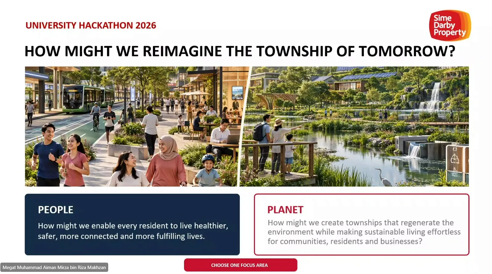

On screen from 14:41 in the recording.

UNIVERSITY HACKATHON 2026

HOW MIGHT WE REIMAGINE THE TOWNSHIP OF TOMORROW?

PEOPLE
How might we enable every resident to live healthier, safer, more connected and more fulfilling lives.

PLANET
How might we create townships that regenerate the environment while making sustainable living effortless for communities, residents and businesses?

CHOOSE ONE FOCUS AREA

Visuals: Two photos side by side across the top. Left: a streetscape with a green electric bus on a green bike lane, a cyclist, joggers, a woman in a hijab, a child in a helmet, and people at café tables with a laptop. Right: a wetland park with waterfalls, solar panels on green-roofed houses, a timber pergola, a boardwalk, a family pointing across a pond, a heron, and recycling bins. Bottom left: dark navy PEOPLE card with white text. Bottom right: white PLANET card with a red outline, red heading and grey text. Red "CHOOSE ONE FOCUS AREA" bar centred at the bottom. Sime Darby Property logo top right.

## Slide 15: Challenge theme 1, People

On screen from 15:42 in the recording.

UNIVERSITY HACKATHON 2026

Challenge Theme 1 - PEOPLE

How might we enable every resident to live healthier, safer, more connected and more fulfilling lives?

| Theme                     | Description                             |
| ------------------------- | --------------------------------------- |
| Community Wellbeing       | Physical and mental health of residents |
| Safety & Security         | Safer environments for all residents    |
| Accessibility & Inclusion | Designing for everyone                  |
| Mobility                  | Getting around the township             |
| Digital Living            | Connected, tech-enabled lifestyles      |
| Neighbourhood Connection  | Stronger community bonds                |
| Healthy Lifestyles        | Active, balanced living                 |

**You do not need to solve everything.** Find ONE meaningful problem and solve it well.

Visuals: Red line icons beside each theme: heart, shield with tick, wheelchair, bus, Wi-Fi signal, houses with a tree, runner. Right-hand photo: a streetscape with a green electric bus on a green bike lane, joggers, a woman in a wheelchair with a companion, a woman in a hijab, a child on a yellow bike, and café diners. Sime Darby Property logo top right.

## Slide 16: People problems and ideas

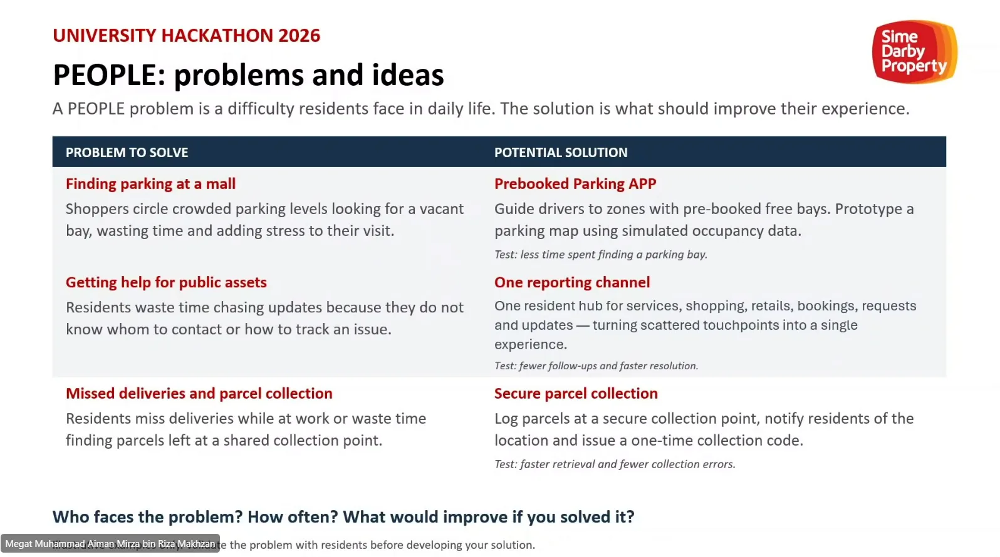

On screen from 17:27 in the recording.

UNIVERSITY HACKATHON 2026

PEOPLE: problems and ideas

A PEOPLE problem is a difficulty residents face in daily life. The solution is what should improve their experience.

| PROBLEM TO SOLVE                                                                                                                                      | POTENTIAL SOLUTION                                                                                                                                                                                                    |
| ----------------------------------------------------------------------------------------------------------------------------------------------------- | --------------------------------------------------------------------------------------------------------------------------------------------------------------------------------------------------------------------- |
| **Finding parking at a mall**: Shoppers circle crowded parking levels looking for a vacant bay, wasting time and adding stress to their visit.        | **Prebooked Parking APP**: Guide drivers to zones with pre-booked free bays. Prototype a parking map using simulated occupancy data. _Test: less time spent finding a parking bay._                                   |
| **Getting help for public assets**: Residents waste time chasing updates because they do not know whom to contact or how to track an issue.           | **One reporting channel**: One resident hub for services, shopping, retails, bookings, requests and updates — turning scattered touchpoints into a single experience. _Test: fewer follow-ups and faster resolution._ |
| **Missed deliveries and parcel collection**: Residents miss deliveries while at work or waste time finding parcels left at a shared collection point. | **Secure parcel collection**: Log parcels at a secure collection point, notify residents of the location and issue a one-time collection code. _Test: faster retrieval and fewer collection errors._                  |

Who faces the problem? How often? What would improve if you solved it?

Illustrative examples only.[?] Validate[?] the problem with residents before developing your solution.

Visuals: No photos. Navy header bar with white caps labels. Red bold problem and solution titles. Grey body text. Italic "Test:" lines. First two rows have a light grey background, third row white. Sime Darby Property logo top right. The bottom sentence is partly hidden by the Teams name label; its opening words are reconstructed from faint pixels and marked [?].

## Slide 17: Challenge theme 2, Planet

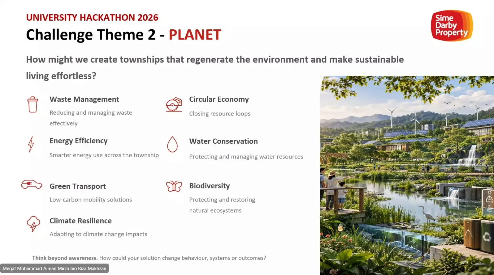

On screen from 18:20 in the recording.

UNIVERSITY HACKATHON 2026

Challenge Theme 2 - PLANET

How might we create townships that regenerate the environment and make sustainable living effortless?

| Theme              | Description                                 |
| ------------------ | ------------------------------------------- |
| Waste Management   | Reducing and managing waste effectively     |
| Circular Economy   | Closing resource loops                      |
| Energy Efficiency  | Smarter energy use across the township      |
| Water Conservation | Protecting and managing water resources     |
| Green Transport    | Low-carbon mobility solutions               |
| Biodiversity       | Protecting and restoring natural ecosystems |
| Climate Resilience | Adapting to climate change impacts          |

**Think beyond awareness.** How could your solution change behaviour, systems or outcomes?

Visuals: Red line icons beside each theme: wheelie bin, saw blade with leaves (circular economy), lightning bolt, water drop, electric car with a plug, butterfly, cloud with lightning. Right-hand photo: a wetland park with wind turbines and solar panels on hillside houses, a waterfall, a family at a timber railing pointing across a pond, a heron, a water feature, recycling bins in the foreground, and a butterfly. Sime Darby Property logo top right.

## Slide 18: Planet problems and ideas

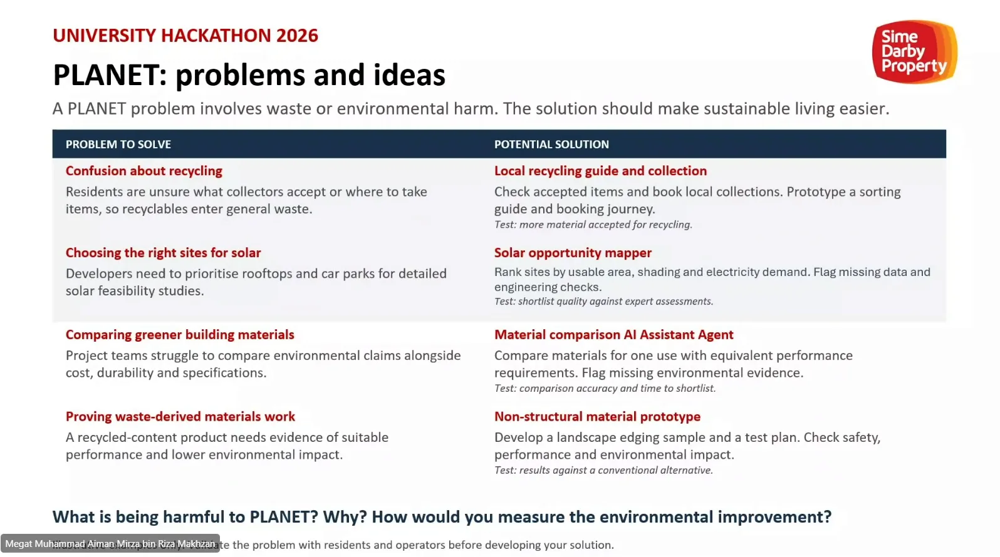

On screen from 19:29 in the recording.

UNIVERSITY HACKATHON 2026

PLANET: problems and ideas

A PLANET problem involves waste or environmental harm. The solution should make sustainable living easier.

| PROBLEM TO SOLVE                                                                                                                                | POTENTIAL SOLUTION                                                                                                                                                                                          |
| ----------------------------------------------------------------------------------------------------------------------------------------------- | ----------------------------------------------------------------------------------------------------------------------------------------------------------------------------------------------------------- |
| **Confusion about recycling**: Residents are unsure what collectors accept or where to take items, so recyclables enter general waste.          | **Local recycling guide and collection**: Check accepted items and book local collections. Prototype a sorting guide and booking journey. _Test: more material accepted for recycling._                     |
| **Choosing the right sites for solar**: Developers need to prioritise rooftops and car parks for detailed solar feasibility studies.            | **Solar opportunity mapper**: Rank sites by usable area, shading and electricity demand. Flag missing data and engineering checks. _Test: shortlist quality against expert assessments._                    |
| **Comparing greener building materials**: Project teams struggle to compare environmental claims alongside cost, durability and specifications. | **Material comparison AI Assistant Agent**: Compare materials for one use with equivalent performance requirements. Flag missing environmental evidence. _Test: comparison accuracy and time to shortlist._ |
| **Proving waste-derived materials work**: A recycled-content product needs evidence of suitable performance and lower environmental impact.     | **Non-structural material prototype**: Develop a landscape edging sample and a test plan. Check safety, performance and environmental impact. _Test: results against a conventional alternative._           |

What is being harmful to PLANET? Why? How would you measure the environmental improvement?

Illustrative examples only.[?] Validate[?] the problem with residents and operators before developing your solution.

Visuals: No photos. Navy header bar with white caps labels. Red bold problem and solution titles. Grey body text. Italic "Test:" lines. First two rows have a light grey background, last two rows white. Sime Darby Property logo top right. The bottom sentence is partly hidden by the Teams name label; its opening words are reconstructed from faint pixels and marked [?].

## Slide 19: From a big challenge to a great idea

On screen from 21:09 in the recording.

UNIVERSITY HACKATHON 2026

Do not try to redesign an entire township. Solve a specific problem that matters. Follow this structured approach to develop a compelling, evidence-based solution.

- Observe — Study real township life
- Identify — Pinpoint a specific problem
- Understand — Learn users’ needs and context
- Create — Design a focused solution
- Build — Prototype or demonstrate it

Each step builds on the last. Teams that follow this process produce stronger, more credible and more impactful solutions.

Visuals: Sime Darby Property logo top right. Five steps joined by a looping path that runs left to right: a red dot marks the start and a navy arrow marks the end. Arc colours shift from red (Observe) through orange and amber to navy (Build). Arrowheads alternate down and up between steps.

## Slide 20: What makes a strong solution

On screen from 21:58 in the recording.

UNIVERSITY HACKATHON 2026

| Heading        | Body text                                                                                |
| -------------- | ---------------------------------------------------------------------------------------- |
| RELEVANT       | Addresses a real People or Planet challenge within a township context.                   |
| IMPACTFUL      | Creates meaningful and measurable outcomes for residents or the environment.             |
| INNOVATIVE     | Offers something meaningfully different and not simply repackaging an existing solution. |
| FEASIBLE       | Can realistically be piloted and implemented within a township environment.              |
| SCALABLE       | Has potential beyond one location or use case. Can grow across SDP townships.            |
| EVIDENCE BASED | Supported by research, user validation, a prototype or a working demonstration.          |

Judges will assess every submission against six core dimensions. Strong solutions score well across all six and not just one or two.

Visuals: Six white cards in a two-column grid, each with a red heading and short red underline, read left to right then top to bottom. A dark navy rounded banner runs across the bottom. Sime Darby Property logo top right.

## Slide 21: The journey begins

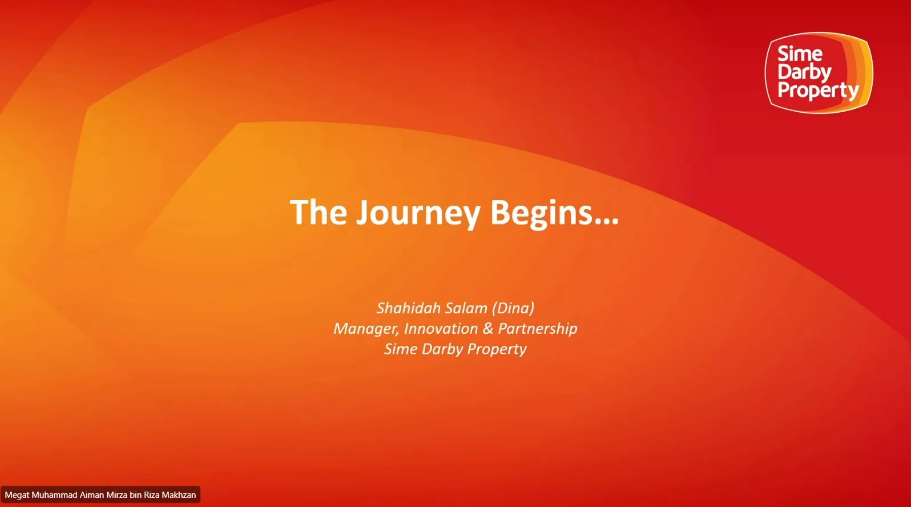

On screen from 25:06 in the recording.

Shahidah Salam (Dina)

Manager, Innovation & Partnership

Sime Darby Property

Visuals: Full-bleed orange-to-red gradient with curved, lighter swooshes across the background. Sime Darby Property logo top right. Title is upright white text; the three speaker lines are white italic, all centred.

## Slide 22: Your hackathon journey

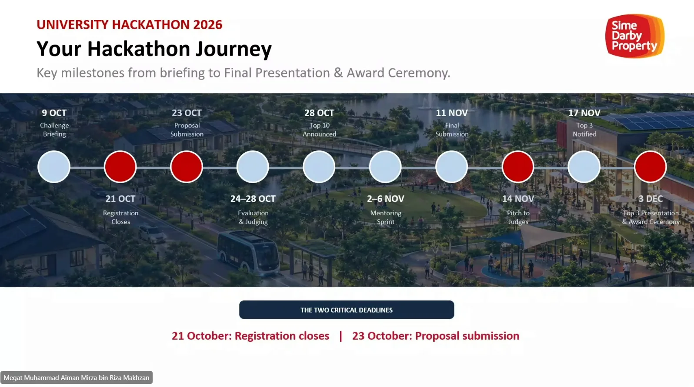

On screen from 25:58 in the recording.

UNIVERSITY HACKATHON 2026

Key milestones from briefing to Final Presentation & Award Ceremony.

Timeline, in order, left to right:

1. 9 OCT — Challenge Briefing (light-blue dot)
2. 21 OCT — Registration Closes (red dot)
3. 23 OCT — Proposal Submission (red dot)
4. 24–28 OCT — Evaluation & Judging (light-blue dot)
5. 28 OCT — Top 10 Announced (light-blue dot)
6. 2–6 NOV — Mentoring Sprint (light-blue dot)
7. 11 NOV — Final Submission (light-blue dot)
8. 14 NOV — Pitch to Judges (red dot)
9. 17 NOV — Top 3 Notified (light-blue dot)
10. 3 DEC — Top 3 Presentation & Award Ceremony (red dot)

THE TWO CRITICAL DEADLINES

21 October: Registration closes | 23 October: Proposal submission

Visuals: Background photo of a township: aerial view of landed houses with solar panels, a lake with fountains, a green park with people, a small shuttle bus on a road, a bus shelter and a playground. Ten circular dots sit on one horizontal line; the 4 red dots (21 OCT, 23 OCT, 14 NOV, 3 DEC) mark key deadlines, and the 6 light-blue dots mark other milestones. The navy banner names 21 and 23 October as the two critical deadlines. Sime Darby Property logo top right.

## Slide 23: Submission deadline

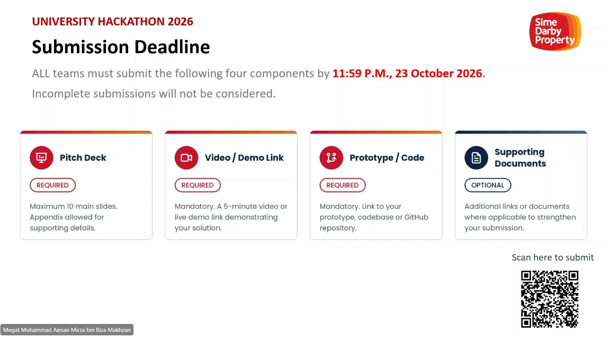

On screen from 28:02 in the recording.

UNIVERSITY HACKATHON 2026

ALL teams must submit the following four components by **11:59 P.M., 23 October 2026**.

Incomplete submissions will not be considered.

| Component            | Status   | Description                                                                   |
| -------------------- | -------- | ----------------------------------------------------------------------------- |
| Pitch Deck           | REQUIRED | Maximum 10 main slides. Appendix allowed for supporting details.              |
| Video / Demo Link    | REQUIRED | Mandatory. A 5-minute video or live demo link demonstrating your solution.    |
| Prototype / Code     | REQUIRED | Mandatory. Link to your prototype, codebase or GitHub repository.             |
| Supporting Documents | OPTIONAL | Additional links or documents where applicable to strengthen your submission. |

QR code, caption: Scan here to submit. Decoded URL: https://simedarbyproperty.com/universityhackathon/submission/

Visuals: Four white cards with coloured top bars (red-to-orange for the first three, navy for Supporting Documents). Each card has a round icon: a presentation screen, a video camera, a branch-and-node symbol, and a document page on a navy circle. REQUIRED pills are outlined in red and the OPTIONAL pill is outlined in navy. Date and time are in red bold. QR code bottom right. Sime Darby Property logo top right.

## Slide 24: What your pitch deck should cover

On screen from 30:38 in the recording.

UNIVERSITY HACKATHON 2026

The slides should cover 8 key areas:

**The Story**

1. Problem
2. Target User
3. Solution
4. Innovation

**The Proof**

5. How it Works
6. Impact
7. Feasibility
8. Implementation

Keep your core pitch deck to 10 slides and moving secondary details to the appendix.

Photo banner text:

FOR MALAYSIA'S BRIGHTEST MINDS

FROM BLUEPRINTS TO REALITY

Where People and Planet thrive together — bring your innovation, mentorship & real-world impact await.

Visuals: Right side is a photo banner of a lit, modern mixed-use building at dusk, with a patterned angled facade, a glass curtain-wall section and blurred car light trails on the road in front. A partly visible shop sign sits at the left edge. The banner text sits on a dark navy overlay with a yellow accent bar above the first line. Left side: "The Story" heading in red with a red underline, numbers 1 to 4 in red circles; "The Proof" heading in navy with a navy underline, numbers 5 to 8 in navy circles. Callout box has a red left border. Sime Darby Property logo top right.

## Slide 25: Example pitch deck walkthrough

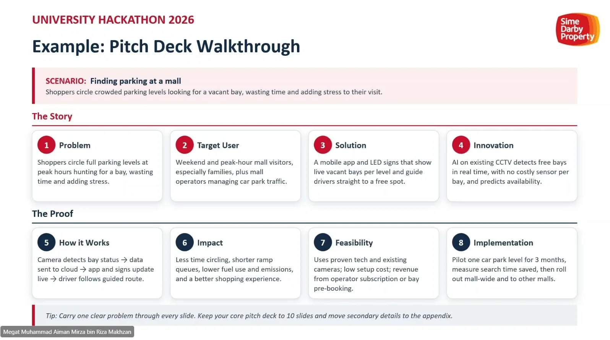

On screen from 33:26 in the recording.

UNIVERSITY HACKATHON 2026

SCENARIO: Finding parking at a mall

Shoppers circle crowded parking levels looking for a vacant bay, wasting time and adding stress to their visit.

**The Story**

**1 Problem**

Shoppers circle full parking levels at peak hours hunting for a bay, wasting time and adding stress.

**2 Target User**

Weekend and peak-hour mall visitors, especially families, plus mall operators managing car park traffic.

**3 Solution**

A mobile app and LED signs that show live vacant bays per level and guide drivers straight to a free spot.

**4 Innovation**

AI on existing CCTV detects free bays in real time, with no costly sensor per bay, and predicts availability.

**The Proof**

**5 How it Works**

Camera detects bay status → data sent to cloud → app and signs update live → driver follows guided route.

**6 Impact**

Less time circling, shorter ramp queues, lower fuel use and emissions, and a better shopping experience.

**7 Feasibility**

Uses proven tech and existing cameras; low setup cost; revenue from operator subscription or bay pre-booking.

**8 Implementation**

Pilot one car park level for 3 months, measure search time saved, then roll out mall-wide and to other malls.

Tip: Carry one clear problem through every slide. Keep your core pitch deck to 10 slides and move secondary details to the appendix.

Visuals: Sime Darby Property logo top right (red and orange). Red SCENARIO banner on a pale pink panel with a red left bar. Eight white rounded cards with grey outlines in two rows of four; numbers 1 to 4 sit in red circles under a red "The Story" rule, numbers 5 to 8 sit in navy circles under a navy "The Proof" rule. Grey tip bar with a red left edge at the bottom. No photos.

## Slide 26: Judges criteria

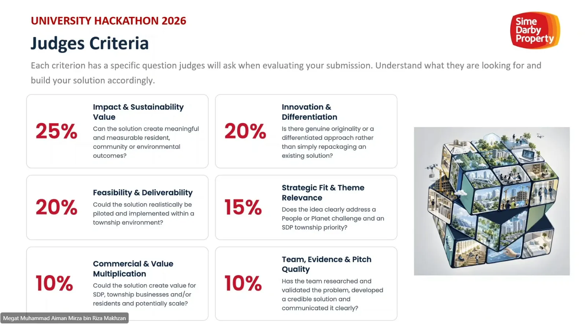

On screen from 36:28 in the recording.

UNIVERSITY HACKATHON 2026

Judges Criteria

Each criterion has a specific question judges will ask when evaluating your submission. Understand what they are looking for and build your solution accordingly.

| Percentage | Criterion                         | Question                                                                                                       |
| ---------- | --------------------------------- | -------------------------------------------------------------------------------------------------------------- |
| 25%        | Impact & Sustainability Value     | Can the solution create meaningful and measurable resident, community or environmental outcomes?               |
| 20%        | Innovation & Differentiation      | Is there genuine originality or a differentiated approach rather than simply repackaging an existing solution? |
| 20%        | Feasibility & Deliverability      | Could the solution realistically be piloted and implemented within a township environment?                     |
| 15%        | Strategic Fit & Theme Relevance   | Does the idea clearly address a People or Planet challenge and an SDP township priority?                       |
| 10%        | Commercial & Value Multiplication | Could the solution create value for SDP, township businesses and/or residents and potentially scale?           |
| 10%        | Team, Evidence & Pitch Quality    | Has the team researched and validated the problem, developed a credible solution and communicated it clearly?  |

Visuals: Sime Darby Property logo top right. Six white rounded cards in a 2 by 3 grid, each with a large red percentage on the left. On the right, a render of a Rubik's-cube-style stack of tiles on a light grey background; the tiles show township scenes: green parks and lakes, high-rise towers, people in meeting and work spaces, construction cranes with workers, solar panels, a drone and interiors.

## Slide 27: Top 10 ideas refined by industry experts

On screen from 37:23 in the recording.

UNIVERSITY HACKATHON 2026

Top 10 — Ideas refined by Industry Subject Matter Expert

Selected teams will receive mentoring support from Industry Subject Matter Expert prior to pitching physically to Sime Darby Property.

| Date           | Stage                               |
| -------------- | ----------------------------------- |
| 28 October     | Top 10 Announcement                 |
| 2 – 6 November | Online Mentoring Sprint             |
| 11 November    | Final Submission                    |
| 14 November    | Pitch to Judges Day                 |
| 3 December     | Final Presentation & Award Ceremony |

With mentor guidance, the Top 10 will refine their solution, implementation approach, prototype/demo and pitch before presenting in person to Sime Darby Property’s final judges.

Visuals: Sime Darby Property logo top right. Five chevron-shaped segments read left to right on one white rounded panel, each with a pale tint (pink, yellow, green, blue, lavender). Icons in circles: red megaphone (28 October), gold group of people (2 – 6 November), green upload arrow (11 November), navy microphone (14 November), purple trophy (3 December). Dates are in red. A dark navy rounded banner runs along the bottom.

## Slide 28: Top 10 pitch and talent spotlight

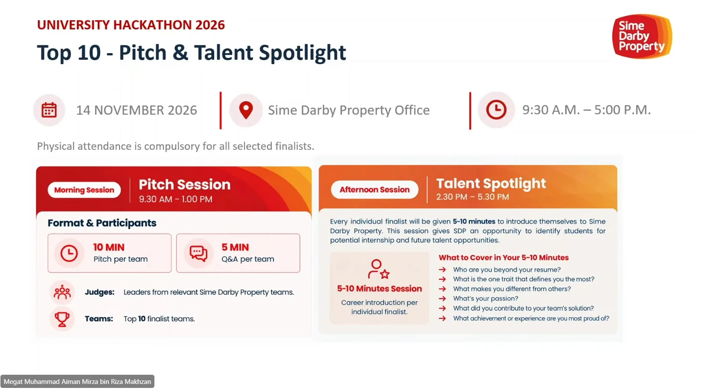

On screen from 37:44 in the recording.

UNIVERSITY HACKATHON 2026

Top 10 - Pitch & Talent Spotlight

- 14 NOVEMBER 2026
- Sime Darby Property Office
- 9:30 A.M. – 5:00 P.M.

Physical attendance is compulsory for all selected finalists.

**Morning Session**

**Pitch Session**

9.30 AM – 1.00 PM

**Format & Participants**

| Duration | Item           |
| -------- | -------------- |
| 10 MIN   | Pitch per team |
| 5 MIN    | Q&A per team   |

Judges: Leaders from relevant Sime Darby Property teams.

Teams: Top 10 finalist teams.

**Afternoon Session**

**Talent Spotlight**

2.30 PM – 5.30 PM

Every individual finalist will be given 5-10 minutes to introduce themselves to Sime Darby Property. This session gives SDP an opportunity to identify students for potential internship and future talent opportunities.

**5-10 Minutes Session**

Career introduction per individual finalist.

**What to Cover in Your 5-10 Minutes**

- Who are you beyond your resume?
- What is the one trait that defines you the most?
- What makes you different from others?
- What’s your passion?
- What did you contribute to your team’s solution?
- What achievement or experience are you most proud of?

Visuals: Sime Darby Property logo top right. Three info items across the top, each with a light pink circle icon: red calendar (date), red location pin (venue), red clock (time), separated by thin red vertical bars. Left card: red gradient header with a white "Morning Session" pill, light pink body with two red-bordered boxes (clock icon for 10 MIN, speech-bubble icon for 5 MIN), a group icon beside Judges and a trophy icon beside Teams. Right card: orange gradient header with a white "Afternoon Session" pill, a beige box holding a red person-with-star icon, and red arrow bullets for the questions.

## Slide 29: Final presentation and award ceremony

On screen from 39:49 in the recording.

UNIVERSITY HACKATHON 2026

Final Presentation & Award Ceremony

**Event Details**

- 3 DECEMBER 2026
- ELMINA, SIME DARBY PROPERTY
- ALL TOP 10 FINALIST TEAMS ATTEND

Physical attendance is compulsory for all Top 10 finalist teams on 3 December 2026.

TOP 5 PRESENT

The Top 5 teams present their solutions to an audience. Presentation format and duration to be confirmed.

TOP 10 SHOWCASE

All Top 10 finalist teams will be provided with a showcase booth. More details and setup requirements will be shared later.

WINNER ANNOUNCEMENT

Final ranking will be revealed and certificates & prizes presented at the event to all Top 10 teams.

**Final ranking will NOT be revealed on 17 November.**

Champion, 1st Runner-Up and 2nd Runner-Up will only be announced at the Final Presentation & Award Ceremony on **3 December 2026**.

Champion

Ranking hidden until Final Presentation & Award Ceremony.

1st Runner-Up

Ranking hidden until Final Presentation & Award Ceremony.

2nd Runner-Up

Ranking hidden until Final Presentation & Award Ceremony.

Visuals: Sime Darby Property logo top right. Left panel is light blue, headed "Event Details", with icons in pale pink circles: red calendar (3 DECEMBER 2026), red location pin (venue), red group of people (all Top 10 teams attend), then red group icon (Top 5 present), red presentation screen with play symbol (Top 10 showcase), red trophy (winner announcement). Right panel is pale pink: a red megaphone beside the ranking notice, then three rank rows: gold trophy with star (Champion), silver medal with "2" (1st Runner-Up), bronze medal with "3" (2nd Runner-Up).

## Slide 30: Prize structure and winner pathway

On screen from 41:07 in the recording.

UNIVERSITY HACKATHON 2026

Prize Structure & Winner Pathway

Designed to attract quality participation and stay aligned with market benchmarks. With a career pathway beyond the cash prize

**PRIZE POOL | TOTAL RM14,000**

| Place                          | Prize      |
| ------------------------------ | ---------- |
| CHAMPION                       | RM6,000    |
| 1ST RUNNER-UP                  | RM3,000    |
| 2ND RUNNER-UP                  | RM1,500    |
| CONSOLATION (4th - 10th place) | RM500 each |

**BEYOND THE PRIZE MONEY**

**Internship & MAP Programme**

- Intern Programme: 10 selected winners join as interns and continue building their own submitted idea alongside SDP teams and mentors.
- MAP Programme: High-potential winners enter the MAP track for structured development, mentoring and exposure across the business.
- Merit-based and capped: Seats are awarded on merit by the judging panel with Judges from Sime Darby Property.

Visuals: Sime Darby Property logo top right. Left white card with a red "PRIZE POOL" header bar and prize rows separated by thin grey rules; amounts in large red numerals. Right white card with a red "BEYOND THE PRIZE MONEY" header and a red "Internship & MAP Programme" banner with a white group icon. Below it, three rows with pale pink circle icons: red briefcase (Intern Programme), red bar chart with upward arrow (MAP Programme), red star (Merit-based and capped).

## Slide 31: Journey to build your idea and career

On screen from 41:39 in the recording.

UNIVERSITY HACKATHON 2026

From a hybrid hackathon into a continuous talent and innovation pipeline

**01 | TALENT**

**Winners join SDP**

- **Placement in SDP**: Top-performing hackathon teams are offered a place in SDP.
- **Talent Pipeline**: Converts competition performance into a direct, pre-qualified talent pipeline.
- **Real-world Opportunity**: Winners get the opportunity to carry their own solution (guided by SDP subject matter expert) into the organisation.

**02 | INTERNS**

**Interns build the ideas**

- **Attached to Selected Ideas**: Interns are attached to the selected ideas during their tenure.
- **Hands-on Involvement**: Hands-on involvement keeps momentum after the event closes.
- **Real Project Exposure**: Gives students real project exposure and mentoring.

**03 | TEST & LEARN**

**Ideas test and learn**

- **Ideas are assessed**: The full pool of ideas is processed and assessed.
- **Proof of concept**: A selected few go through the proof of concept process for execution.
- **Greater employee involvement**: Delivery involves greater involvement of employees from various fields for participation.

Footer strip, left to right: HACKATHON → TALENT INTAKE → IDEA INCUBATION → COMPANY-WIDE EXECUTION

Visuals: Three white cards, each with a full-width red-to-orange header bar carrying a large number (01, 02, 03) and a stage name (TALENT, INTERNS, TEST & LEARN). Each item has a red line icon on a pale pink circle: group of people, bar chart with upward arrow, lightbulb, document with person, people group, lightbulb, document with magnifier, gear, group of people. "CAREER" in the title is red, the rest of the title is dark navy. Sime Darby Property logo (red and orange) top right. Footer is a red-to-orange chevron strip with four stages.

## Slide 32: Other matters

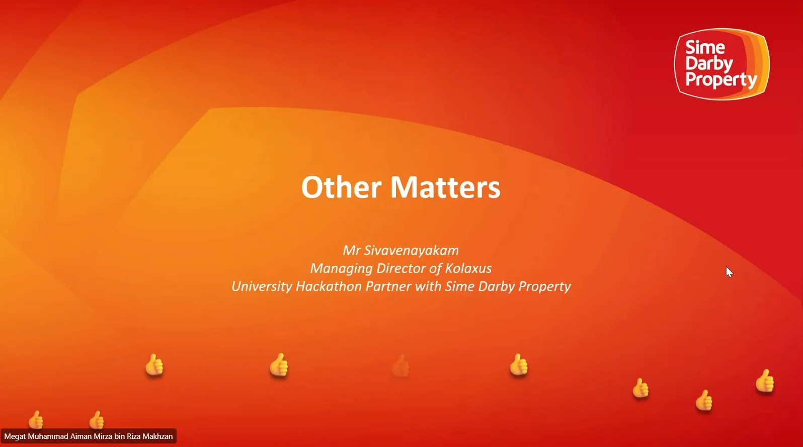

On screen from 42:16 in the recording.

Other Matters

Mr Sivavenayakam

Managing Director of Kolaxus

University Hackathon Partner with Sime Darby Property

Visuals: Full-bleed orange-to-red gradient with curved lighter bands. White title and white italic speaker lines, centred. Sime Darby Property logo top right. Scattered yellow thumbs-up emoji along the bottom edge look like Teams reaction overlays, not slide art, so they are not transcribed.

## Slide 33: Terms of hackathon

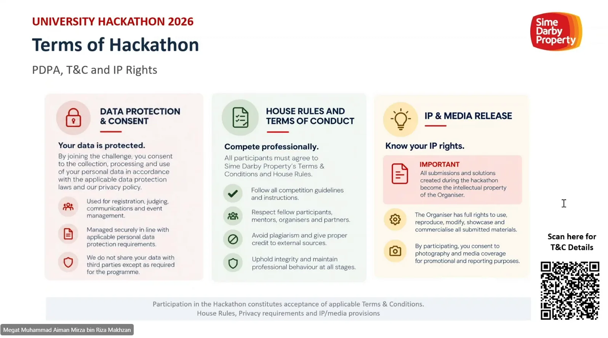

On screen from 42:26 in the recording.

UNIVERSITY HACKATHON 2026

PDPA, T&C and IP Rights

**DATA PROTECTION & CONSENT**

**Your data is protected.**

By joining the challenge, you consent to the collection, processing and use of your personal data in accordance with the applicable data protection laws and our privacy policy.

- Used for registration, judging, communications and event management.
- Managed securely in line with applicable personal data protection requirements.
- We do not share your data with third parties except as required for the programme.

**HOUSE RULES AND TERMS OF CONDUCT**

**Compete professionally.**

All participants must agree to Sime Darby Property’s Terms & Conditions and House Rules.

- Follow all competition guidelines and instructions.
- Respect fellow participants, mentors, organisers and partners.
- Avoid plagiarism and give proper credit to external sources.
- Uphold integrity and maintain professional behaviour at all stages.

**IP & MEDIA RELEASE**

**Know your IP rights.**

Boxed callout, as printed:

**IMPORTANT**

All submissions and solutions created during the hackathon become the intellectual property of the Organiser.

- The Organiser has full rights to use, reproduce, modify, showcase and commercialise all submitted materials.
- By participating, you consent to photography and media coverage for promotional and reporting purposes.

Footer band, line 1: Participation in the Hackathon constitutes acceptance of applicable Terms & Conditions.

Footer band, line 2: House Rules, Privacy requirements and IP/media provisions

Right-hand callout: Scan here for T&C Details

QR code, caption "Scan here for T&C Details". Decodes to: https://simedarbyproperty.com/universityhackathon/terms-and-conditions/

Visuals: Three cards side by side. Left card is pale red with a red padlock icon in a pink circle. Middle card is pale green with a green checklist-document icon in a green circle. Right card is pale yellow with a yellow lightbulb icon in a yellow circle. Red underline accents sit under each card heading. Bullet icons: red group, red document, red shield (data); green checkmark, green group, green circle-slash, green shield (house rules); gold gear, gold camera (IP). The IMPORTANT box is pale red with a red document icon. Footer is a pale blue-grey band. Sime Darby Property logo top right. Black I-beam mouse cursor on the right is ignored.

## Slide 34: Selected finalists must attend physically

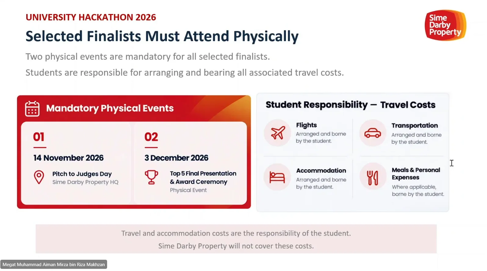

On screen from 45:09 in the recording.

UNIVERSITY HACKATHON 2026

Two physical events are mandatory for all selected finalists.

Students are responsible for arranging and bearing all associated travel costs.

**Mandatory Physical Events**

- **01**: 14 November 2026. Pitch to Judges Day, Sime Darby Property HQ.
- **02**: 3 December 2026. Top 5 Final Presentation & Award Ceremony. Physical Event.

**Student Responsibility — Travel Costs**

| Item                      | Responsibility                          |
| ------------------------- | --------------------------------------- |
| Flights                   | Arranged and borne by the student.      |
| Transportation            | Arranged and borne by the student.      |
| Accommodation             | Arranged and borne by the student.      |
| Meals & Personal Expenses | Where applicable, borne by the student. |

Footer band, line 1: Travel and accommodation costs are the responsibility of the student.

Footer band, line 2: Sime Darby Property will not cover these costs.

Visuals: Left card is solid red with an orange corner sweep and a white calendar icon. It holds two white inner tiles, 01 and 02, each with a red numeral and underline. Tile 01 has a red location-pin icon. Tile 02 has a red trophy icon. Right card is near-white with red line icons on pale pink circles: aeroplane (Flights), car (Transportation), bed (Accommodation), fork and knife (Meals). Footer band is pale pink. Sime Darby Property logo top right. Black I-beam mouse cursor is ignored.

## Slide 35: Stay connected

On screen from 46:05 in the recording.

UNIVERSITY HACKATHON 2026

Participants will have access to a dedicated communication and support channel throughout the Hackathon programme.

Left red card, as printed:

- Support Platform
- Telegram Link
- Details will be shared through official programme channels after submission.

QR code, no separate caption. Decodes to: https://t.me/+cJZO7xI1KJM4NmVl

**What the Channel Covers**

- Challenge questions and clarifications
- Submission questions and guidance
- Technical support
- Programme reminders and updates
- Clarifications and FAQs

Visuals: Left card is a red-to-orange panel with a white paper-plane (Telegram) icon in a translucent circle. A white square QR code sits bottom right of the card. Right column has five items, each with a red line icon on a pale pink circle: speech bubbles, document, gear, bell, question mark. Sime Darby Property logo top right. Black I-beam mouse cursor is ignored.

## Slide 36: Your next move

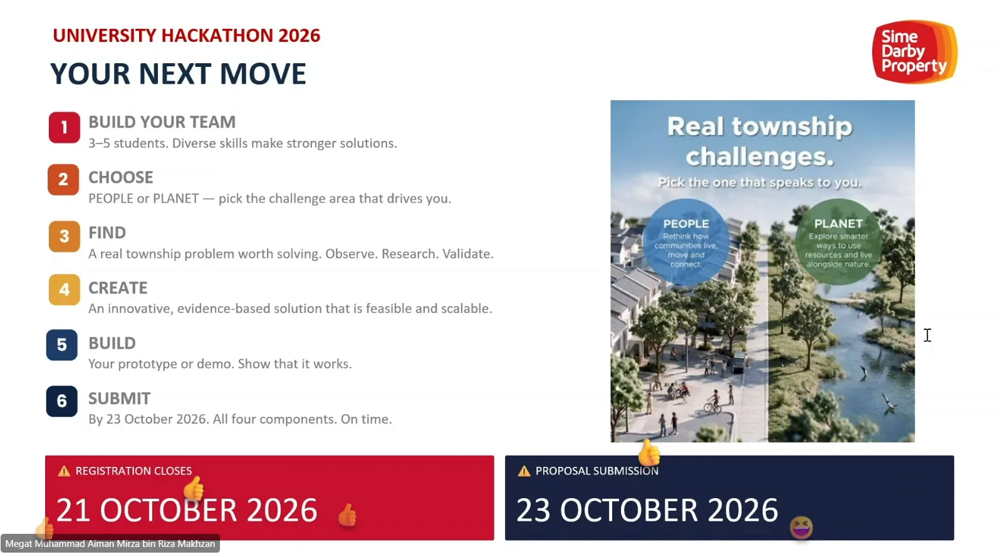

On screen from 46:32 in the recording.

UNIVERSITY HACKATHON 2026

1. **BUILD YOUR TEAM**: 3–5 students. Diverse skills make stronger solutions.
2. **CHOOSE**: PEOPLE or PLANET — pick the challenge area that drives you.
3. **FIND**: A real township problem worth solving. Observe. Research. Validate.
4. **CREATE**: An innovative, evidence-based solution that is feasible and scalable.
5. **BUILD**: Your prototype or demo. Show that it works.
6. **SUBMIT**: By 23 October 2026. All four components. On time.

Poster text, as printed:

- Real township challenges.
- Pick the one that speaks to you.
- PEOPLE (blue circle): Rethink how communities live, move and connect.
- PLANET (green circle): Explore smarter ways to use resources and live alongside nature.

Red date box, as printed:

- REGISTRATION CLOSES
- 21 OCTOBER 2026

Navy date box, as printed:

- PROPOSAL SUBMISSION
- 23 OCTOBER 2026

Visuals: Six numbered step badges in a colour ramp from red (1) through orange and amber (4) to dark blue and navy (5 and 6). Step labels are grey caps. Right side is a tall portrait poster of an aerial township rendering: houses, tree-lined street, people and a cyclist on a plaza, and a river with birds on the right. Blue circle overlay marks PEOPLE and green circle overlay marks PLANET. The red date tile marks registration close and the navy tile marks proposal submission. Each date tile has an amber warning-triangle icon. Sime Darby Property logo top right. Floating thumbs-up and grinning emoji over the slide look like Teams reaction overlays, not slide content, so they are not transcribed.

## Slide 37: Questions

On screen from 48:15 in the recording.

QUESTIONS?

Ask us anything in the chat box

Ask us anything about the challenge, submission or programme journey.

Sime Darby Property University Hackathon 2026 · Township of Tomorrow

9 OCTOBER 2026

Visuals: White background with faint grey curved swooshes. "QUESTIONS?" is small dark navy caps at top centre. "Ask us anything in the chat box" is large red text across the centre. A thin grey horizontal rule sits under the subtitle. Date line has a small calendar icon. Sime Darby Property logo top right. Black I-beam mouse cursor is ignored.
