# Opening briefing slides

Every slide shown during the Sime Darby Property University Hackathon 2026 opening briefing on 9 October 2026, each with its image and its text. The [transcript](transcript.md) covers what was said and the [meeting chat](chat.md) what attendees typed.

Contents:

1.  [Slide 01: Sime Darby Property logo](#slide-01-sime-darby-property-logo)
1.  [Slide 02: Message from the Group Managing Director and CEO](#slide-02-message-from-the-group-managing-director-and-ceo)
1.  [Slide 03: Meet Sime Darby Property](#slide-03-meet-sime-darby-property)
1.  [Slide 04: Purpose, vision, mission and core values](#slide-04-purpose-vision-mission-and-core-values)
1.  [Slide 05: Shaping Malaysia's urban landscape for over five decades](#slide-05-shaping-malaysias-urban-landscape-for-over-five-decades)
1.  [Slide 06: Recent company highlights and milestones](#slide-06-recent-company-highlights-and-milestones)
1.  [Slide 07: Business segments overview](#slide-07-business-segments-overview)
1.  [Slide 08: Property development footprint](#slide-08-property-development-footprint)
1.  [Slide 09: Commitment to sustainability](#slide-09-commitment-to-sustainability)
1.  [Slide 10: University Hackathon 2026 section title](#slide-10-university-hackathon-2026-section-title)
1.  [Slide 11: Message from the Chief Digital and Technology Officer](#slide-11-message-from-the-chief-digital-and-technology-officer)
1.  [Slide 12: Video message still, Elmen Tan](#slide-12-video-message-still-elmen-tan)
1.  [Slide 13: Why Township of Tomorrow](#slide-13-why-township-of-tomorrow)
1.  [Slide 14: How might we reimagine the Township of Tomorrow](#slide-14-how-might-we-reimagine-the-township-of-tomorrow)
1.  [Slide 15: Challenge theme 1, People](#slide-15-challenge-theme-1-people)
1.  [Slide 16: People problems and ideas](#slide-16-people-problems-and-ideas)
1.  [Slide 17: Challenge theme 2, Planet](#slide-17-challenge-theme-2-planet)
1.  [Slide 18: Planet problems and ideas](#slide-18-planet-problems-and-ideas)
1.  [Slide 19: From a big challenge to a great idea](#slide-19-from-a-big-challenge-to-a-great-idea)
1.  [Slide 20: What makes a strong solution](#slide-20-what-makes-a-strong-solution)
1.  [Slide 21: The journey begins](#slide-21-the-journey-begins)
1.  [Slide 22: Your hackathon journey](#slide-22-your-hackathon-journey)
1.  [Slide 23: Submission deadline](#slide-23-submission-deadline)
1.  [Slide 24: What your pitch deck should cover](#slide-24-what-your-pitch-deck-should-cover)
1.  [Slide 25: Example pitch deck walkthrough](#slide-25-example-pitch-deck-walkthrough)
1.  [Slide 26: Judges criteria](#slide-26-judges-criteria)
1.  [Slide 27: Top 10 ideas refined by industry experts](#slide-27-top-10-ideas-refined-by-industry-experts)
1.  [Slide 28: Top 10 pitch and talent spotlight](#slide-28-top-10-pitch-and-talent-spotlight)
1.  [Slide 29: Final presentation and award ceremony](#slide-29-final-presentation-and-award-ceremony)
1.  [Slide 30: Prize structure and winner pathway](#slide-30-prize-structure-and-winner-pathway)
1.  [Slide 31: Journey to build your idea and career](#slide-31-journey-to-build-your-idea-and-career)
1.  [Slide 32: Other matters](#slide-32-other-matters)
1.  [Slide 33: Terms of hackathon](#slide-33-terms-of-hackathon)
1.  [Slide 34: Selected finalists must attend physically](#slide-34-selected-finalists-must-attend-physically)
1.  [Slide 35: Stay connected](#slide-35-stay-connected)
1.  [Slide 36: Your next move](#slide-36-your-next-move)
1.  [Slide 37: Questions](#slide-37-questions)

## Slide 01: Sime Darby Property logo

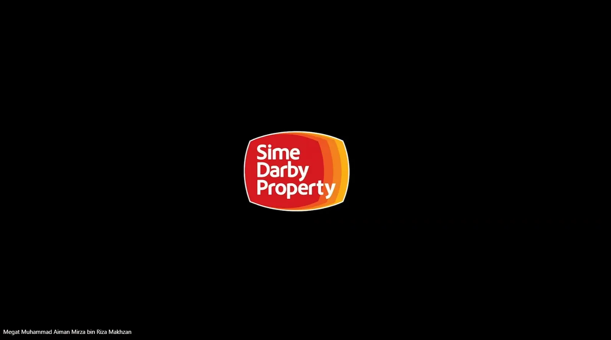

_No text besides the Sime Darby Property logo._

## Slide 02: Message from the Group Managing Director and CEO

**Message from Group Managing Director & Chief Executive Officer**

**VIDEO MESSAGE**

**Dato’ Seri Azmir Merican**

Group Managing Director & Chief Executive Officer

Sime Darby Property

**Watch the Opening Message**

Dato’ Seri Azmir Merican shares why Sime Darby Property is inviting university students to help shape the future of township living.

## Slide 03: Meet Sime Darby Property

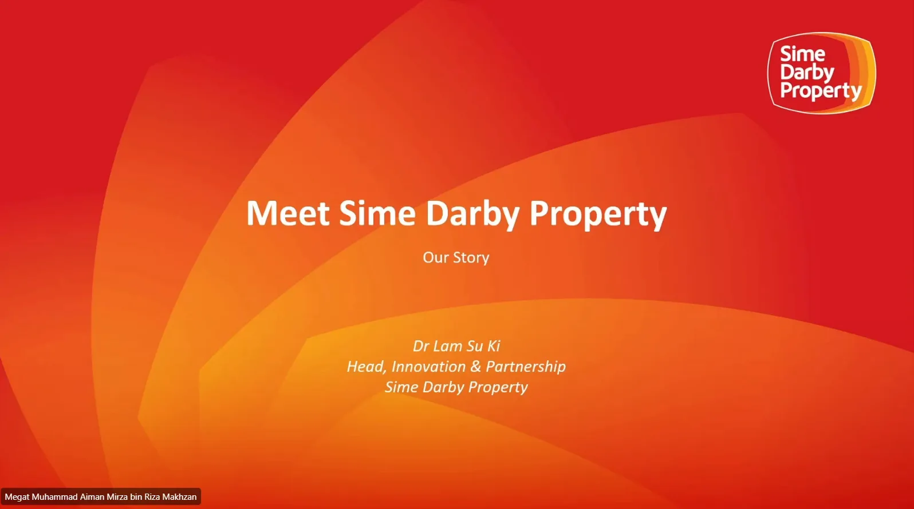

**Meet Sime Darby Property**

Our Story

_Dr Lam Su Ki_

_Head, Innovation & Partnership_

_Sime Darby Property_

## Slide 04: Purpose, vision, mission and core values

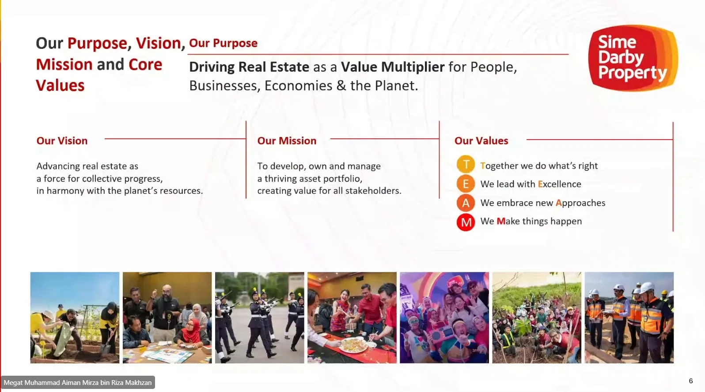

**Our Purpose, Vision, Mission and Core Values**

**Our Purpose**

**Driving Real Estate** as a **Value Multiplier** for People, Businesses, Economies & the Planet.

**Our Vision**

Advancing real estate as a force for collective progress, in harmony with the planet’s resources.

**Our Mission**

To develop, own and manage a thriving asset portfolio, creating value for all stakeholders.

**Our Values**

| Badge | Value                           |
| ----- | ------------------------------- |
| T     | **T**ogether we do what’s right |
| E     | We lead with **E**xcellence     |
| A     | We embrace new **A**pproaches   |
| M     | We **M**ake things happen       |

## Slide 05: Shaping Malaysia's urban landscape for over five decades

**Shaping Malaysia’s Urban Landscape for Over Five Decades**

Sime Darby Property is a real estate company recognised for township excellence, sustainability and a trusted developer with scale, stability and a long-term commitment to nation and community building.

- London, United Kingdom
- Malaysia
  - Kedah
  - Selangor
  - Kuala Lumpur
  - Negeri Sembilan
  - Johor
- Melbourne, Australia

Listed on Main Market of Bursa Malaysia

**RM10bil**

Market capitalisation

One of the largest property developers with landbank of

**~11,400 acres**

translating to GDV of over ~RM105bil

**28**

Active townships and integrated developments across Klang Valley, Negeri Sembilan, and Johor, including London and Melbourne

**2**

Overseas developments in London and Melbourne

| Logo                                                         | Text                                                                                                                  |
| ------------------------------------------------------------ | --------------------------------------------------------------------------------------------------------------------- |
| BURSA MALAYSIA                                               | Constituent of FTSE Bursa Malaysia Mid 70 Index                                                                       |
| FTSE4Good                                                    | Constituent of FTSE4Good Bursa Malaysia Index FTSE4Good Bursa Malaysia Shariah Index                               |
| MSCI ESG RATINGS BBB (scale: CCC B BB BBB A AA AAA)          | Constituent of MSCI ACWI Small Cap Index                                                                              |
| MARC                                                         | AA+ rating on the RM4.5b Sukuk Musharakah programme                                                                   |
| THE EDGE MALAYSIA                                            | Ranked 1st Top Developer for 2 consecutive years (2024 & 2025) The Edge Malaysia Top Property Developers Awards |
| CDP                                                          | Only Malaysian Property Company with a B Rating by Carbon Disclosure Project (CDP)                                    |
| TIME WORLD’S BEST COMPANIES SUSTAINABLE GROWTH statista 2025 | Ranked 75th on TIME & Statista’s 2026 World’s Best Companies in Sustainable Growth 2026                               |
| FORTUNE SOUTHEAST ASIA 500 2026                              | Ranked 287th on the Fortune Southeast Asia 500 list 2026                                                              |

## Slide 06: Recent company highlights and milestones

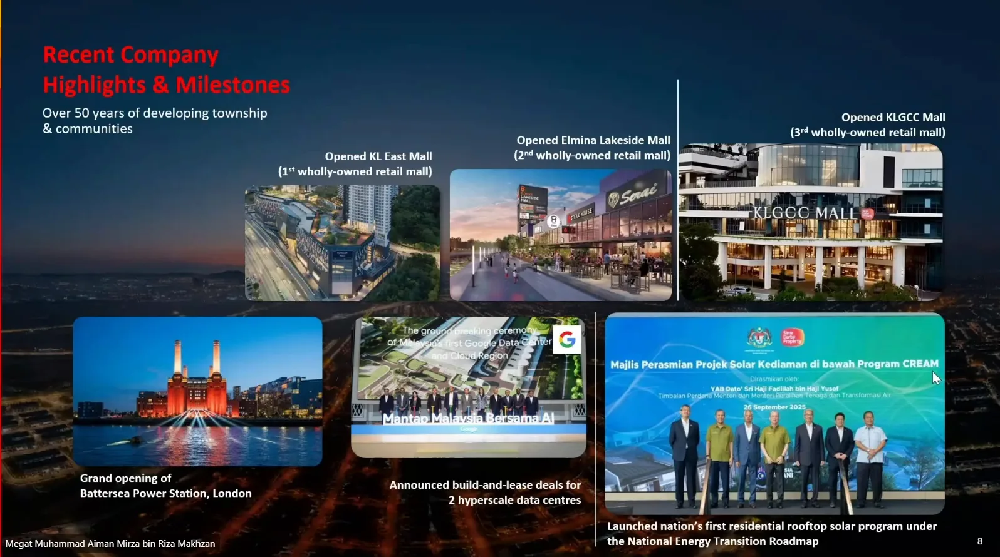

**Recent Company Highlights & Milestones**

Over 50 years of developing township & communities

- **Opened KL East Mall (1st wholly-owned retail mall)**
- **Opened Elmina Lakeside Mall (2nd wholly-owned retail mall)**
- **Opened KLGCC Mall (3rd wholly-owned retail mall)**
- **Grand opening of Battersea Power Station, London**
- **Announced build-and-lease deals for 2 hyperscale data centres**
- **Launched nation’s first residential rooftop solar program under the National Energy Transition Roadmap**

## Slide 07: Business segments overview

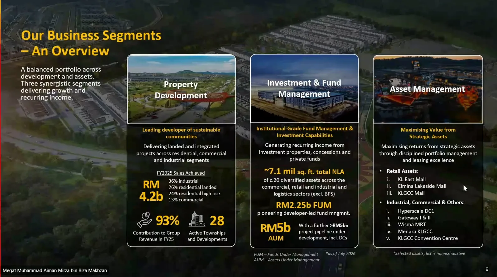

**Our Business Segments – An Overview**

A balanced portfolio across development and assets. Three synergistic segments delivering growth and recurring income.

**Property Development**

**Leading developer of sustainable communities**

Delivering landed and integrated projects across residential, commercial and industrial segments

FY2025 Sales Achieved

**RM 4.2b**

- 36% industrial
- 26% residential landed
- 24% residential high rise
- 13% commercial

**93%** Contribution to Group Revenue in FY25

**28** Active Townships and Developments

**Investment & Fund Management**

**Institutional-Grade Fund Management & Investment Capabilities**

Generating recurring income from investment properties, concessions and private funds

**~7.1 mil sq. ft. total NLA** of c.20 diversified assets across the commercial, retail and industrial and logistics sectors (excl. BPS)

**RM2.25b FUM** pioneering developer-led fund mngmnt.

**RM5b AUM** With a further **>RM5bn** project pipeline under development, incl. DCs

_FUM – Funds Under Management_

_AUM – Assets Under Management_

_\*as of July 2026_

**Asset Management**

**Maximising Value from Strategic Assets**

Maximising returns from strategic assets through disciplined portfolio management and leasing excellence

- **Retail Assets**:
  - i. KL East Mall
  - ii. Elmina Lakeside Mall
  - iii. KLGCC Mall
- **Industrial, Commercial & Others:**
  - i. Hyperscale DC1
  - ii. Gateway I & II
  - iii. Wisma MRT
  - iv. Menara KLGCC
  - v. KLGCC Convention Centre

_\*Selected assets; list is non-exhaustive_

## Slide 08: Property development footprint

**Property Development Footprint**

One of the largest master developers in Malaysia with 28 Townships in Malaysia & 2 Overseas Developments

**Kedah**

**Upcoming Township (Gurun)**

**Selangor**

**Township Developments**

| Logo              | Acreage     |
| ----------------- | ----------- |
| Bukit Jelutong    | 2,205 Acres |
| City of ELMINA    | 6,337 Acres |
| BANDAR BUKIT RAJA | 4,332 Acres |
| PUTRA HEIGHTS     | 1,711 Acres |
| SERENiA CITY      | 2,370 Acres |
| SAUJANA IMPIAN    | 613 Acres   |
| USJ HEIGHTS       | 375 Acres   |

**Integrated Developments**

| Logo                         | Acreage   |
| ---------------------------- | --------- |
| SJ7                          | 35 Acres  |
| SJCC Subang Jaya City Centre | 30 Acres  |
| ARA DAMANSARA                | 693 Acres |

**Kuala Lumpur**

**Signature Developments**

| Logo            | Acreage  |
| --------------- | -------- |
| KLGCC RESORT[?] | 84 Acres |

**Integrated Developments**

| Logo     | Acreage   |
| -------- | --------- |
| KL EAST  | 160 Acres |
| MELAWATI | 882 Acres |

**Negeri Sembilan**

**Township Developments**

| Logo                                | Acreage     |
| ----------------------------------- | ----------- |
| NILAI IMPIAN                        | 1,809 Acres |
| Planters Haven                      | 270 Acres   |
| Chemara Hills SEREMBAN[?]           | 44 Acres    |
| Bandar Ainsdale                     | 562 Acres   |
| Hamilton City                       | 892 Acres   |
| VISION BUSINESS PARK NILAI SOUTH[?] | 760 Acres   |

**Johor**

**Township**

| Logo                    | Acreage     |
| ----------------------- | ----------- |
| TAMAN PASIR PUTIH       | 675 Acres   |
| BANDAR UNIVERSITI PAGOH | 4,098 Acres |

**London, United Kingdom**

BATTERSEA POWER STATION

**Melbourne, Australia**

Notes:

- All acreage shown reflects Total Developable Area.
- Not all Townships & Developments are illustrated in the diagram.
- Including JV Developments

## Slide 09: Commitment to sustainability

**Our Commitment to Sustainability**

**Building Communities that Endure**

Clear targets, real progress, and measurable impact

**2024 Sustainability Highlights**

**Key milestones that reflect our ongoing commitment to environmental stewardship, social impact, and responsible governance.**

- **30,100** Endangered, Rare & Threatened (“ERT”) Species of trees planted since 2011
- **Planted 1,450 trees** Along a 500-metre stretch of the Elmina Urban Biodiversity Corridor
- **9** rooftop solar photovoltaic installed with a capacity of 603 kWp
- **90.3%** of operations assessed for biodiversity risks
- **983** employees trained in health and Safety _138% increase from 2023_
- **3 Star** FTSE4Good Bursa Malaysia Index _Reinclusion in 2024_
- **0.26%** Lost Time Injury Frequency Rate
- **B rating** in the Carbon Disclosure Project (“CDP”) _An increase from C to B rating_
- More than **70,000** beneficiaries of community programmes and spaces, with a total economic spend of **RM20.8 million**
- **50%** waste diversion rate
- **106,130 hours** of learning and training recorded
- **33%** female board members
- **44%** female representation in the workforce

**Our Sustainability Strategy 2025-2030**

**Our Purpose**

Driving Real Estate as a Value Multiplier for People, Businesses, Economies & the Planet.

**Our Vision**

Advancing real estate as a force for collective progress, in harmony with the planet's resources

**Fostering Resilient Communities**

- Reduce operational emissions by 40% and enrich urban biodiversity (covers Energy Low Carbon and Urban Biodiversity)
- Create climate resilience and socio-economic value through shared value partnerships (covers Climate Resilience and Community Experience)

| Pillar                   | 2030 Targets                                                                                           |
| ------------------------ | ------------------------------------------------------------------------------------------------------ |
| **Energy Low Carbon**    | Reduce 40% Scope 1 & Scope 2 emissions intensity                                                       |
| **Urban Biodiversity**   | Achieve net biodiversity positive status through Avoidance, Restoration and Conservation (ARC) efforts |
| **Climate Resilience**   | Establish climate adaptation and resilience plans for high-risk assets                                 |
| **Community Experience** | Deliver positive community experience through social value integration                                 |

**Announcement of Net Zero Targets by end-FY2023**

- **Current focus on reducing Scope 1 and 2 emissions** whilst baselining Scope 3
- Scope 1 and 2 carbon reduction targets is referenced against SBTi, measuring from our FY2021 baseline emissions
  - **40% reduction** of absolute carbon emissions **by 2030**
  - **Achieving Net Zero Emissions by 2050**
- Continuous assessment of our external indicators

## Slide 10: University Hackathon 2026 section title

**Sime Darby Property University Hackathon 2026**

## Slide 11: Message from the Chief Digital and Technology Officer

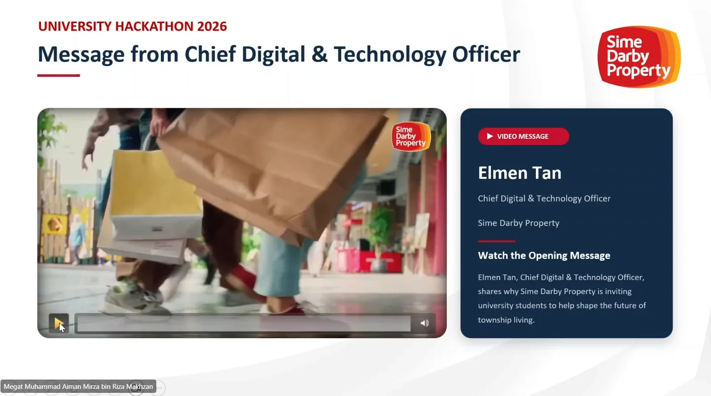

**Message from Chief Digital & Technology Officer**

**VIDEO MESSAGE**

**Elmen Tan**

Chief Digital & Technology Officer

Sime Darby Property

**Watch the Opening Message**

Elmen Tan, Chief Digital & Technology Officer, shares why Sime Darby Property is inviting university students to help shape the future of township living.

## Slide 12: Video message still, Elmen Tan

**Mr. Elmen Tan**

Chief Digital and Technology Officer

Sime Darby Property

At Sime Darby Property, we believe the future belongs to those (video subtitle)

## Slide 13: Why Township of Tomorrow

**Why Township of Tomorrow?**

**We build homes. But a home is only the beginning of a life.**

Families move into our townships and live there for decades. We asked ourselves a simple question: how do we help them keep living sustainably long after the keys are handed over?

That is where we challenge ourselves — to multiply the value of a township even after we have fulfilled our responsibility as a developer.

**Now we are sharing that challenge with you.**

**Imagine the township of tomorrow — and help us build it.**

**_This is not just about buildings. It is about how people live._**

**TOWNSHIP OF TOMORROW**

Sime Darby Property University Hackathon is here. Shape the future of sustainable, smart & connected townships.

## Slide 14: How might we reimagine the Township of Tomorrow

**HOW MIGHT WE REIMAGINE THE TOWNSHIP OF TOMORROW?**

**PEOPLE**

How might we enable every resident to live healthier, safer, more connected and more fulfilling lives.

**PLANET**

How might we create townships that regenerate the environment while making sustainable living effortless for communities, residents and businesses?

**CHOOSE ONE FOCUS AREA**

## Slide 15: Challenge theme 1, People

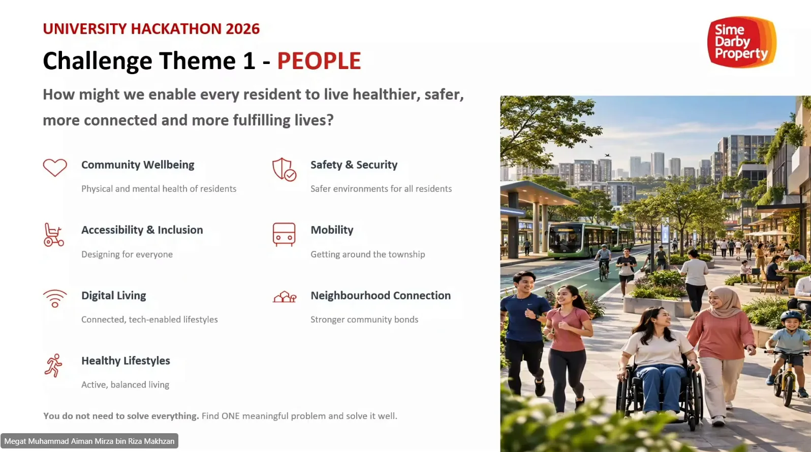

**Challenge Theme 1 - PEOPLE**

**How might we enable every resident to live healthier, safer, more connected and more fulfilling lives?**

| Theme                         | Description                             |
| ----------------------------- | --------------------------------------- |
| **Community Wellbeing**       | Physical and mental health of residents |
| **Safety & Security**         | Safer environments for all residents    |
| **Accessibility & Inclusion** | Designing for everyone                  |
| **Mobility**                  | Getting around the township             |
| **Digital Living**            | Connected, tech-enabled lifestyles      |
| **Neighbourhood Connection**  | Stronger community bonds                |
| **Healthy Lifestyles**        | Active, balanced living                 |

**You do not need to solve everything.** Find ONE meaningful problem and solve it well.

## Slide 16: People problems and ideas

**PEOPLE: problems and ideas**

A PEOPLE problem is a difficulty residents face in daily life. The solution is what should improve their experience.

| PROBLEM TO SOLVE                                                                                                                                     | POTENTIAL SOLUTION                                                                                                                                                                                                   |
| ---------------------------------------------------------------------------------------------------------------------------------------------------- | -------------------------------------------------------------------------------------------------------------------------------------------------------------------------------------------------------------------- |
| **Finding parking at a mall** Shoppers circle crowded parking levels looking for a vacant bay, wasting time and adding stress to their visit.        | **Prebooked Parking APP** Guide drivers to zones with pre-booked free bays. Prototype a parking map using simulated occupancy data. _Test: less time spent finding a parking bay._                                   |
| **Getting help for public assets** Residents waste time chasing updates because they do not know whom to contact or how to track an issue.           | **One reporting channel** One resident hub for services, shopping, retails, bookings, requests and updates — turning scattered touchpoints into a single experience. _Test: fewer follow-ups and faster resolution._ |
| **Missed deliveries and parcel collection** Residents miss deliveries while at work or waste time finding parcels left at a shared collection point. | **Secure parcel collection** Log parcels at a secure collection point, notify residents of the location and issue a one-time collection code. _Test: faster retrieval and fewer collection errors._                  |

**Who faces the problem? How often? What would improve if you solved it?**

Illustrative examples only. Validate the problem with residents before developing your solution.

## Slide 17: Challenge theme 2, Planet

**Challenge Theme 2 - PLANET**

**How might we create townships that regenerate the environment and make sustainable living effortless?**

| Theme                  | Description                                 |
| ---------------------- | ------------------------------------------- |
| **Waste Management**   | Reducing and managing waste effectively     |
| **Circular Economy**   | Closing resource loops                      |
| **Energy Efficiency**  | Smarter energy use across the township      |
| **Water Conservation** | Protecting and managing water resources     |
| **Green Transport**    | Low-carbon mobility solutions               |
| **Biodiversity**       | Protecting and restoring natural ecosystems |
| **Climate Resilience** | Adapting to climate change impacts          |

**Think beyond awareness.** How could your solution change behaviour, systems or outcomes?

## Slide 18: Planet problems and ideas

**PLANET: problems and ideas**

A PLANET problem involves waste or environmental harm. The solution should make sustainable living easier.

| PROBLEM TO SOLVE                                                                                                                               | POTENTIAL SOLUTION                                                                                                                                                                                         |
| ---------------------------------------------------------------------------------------------------------------------------------------------- | ---------------------------------------------------------------------------------------------------------------------------------------------------------------------------------------------------------- |
| **Confusion about recycling** Residents are unsure what collectors accept or where to take items, so recyclables enter general waste.          | **Local recycling guide and collection** Check accepted items and book local collections. Prototype a sorting guide and booking journey. _Test: more material accepted for recycling._                     |
| **Choosing the right sites for solar** Developers need to prioritise rooftops and car parks for detailed solar feasibility studies.            | **Solar opportunity mapper** Rank sites by usable area, shading and electricity demand. Flag missing data and engineering checks. _Test: shortlist quality against expert assessments._                    |
| **Comparing greener building materials** Project teams struggle to compare environmental claims alongside cost, durability and specifications. | **Material comparison AI Assistant Agent** Compare materials for one use with equivalent performance requirements. Flag missing environmental evidence. _Test: comparison accuracy and time to shortlist._ |
| **Proving waste-derived materials work** A recycled-content product needs evidence of suitable performance and lower environmental impact.     | **Non-structural material prototype** Develop a landscape edging sample and a test plan. Check safety, performance and environmental impact. _Test: results against a conventional alternative._           |

**What is being harmful to PLANET? Why? How would you measure the environmental improvement?**

Illustrative examples only. Validate the problem with residents and operators before developing your solution.

## Slide 19: From a big challenge to a great idea

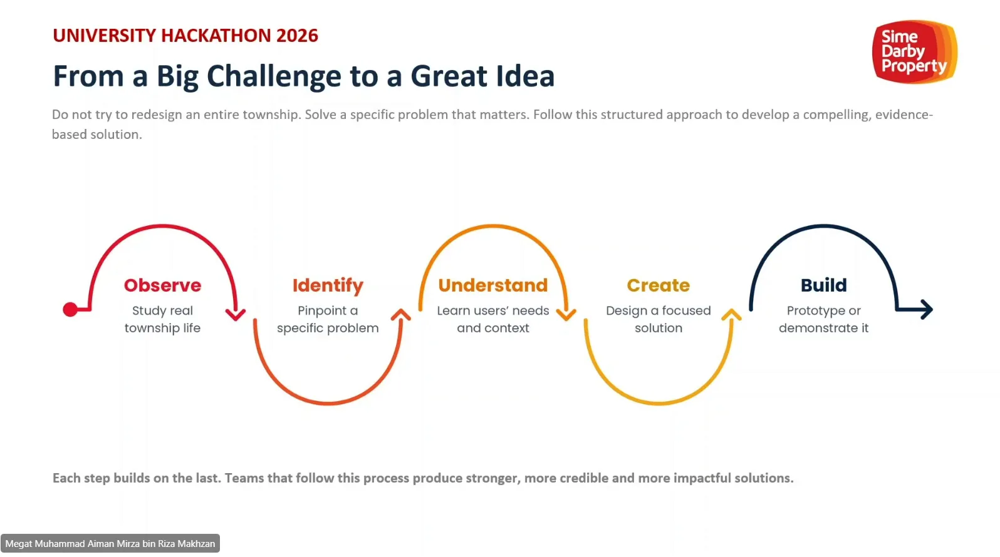

**From a Big Challenge to a Great Idea**

Do not try to redesign an entire township. Solve a specific problem that matters. Follow this structured approach to develop a compelling, evidence-based solution.

| Step           | Description                    |
| -------------- | ------------------------------ |
| **Observe**    | Study real township life       |
| **Identify**   | Pinpoint a specific problem    |
| **Understand** | Learn users’ needs and context |
| **Create**     | Design a focused solution      |
| **Build**      | Prototype or demonstrate it    |

**Each step builds on the last. Teams that follow this process produce stronger, more credible and more impactful solutions.**

## Slide 20: What makes a strong solution

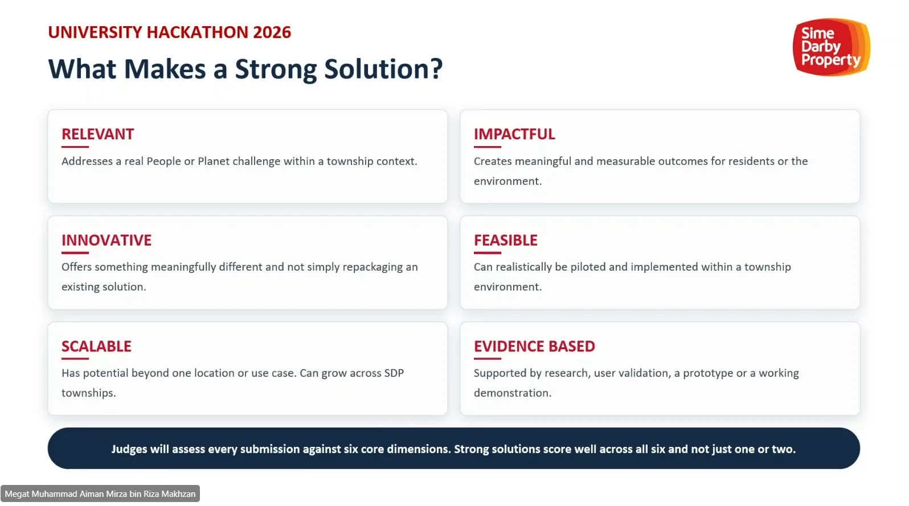

**What Makes a Strong Solution?**

**RELEVANT**

Addresses a real People or Planet challenge within a township context.

**IMPACTFUL**

Creates meaningful and measurable outcomes for residents or the environment.

**INNOVATIVE**

Offers something meaningfully different and not simply repackaging an existing solution.

**FEASIBLE**

Can realistically be piloted and implemented within a township environment.

**SCALABLE**

Has potential beyond one location or use case. Can grow across SDP townships.

**EVIDENCE BASED**

Supported by research, user validation, a prototype or a working demonstration.

**Judges will assess every submission against six core dimensions. Strong solutions score well across all six and not just one or two.**

## Slide 21: The journey begins

**The Journey Begins…**

_Shahidah Salam (Dina)_

_Manager, Innovation & Partnership_

_Sime Darby Property_

## Slide 22: Your hackathon journey

**Your Hackathon Journey**

Key milestones from briefing to Final Presentation & Award Ceremony.

| Date          | Milestone                                          |
| ------------- | -------------------------------------------------- |
| **9 OCT**     | Challenge Briefing                                 |
| **21 OCT**    | Registration Closes (key deadline)                 |
| **23 OCT**    | Proposal Submission (key deadline)                 |
| **24–28 OCT** | Evaluation & Judging                               |
| **28 OCT**    | Top 10 Announced                                   |
| **2–6 NOV**   | Mentoring Sprint                                   |
| **11 NOV**    | Final Submission                                   |
| **14 NOV**    | Pitch to Judges (key deadline)                     |
| **17 NOV**    | Top 3 Notified                                     |
| **3 DEC**     | Top 3 Presentation & Award Ceremony (key deadline) |

**THE TWO CRITICAL DEADLINES**

**21 October: Registration closes | 23 October: Proposal submission**

## Slide 23: Submission deadline

**Submission Deadline**

ALL teams must submit the following four components by **11:59 P.M., 23 October 2026**.

Incomplete submissions will not be considered.

| Component                | Status   | Description                                                                   |
| ------------------------ | -------- | ----------------------------------------------------------------------------- |
| **Pitch Deck**           | REQUIRED | Maximum 10 main slides. Appendix allowed for supporting details.              |
| **Video / Demo Link**    | REQUIRED | Mandatory. A 5-minute video or live demo link demonstrating your solution.    |
| **Prototype / Code**     | REQUIRED | Mandatory. Link to your prototype, codebase or GitHub repository.             |
| **Supporting Documents** | OPTIONAL | Additional links or documents where applicable to strengthen your submission. |

QR code ("Scan here to submit"): https://simedarbyproperty.com/universityhackathon/submission/

## Slide 24: What your pitch deck should cover

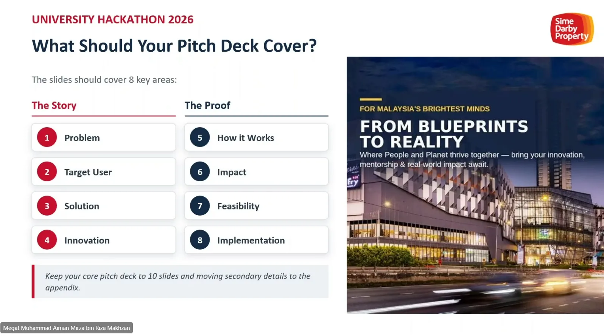

**What Should Your Pitch Deck Cover?**

The slides should cover 8 key areas:

**The Story**

1. **Problem**
2. **Target User**
3. **Solution**
4. **Innovation**

**The Proof**

5. **How it Works**
6. **Impact**
7. **Feasibility**
8. **Implementation**

_Keep your core pitch deck to 10 slides and moving secondary details to the appendix._

**FOR MALAYSIA'S BRIGHTEST MINDS**

**FROM BLUEPRINTS TO REALITY**

Where People and Planet thrive together — bring your innovation, mentorship & real-world impact await.

## Slide 25: Example pitch deck walkthrough

**Example: Pitch Deck Walkthrough**

**SCENARIO: Finding parking at a mall**

Shoppers circle crowded parking levels looking for a vacant bay, wasting time and adding stress to their visit.

**The Story**

**1 Problem**

Shoppers circle full parking levels at peak hours hunting for a bay, wasting time and adding stress.

**2 Target User**

Weekend and peak-hour mall visitors, especially families, plus mall operators managing car park traffic.

**3 Solution**

A mobile app and LED signs that show live vacant bays per level and guide drivers straight to a free spot.

**4 Innovation**

AI on existing CCTV detects free bays in real time, with no costly sensor per bay, and predicts availability.

**The Proof**

**5 How it Works**

Camera detects bay status → data sent to cloud → app and signs update live → driver follows guided route.

**6 Impact**

Less time circling, shorter ramp queues, lower fuel use and emissions, and a better shopping experience.

**7 Feasibility**

Uses proven tech and existing cameras; low setup cost; revenue from operator subscription or bay pre-booking.

**8 Implementation**

Pilot one car park level for 3 months, measure search time saved, then roll out mall-wide and to other malls.

_Tip: Carry one clear problem through every slide. Keep your core pitch deck to 10 slides and move secondary details to the appendix._

## Slide 26: Judges criteria

**Judges Criteria**

Each criterion has a specific question judges will ask when evaluating your submission. Understand what they are looking for and build your solution accordingly.

| Weight  | Criterion                             | Question                                                                                                       |
| ------- | ------------------------------------- | -------------------------------------------------------------------------------------------------------------- |
| **25%** | **Impact & Sustainability Value**     | Can the solution create meaningful and measurable resident, community or environmental outcomes?               |
| **20%** | **Innovation & Differentiation**      | Is there genuine originality or a differentiated approach rather than simply repackaging an existing solution? |
| **20%** | **Feasibility & Deliverability**      | Could the solution realistically be piloted and implemented within a township environment?                     |
| **15%** | **Strategic Fit & Theme Relevance**   | Does the idea clearly address a People or Planet challenge and an SDP township priority?                       |
| **10%** | **Commercial & Value Multiplication** | Could the solution create value for SDP, township businesses and/or residents and potentially scale?           |
| **10%** | **Team, Evidence & Pitch Quality**    | Has the team researched and validated the problem, developed a credible solution and communicated it clearly?  |

## Slide 27: Top 10 ideas refined by industry experts

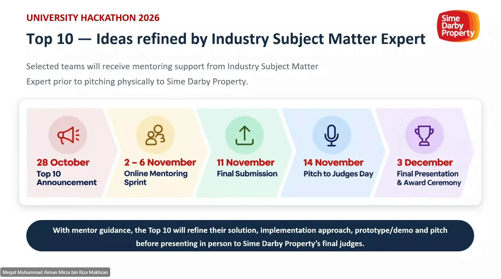

**Top 10 — Ideas refined by Industry Subject Matter Expert**

Selected teams will receive mentoring support from Industry Subject Matter Expert prior to pitching physically to Sime Darby Property.

| Date               | Stage                                   |
| ------------------ | --------------------------------------- |
| **28 October**     | **Top 10 Announcement**                 |
| **2 – 6 November** | **Online Mentoring Sprint**             |
| **11 November**    | **Final Submission**                    |
| **14 November**    | **Pitch to Judges Day**                 |
| **3 December**     | **Final Presentation & Award Ceremony** |

**With mentor guidance, the Top 10 will refine their solution, implementation approach, prototype/demo and pitch before presenting in person to Sime Darby Property’s final judges.**

## Slide 28: Top 10 pitch and talent spotlight

**Top 10 - Pitch & Talent Spotlight**

- 14 NOVEMBER 2026
- Sime Darby Property Office
- 9:30 A.M. – 5:00 P.M.

Physical attendance is compulsory for all selected finalists.

**Morning Session**

**Pitch Session**

9.30 AM – 1.00 PM

**Format & Participants**

| Duration   | Item           |
| ---------- | -------------- |
| **10 MIN** | Pitch per team |
| **5 MIN**  | Q&A per team   |

- **Judges:** Leaders from relevant Sime Darby Property teams.
- **Teams:** Top **10** finalist teams.

**Afternoon Session**

**Talent Spotlight**

2.30 PM – 5.30 PM

Every individual finalist will be given **5-10 minutes** to introduce themselves to Sime Darby Property. This session gives SDP an opportunity to identify students for potential internship and future talent opportunities.

**5-10 Minutes Session**

Career introduction per individual finalist.

**What to Cover in Your 5-10 Minutes**

- Who are you beyond your resume?
- What is the one trait that defines you the most?
- What makes you different from others?
- What’s your passion?
- What did you contribute to your team’s solution?
- What achievement or experience are you most proud of?

## Slide 29: Final presentation and award ceremony

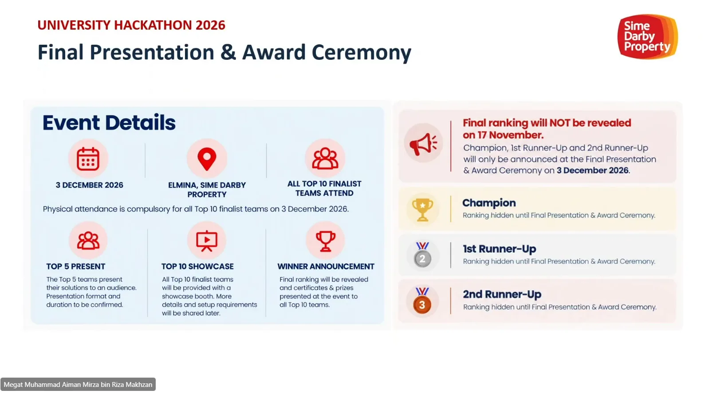

**Final Presentation & Award Ceremony**

**Event Details**

- **3 DECEMBER 2026**
- **ELMINA, SIME DARBY PROPERTY**
- **ALL TOP 10 FINALIST TEAMS ATTEND**

Physical attendance is compulsory for all Top 10 finalist teams on 3 December 2026.

**TOP 5 PRESENT**

The Top 5 teams present their solutions to an audience. Presentation format and duration to be confirmed.

**TOP 10 SHOWCASE**

All Top 10 finalist teams will be provided with a showcase booth. More details and setup requirements will be shared later.

**WINNER ANNOUNCEMENT**

Final ranking will be revealed and certificates & prizes presented at the event to all Top 10 teams.

**Final ranking will NOT be revealed on 17 November.**

Champion, 1st Runner-Up and 2nd Runner-Up will only be announced at the Final Presentation & Award Ceremony on **3 December 2026**.

| Rank              | Status                                                    |
| ----------------- | --------------------------------------------------------- |
| **Champion**      | Ranking hidden until Final Presentation & Award Ceremony. |
| **1st Runner-Up** | Ranking hidden until Final Presentation & Award Ceremony. |
| **2nd Runner-Up** | Ranking hidden until Final Presentation & Award Ceremony. |

## Slide 30: Prize structure and winner pathway

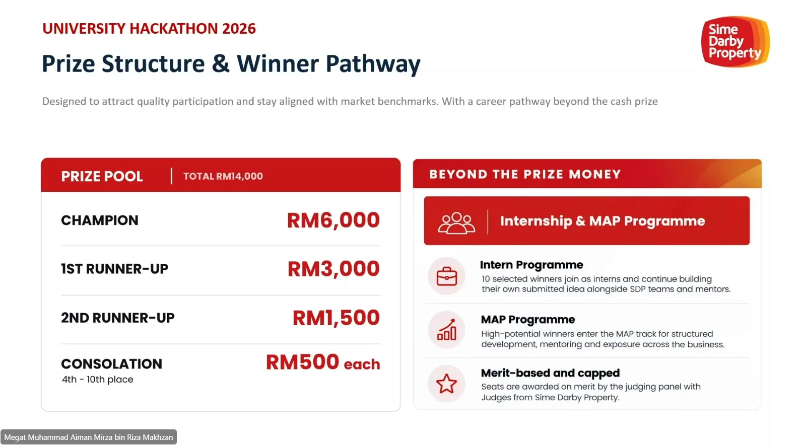

**Prize Structure & Winner Pathway**

Designed to attract quality participation and stay aligned with market benchmarks. With a career pathway beyond the cash prize

**PRIZE POOL | TOTAL RM14,000**

| Place                            | Prize          |
| -------------------------------- | -------------- |
| **CHAMPION**                     | **RM6,000**    |
| **1ST RUNNER-UP**                | **RM3,000**    |
| **2ND RUNNER-UP**                | **RM1,500**    |
| **CONSOLATION** 4th - 10th place | **RM500 each** |

**BEYOND THE PRIZE MONEY**

**Internship & MAP Programme**

| Item                       | Description                                                                                                         |
| -------------------------- | ------------------------------------------------------------------------------------------------------------------- |
| **Intern Programme**       | 10 selected winners join as interns and continue building their own submitted idea alongside SDP teams and mentors. |
| **MAP Programme**          | High-potential winners enter the MAP track for structured development, mentoring and exposure across the business.  |
| **Merit-based and capped** | Seats are awarded on merit by the judging panel with Judges from Sime Darby Property.                               |

## Slide 31: Journey to build your idea and career

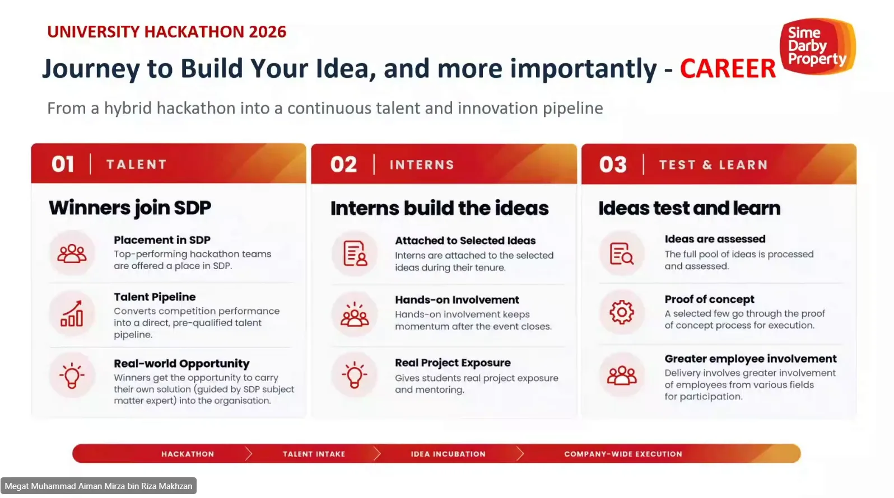

**Journey to Build Your Idea, and more importantly - CAREER**

From a hybrid hackathon into a continuous talent and innovation pipeline

**01 | TALENT**

**Winners join SDP**

| Item                       | Description                                                                                                          |
| -------------------------- | -------------------------------------------------------------------------------------------------------------------- |
| **Placement in SDP**       | Top-performing hackathon teams are offered a place in SDP.                                                           |
| **Talent Pipeline**        | Converts competition performance into a direct, pre-qualified talent pipeline.                                       |
| **Real-world Opportunity** | Winners get the opportunity to carry their own solution (guided by SDP subject matter expert) into the organisation. |

**02 | INTERNS**

**Interns build the ideas**

| Item                           | Description                                                     |
| ------------------------------ | --------------------------------------------------------------- |
| **Attached to Selected Ideas** | Interns are attached to the selected ideas during their tenure. |
| **Hands-on Involvement**       | Hands-on involvement keeps momentum after the event closes.     |
| **Real Project Exposure**      | Gives students real project exposure and mentoring.             |

**03 | TEST & LEARN**

**Ideas test and learn**

| Item                             | Description                                                                               |
| -------------------------------- | ----------------------------------------------------------------------------------------- |
| **Ideas are assessed**           | The full pool of ideas is processed and assessed.                                         |
| **Proof of concept**             | A selected few go through the proof of concept process for execution.                     |
| **Greater employee involvement** | Delivery involves greater involvement of employees from various fields for participation. |

**HACKATHON → TALENT INTAKE → IDEA INCUBATION → COMPANY-WIDE EXECUTION**

## Slide 32: Other matters

**Other Matters**

_Mr Sivavenayakam_

_Managing Director of Kolaxus_

_University Hackathon Partner with Sime Darby Property_

## Slide 33: Terms of hackathon

**Terms of Hackathon**

PDPA, T&C and IP Rights

**DATA PROTECTION & CONSENT**

**Your data is protected.**

By joining the challenge, you consent to the collection, processing and use of your personal data in accordance with the applicable data protection laws and our privacy policy.

- Used for registration, judging, communications and event management.
- Managed securely in line with applicable personal data protection requirements.
- We do not share your data with third parties except as required for the programme.

**HOUSE RULES AND TERMS OF CONDUCT**

**Compete professionally.**

All participants must agree to Sime Darby Property’s Terms & Conditions and House Rules.

- Follow all competition guidelines and instructions.
- Respect fellow participants, mentors, organisers and partners.
- Avoid plagiarism and give proper credit to external sources.
- Uphold integrity and maintain professional behaviour at all stages.

**IP & MEDIA RELEASE**

**Know your IP rights.**

**IMPORTANT**

All submissions and solutions created during the hackathon become the intellectual property of the Organiser.

- The Organiser has full rights to use, reproduce, modify, showcase and commercialise all submitted materials.
- By participating, you consent to photography and media coverage for promotional and reporting purposes.

Participation in the Hackathon constitutes acceptance of applicable Terms & Conditions.

House Rules, Privacy requirements and IP/media provisions

QR code ("Scan here for T&C Details"): https://simedarbyproperty.com/universityhackathon/terms-and-conditions/

## Slide 34: Selected finalists must attend physically

**Selected Finalists Must Attend Physically**

Two physical events are mandatory for all selected finalists.

Students are responsible for arranging and bearing all associated travel costs.

**Mandatory Physical Events**

| No.    | Date                 | Event                                         | Note                   |
| ------ | -------------------- | --------------------------------------------- | ---------------------- |
| **01** | **14 November 2026** | **Pitch to Judges Day**                       | Sime Darby Property HQ |
| **02** | **3 December 2026**  | **Top 5 Final Presentation & Award Ceremony** | Physical Event         |

**Student Responsibility — Travel Costs**

| Item                          | Responsibility                          |
| ----------------------------- | --------------------------------------- |
| **Flights**                   | Arranged and borne by the student.      |
| **Transportation**            | Arranged and borne by the student.      |
| **Accommodation**             | Arranged and borne by the student.      |
| **Meals & Personal Expenses** | Where applicable, borne by the student. |

Travel and accommodation costs are the responsibility of the student.

Sime Darby Property will not cover these costs.

## Slide 35: Stay connected

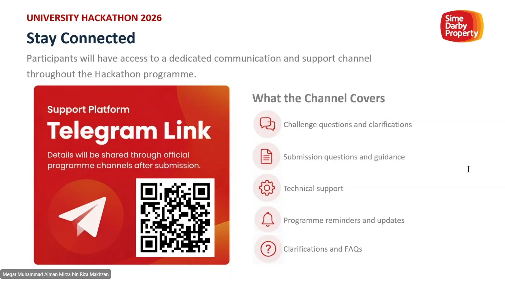

**Stay Connected**

Participants will have access to a dedicated communication and support channel throughout the Hackathon programme.

Support Platform

**Telegram Link**

Details will be shared through official programme channels after submission.

QR code: https://t.me/+cJZO7xI1KJM4NmVl

**What the Channel Covers**

- Challenge questions and clarifications
- Submission questions and guidance
- Technical support
- Programme reminders and updates
- Clarifications and FAQs

## Slide 36: Your next move

**YOUR NEXT MOVE**

1. **BUILD YOUR TEAM** 3–5 students. Diverse skills make stronger solutions.
2. **CHOOSE** PEOPLE or PLANET — pick the challenge area that drives you.
3. **FIND** A real township problem worth solving. Observe. Research. Validate.
4. **CREATE** An innovative, evidence-based solution that is feasible and scalable.
5. **BUILD** Your prototype or demo. Show that it works.
6. **SUBMIT** By 23 October 2026. All four components. On time.

**Real township challenges.**

Pick the one that speaks to you.

**PEOPLE**

Rethink how communities live, move and connect.

**PLANET**

Explore smarter ways to use resources and live alongside nature.

| Milestone           | Date            |
| ------------------- | --------------- |
| REGISTRATION CLOSES | 21 OCTOBER 2026 |
| PROPOSAL SUBMISSION | 23 OCTOBER 2026 |

## Slide 37: Questions

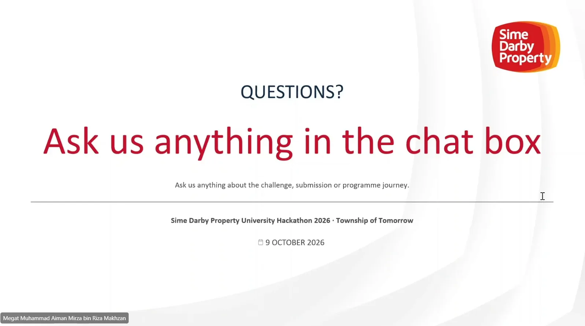

**QUESTIONS?**

Ask us anything in the chat box

Ask us anything about the challenge, submission or programme journey.

**Sime Darby Property University Hackathon 2026 · Township of Tomorrow**

9 OCTOBER 2026
